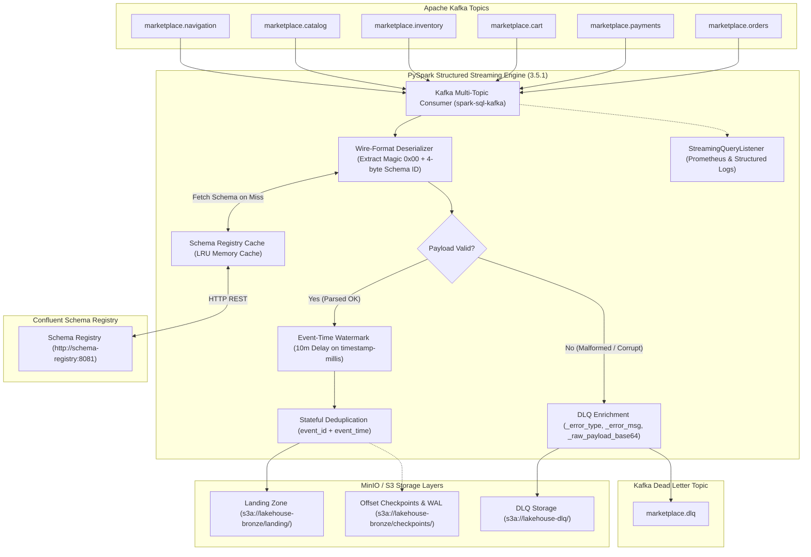

# ADR-0007: Streaming Ingestion Pipeline Architecture

## Status

Accepted

## Context and Problem Statement

The Marketplace Sandbox requires a continuous, scalable, and resilient real-time ingestion layer to consume events emitted by multiple microservices across e-commerce domains. Six core event streams are actively published to Apache Kafka:
* `marketplace.orders` (Order lifecycle events)
* `marketplace.payments` (Payment authorizations and settlement events)
* `marketplace.cart` (Shopping cart mutations)
* `marketplace.inventory` (Stock reservation and inventory updates)
* `marketplace.catalog` (Product and category modifications)
* `marketplace.navigation` (High-volume user telemetry and clickstream)

These events are serialized using the Confluent Avro wire format, where payloads are prefixed with a 5-byte header (a `0x00` magic byte followed by a 4-byte big-endian Schema Registry schema ID). Furthermore, our upstream testbed includes a configurable Chaos Engine that actively injects anomalies into the event stream, including malformed binary frames, schema mismatch mutations, delayed timestamps, and duplicate event IDs.

The ingestion engine must:
1. Ingest all 6 Kafka topics simultaneously with low operational overhead.
2. Dynamically resolve Avro schemas from Confluent Schema Registry without pipeline halts or schema compilation bottlenecks.
3. Resiliently isolate malformed, unregistered, or corrupted records into a Dead Letter Queue (DLQ) without breaking stream consumption.
4. Correctly process out-of-order data using event-time watermarking and eliminate duplicates across sliding horizons.
5. Guarantee at-least-once ingestion semantics with write-ahead logs and offset checkpointing to object storage.
6. Run locally within Docker Compose (`apache/spark:3.5.1`) while maintaining complete API and configuration parity for cloud migration to managed Databricks clusters on AWS in Step 13.

## Decision Drivers

* **Fault Tolerance & End-to-End Semantics**: Zero event loss across broker failovers, process restarts, or network partitions via robust checkpointing and offset management.
* **Resilience to Poison Pills (Chaos Isolation)**: Corrupt records, illegal magic bytes, or schema mismatches injected by the Chaos Engine must never terminate the stream.
* **Dynamic Confluent Wire-Format Decoding**: High-throughput binary deserialization that interacts efficiently with Confluent Schema Registry via in-memory caching.
* **Event-Time Processing & Deduplication**: Native handling of late-arriving events via watermarking and stateful deduplication over event IDs.
* **Cloud Migration Parity**: Code and execution models developed locally in Docker must transition seamlessly to managed Databricks on AWS (Step 13) without refactoring business logic.
* **Architectural Simplicity**: Unified multi-topic consumption topology rather than managing disconnected consumer processes.

## Considered Options

### Option 1: Native Python Multi-Process Consumers (`confluent-kafka-python`)
Build standalone Python worker services using `confluent-kafka` or `faust-streaming` to consume each topic independently and persist records to MinIO.
* **Pros**:
  * Lightweight local footprint; low memory overhead compared to the JVM.
  * Native integration with Confluent Python libraries (`confluent-kafka[avro]`).
* **Cons**:
  * Manual checkpointing, offset commit orchestration, and partition rebalance state handling.
  * Poor native support for stateful distributed deduplication and event-time watermarking across large windows.
  * Significant rework required in Step 13, as Databricks is built on Apache Spark and Delta Lake, not standalone Python consumer loops.

### Option 2: Apache Flink Streaming Applications
Deploy an Apache Flink cluster locally and write streaming jobs in PyFlink or Java to ingest Kafka topics.
* **Pros**:
  * Native event-driven streaming model with sub-second latencies and sophisticated state backend (RocksDB).
  * Robust exactly-once processing semantics through Chandy-Lamport distributed snapshotting.
* **Cons**:
  * Substantial operational complexity in local Docker Compose (JobManager, TaskManager, ZooKeeper/etcd coordination).
  * Ecosystem friction with the targeted cloud analytics stack (Databricks, dbt Core, Amazon Redshift), leading to high architecture divergence in Step 13.

### Option 3: PySpark Structured Streaming with Micro-Batch Ingestion (Adopted)
Deploy Apache Spark 3.5.1 Structured Streaming utilizing `spark-sql-kafka-0-10_2.12:3.5.1` and `spark-avro_2.12:3.5.1`, unified multi-topic consumption, Confluent wire-format parsing via custom cached deserializer, bifurcated DLQ routing, event-time watermarking, and S3A checkpointing to MinIO.
* **Pros**:
  * Native micro-batch fault tolerance via Write-Ahead Logs (WAL) and structured offset checkpointing to S3A/MinIO.
  * Direct stateful operations: `.withWatermark()` and `.dropDuplicates()` natively supported out of the box.
  * Standardized enterprise path to Databricks (Step 13): the exact same PySpark DataFrame and Structured Streaming APIs execute transparently on Databricks clusters.
  * High-throughput batching optimizes columnar raw landing writes into object storage.
  * First-class observability via `StreamingQueryListener` capturing input rates, processing rates, and trigger durations.
* **Cons**:
  * Higher local memory footprint due to JVM / Spark Master and Worker instances in Docker.
  * Confluent wire format requires unpacking the 5-byte header before passing payloads to standard Avro decoding engines.

## Decision & Rationale

We chose **Option 3: PySpark Structured Streaming with Micro-Batch Ingestion**.

### 1. PySpark Structured Streaming Architecture
We establish a unified streaming ingestion orchestrator (`processing/streaming/pipeline.py`) running on `apache/spark:3.5.1`. The stream subscribes to a multi-topic comma-separated list (`marketplace.orders,marketplace.payments,marketplace.cart,marketplace.inventory,marketplace.catalog,marketplace.navigation`) via the official `spark-sql-kafka-0-10_2.12:3.5.1` connector.

Running initially in containerized local infrastructure ([infrastructure/docker-compose.yml](file:///home/rafael-siqueira/estudos/projetos/Marketplace-Sandbox/infrastructure/docker-compose.yml)) alongside MinIO, the architecture adheres to pure environment-variable parameterization (`processing/streaming/config.py`). This guarantees an identical runtime contract when transitioning to managed Databricks clusters on AWS in Step 13.

### 2. Confluent Avro Wire-Format Deserialization & Schema Registry Integration
Standard Spark `from_avro` expects clean binary Avro payloads without headers. However, producers serialize data adhering to the Confluent Schema Registry wire specification:
* **Byte 0**: Magic byte `0x00`.
* **Bytes 1-4**: 32-bit big-endian integer representing the Schema ID registered in Schema Registry.
* **Bytes 5-N**: Actual Avro binary-encoded payload.

To handle this cleanly:
1. `processing/streaming/deserializer.py` unpacks binary frames, reading the schema ID from bytes 1-4.
2. An in-memory LRU cache stores parsed schema strings retrieved from `http://schema-registry:8081` (`localhost:8081` in local runs). Network calls occur only on the first occurrence of a schema version.
3. The remaining payload (bytes 5+) is decoded into a typed Spark SQL structure matching the subject schema.
4. Deserialization wraps decoding routines in a defensive boundary: if a record contains an invalid magic byte, non-existent schema ID, or corrupted binary payload (injected by the Chaos Engine), the deserializer outputs `null` for value fields and tags error metadata rather than throwing a fatal JVM exception.

### 3. Dead Letter Queue (DLQ) Bifurcation Pattern
To prevent stream interruption from corrupted records, `processing/streaming/dlq.py` applies a split routing pattern:
* **Valid Event Stream**: Records that deserialize successfully proceed to deduplication, watermarking, and raw landing persistence.
* **Poison / Invalid Event Stream**: Malformed payloads are separated and enriched with structured diagnostic headers:
  * `_error_type`: High-level error classification (e.g., `CORRUPT_FRAME`, `SCHEMA_NOT_FOUND`, `DESERIALIZATION_FAILURE`).
  * `_error_message`: Stack trace or parser rejection reason.
  * `_raw_payload_base64`: Original binary payload encoded in Base64 for byte-level post-mortem analysis.
  * `_kafka_topic`, `_kafka_partition`, `_kafka_offset`: Source message coordinates in Kafka.
  * `_failed_at`: Ingestion failure timestamp (ISO-8601).
* **DLQ Destinations**: Bad records are published to the dedicated Kafka topic `marketplace.dlq` (for real-time alerting and re-drive capabilities) and archived to `s3a://lakehouse-dlq/` in MinIO for forensic auditing.

### 4. Event-Time Watermarking & Stateful Deduplication
To handle out-of-order deliveries and duplicate events produced by network retries or the Chaos Engine:
* **Event Time Attribute**: The pipeline extracts the Avro logical type `timestamp-millis` (stored in the event payload `timestamp` field) and casts it to a Spark `TimestampType`.
* **Watermark Threshold**: Configured with `.withWatermark("event_time", "10 minutes")` (parameterizable via `SparkStreamingConfig`). Events arriving later than 10 minutes past the maximum observed event time are discarded from stateful operations.
* **Deduplication Boundary**: Stateful deduplication is applied using `.dropDuplicates(["event_id", "event_time"])`. Spark maintains an in-memory and checkpoint-backed state store tracking processed `event_id` keys within the 10-minute window, effectively purging expired state to avoid memory leaks.

### 5. Checkpointing & Fault Tolerance
* **Write-Ahead Log (WAL) & Offsets**: Streaming progress is persisted to `s3a://lakehouse-bronze/checkpoints/` using Spark's checkpoint directory mechanism. Checkpoints record micro-batch offsets, state store snapshots, and commit metadata.
* **Landing Zone**: Raw valid events are persisted to MinIO in `s3a://lakehouse-bronze/landing/`, partitioned by date and topic.
* **Process Supervisor & Exponential Backoff**: The entrypoint script (`processing/streaming/recovery.py`) wraps query execution in a supervisor loop with exponential backoff retry. Transient network blips or temporary Schema Registry timeouts trigger graceful retries.
* **Signal Trapping**: Interception of `SIGINT` and `SIGTERM` signals triggers `query.stop()` cleanly, ensuring all pending batch commits and state checkpoints are flushed prior to process exit.
* **Observability**: A custom `StreamingMetricsListener` (`processing/streaming/metrics.py`) implements Spark's `StreamingQueryListener` interface, emitting JSON progress events and Prometheus metrics for `inputRowsPerSecond`, `processedRowsPerSecond`, `batchDurationMs`, and `watermarkTimestamp`.

## Consequences

### Positive
* **Resilient Streaming Engine**: Ingestion runs continuously without crashes, even under heavy anomaly injection from the Chaos Engine.
* **Deterministic Fault Recovery**: In the event of container failure or node termination, restarting the pipeline resumes exactly from the last committed offset in `s3a://lakehouse-bronze/checkpoints/`.
* **Complete Observability & Auditability**: Deep visibility into throughput, latency, lag, and malformed payload diagnostics stored in the DLQ.
* **Databricks Portability**: The codebase relies strictly on standard PySpark 3.5.1 Structured Streaming APIs, guaranteeing a clean transition to managed Databricks on AWS in Step 13.

### Negative
* **Resource Footprint**: Running the Spark JVM in local Docker requires higher base RAM (recommended 3GB to 4GB allocated to Spark) compared to lightweight Python processes.
* **State Store Memory Consumption**: Stateful deduplication over a 10-minute watermark requires RAM to maintain state keys. Tuning watermark duration is necessary under high event volumes.
* **Confluent Wire Format Custom Handling**: Because Spark does not provide an out-of-the-box Confluent 5-byte header stripper in `spark-avro`, custom deserialization logic must be maintained in `processing/streaming/deserializer.py`.

### Risks & Mitigations

* **Risk**: Confluent Schema Registry becomes temporarily unreachable, stalling stream processing.
  * *Mitigation*: In-memory LRU schema caching minimizes external HTTP requests. Deserializer implements exponential retry with backoff on registry calls before routing failing records to the DLQ.
* **Risk**: High-volume burst of duplicates causes state store memory bloat.
  * *Mitigation*: Both `event_id` and `event_time` are included in the `.dropDuplicates()` constraint, allowing Spark to aggressively evict state entries older than the 10-minute watermark threshold.
* **Risk**: Out-of-memory (OOM) errors in local Docker when consuming high clickstream volume from `marketplace.navigation`.
  * *Mitigation*: Configure `maxOffsetsPerTrigger` in `SparkStreamingConfig` to rate-limit micro-batch ingestion size, providing predictable memory bounds.

## References

* [Roadmap: Step 4 — Streaming Ingestion Pipeline](file:///home/rafael-siqueira/estudos/projetos/Marketplace-Sandbox/docs/context/roadmap.md#L61-L76)
* [Current Step: Step 4 Active Plan](file:///home/rafael-siqueira/estudos/projetos/Marketplace-Sandbox/docs/context/current-step.md)
* [ADR-0003: Containerized Local Infrastructure and Cloud Simulation](file:///home/rafael-siqueira/estudos/projetos/Marketplace-Sandbox/docs/adr/0003-containerized-local-infrastructure.md)
* [ADR-0005: Code Quality, Linting, and CI/CD Pipeline](file:///home/rafael-siqueira/estudos/projetos/Marketplace-Sandbox/docs/adr/0005-code-quality-linting-and-cicd-pipeline.md)
* [Confluent Schema Registry Wire Format Specification](https://docs.confluent.io/platform/current/schema-registry/fundamentals/serdes-develop/index.html#wire-format)
* [Apache Spark Structured Streaming Programming Guide](https://spark.apache.org/docs/3.5.1/structured-streaming-programming-guide.html)
