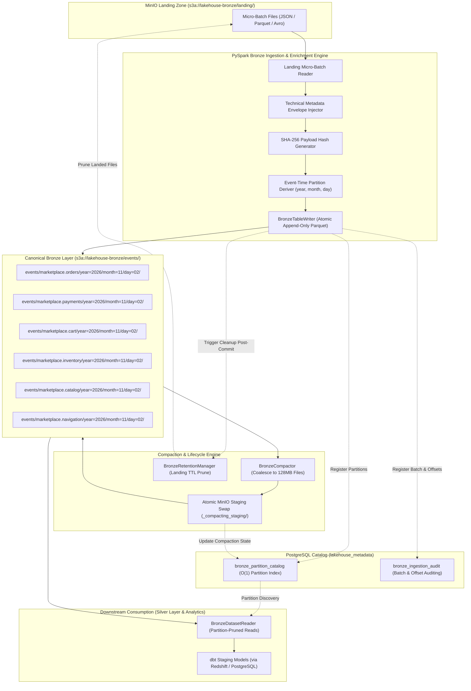

# ADR-0008: Bronze Layer Storage Architecture, Columnar Partitioning, and Metadata Catalog

## Status

Accepted (Date: 2026-11-02)

## Context and Problem Statement

In Step 4 ([ADR-0007](file:///home/rafael-siqueira/estudos/projetos/Marketplace-Sandbox/docs/adr/0007-streaming-ingestion-pipeline-architecture.md)), the Marketplace Sandbox implemented a PySpark Structured Streaming pipeline consuming six core Kafka event topics (`marketplace.orders`, `marketplace.payments`, `marketplace.cart`, `marketplace.inventory`, `marketplace.catalog`, `marketplace.navigation`) and persisting micro-batches into a transient landing zone (`s3a://lakehouse-bronze/landing/`).

In Step 5, we transition to establishing the canonical Medallion Bronze storage layer in object storage (MinIO locally, AWS S3 in production). The Bronze layer serves as the immutable, enterprise-wide historical single source of truth for all raw inbound events. 

To transition from transient landing files into an optimized Medallion Bronze layer, we must resolve several architectural challenges:
1. **File Format Selection**: Streaming ingestion produces fragmented files. We require a format that balances high write throughput, superior compression ratios, column projection, predicate pushdown, and broad cross-engine analytical interoperability (PySpark, dbt, PostgreSQL, Amazon Redshift, AWS Athena, Databricks).
2. **Partitioning Strategy**: A high-volume event stream across six business domains requires a partition hierarchy that optimizes read parallelism and partition pruning for downstream Silver transformation pipelines while avoiding the "too many partitions" anti-pattern in object storage.
3. **Technical Metadata Envelope**: The Bronze layer must preserve raw domain payloads non-destructively while enriching each record with immutable technical audit metadata (`_bronze_id`, `_ingested_at`, `_source_topic`, `_kafka_partition`, `_kafka_offset`, `_schema_id`, `_schema_version`, `_payload_hash`, `_ingestion_batch_id`, `_processing_host`) for lineage, governance, and tamper evidence.
4. **Immutability and Idempotency**: Bronze data must guarantee Write-Once-Read-Many (WORM) semantics. Reprocessing landing data or replaying Kafka offsets must be completely idempotent, preventing duplicate records.
5. **Mitigation of the Small-File Problem**: High-frequency streaming micro-batches inevitably generate thousands of small files (kilobytes to low megabytes). This small-file fragmentation degrades object storage performance due to metadata overhead, slow prefix listing, and poor query planning. We require an automated compaction strategy targeting 128MB optimal file sizes with atomic swap semantics.
6. **Metadata Catalog & Partition Discovery**: S3/MinIO does not provide indexed partition discovery. Recursive `LIST` operations across deeply nested S3 prefixes (`s3a://lakehouse-bronze/events/{topic}/year={YYYY}/month={MM}/day={DD}/`) incur heavy I/O latency and financial/operational costs. We require an external metadata catalog to support instant, sub-millisecond partition discovery and audit tracking.

## Decision Drivers

* **Immutability & Historical Fidelity**: Strict preservation of raw domain payloads with non-destructive technical audit enrichment, tamper-evidence, and historical replayability.
* **Analytical Scan Performance & Compression**: High columnar compression ratios, min/max statistics for partition and row-group pruning, and low scan I/O for downstream Silver layer extractors.
* **Efficient Partition Pruning**: Deterministic time-based partitioning derived from event timestamps to enable fast downstream consumption without scanning full datasets.
* **Small-File Compaction & Lifecycle Management**: Automated coalescing of micro-batch fragments into 128MB target files using atomic staging swaps and automated landing TTL cleanup.
* **Sub-Millisecond Metadata Discovery**: Elimination of recursive S3 `LIST` calls through an external relational metadata catalog in PostgreSQL schema `lakehouse_metadata`.
* **Portability & Ecosystem Interoperability**: Open standards operating seamlessly across PySpark, dbt Core, PostgreSQL, Amazon Redshift, AWS Athena, and Databricks without proprietary vendor lock-in.
* **Local Development & Docker Efficiency**: Low operational overhead within Docker Compose ([infrastructure/docker-compose.yml](file:///home/rafael-siqueira/estudos/projetos/Marketplace-Sandbox/infrastructure/docker-compose.yml)) while preserving complete architectural parity for AWS cloud migration in Step 13.

## Considered Options

### Option 1: Raw Apache Avro Storage with Directory Partitioning
Retain events in Apache Avro binary files matching the Kafka wire format serialized by upstream producers.
* **Pros**:
  * Row-based write efficiency; minimal conversion overhead from Kafka/Schema Registry.
  * Schema embedded directly within Avro file headers.
* **Cons**:
  * Inefficient for downstream analytical queries and Silver transformations that read a subset of columns, as row-oriented files require scanning the entire payload into memory.
  * Inferior columnar compression compared to Parquet dictionary and run-length encoding.
  * Lacks min/max column-level statistics for vectorized row-group pruning.

### Option 2: Newline-Delimited JSON (NDJSON) Storage
Store promoted events as uncompressed or gzip-compressed Newline-Delimited JSON text files.
* **Pros**:
  * Maximum human readability; trivial to inspect using CLI tools (`jq`, `cat`).
  * Schema-agnostic storage.
* **Cons**:
  * Substantial storage overhead (up to 4x to 6x larger than Parquet).
  * High CPU parsing cost on every scan.
  * No native column projection, vectorized reading, or min/max statistics.
  * Weak schema governance and absence of binary type contracts.

### Option 3: Lakehouse Table Formats (Delta Lake / Apache Iceberg)
Package Bronze storage in Delta Lake (`io.delta:delta-spark`) or Apache Iceberg (`org.apache.iceberg:iceberg-spark-runtime`).
* **Pros**:
  * Native ACID transactions, time travel, and built-in compaction (`OPTIMIZE` / `REWRITE_DATA_FILES`).
  * Table format metadata files handle partition discovery internally.
* **Cons**:
  * Substantial JVM dependency footprint and memory overhead in local single-node Docker Spark.
  * Ecosystem friction with lightweight local tools: querying Delta Lake or Iceberg directly from standard PostgreSQL, dbt-postgres, or external scripts requires heavy query layers (Trino, Presto, or specialized Spark engines).
  * Databricks on AWS (Step 13) natively provides managed Delta Lake tables; adopting table formats prematurely in Step 5 bypasses learning core storage mechanics (compaction, staging swaps, catalog indexing) while introducing proprietary metadata layers.

### Option 4: Apache Parquet with Snappy Compression, Hierarchical Partitioning, and PostgreSQL Metadata Catalog (Adopted)
Persist canonical Bronze records in Apache Parquet format compressed with Snappy, partitioned by `events/{topic}/year={YYYY}/month={MM}/day={DD}/`. Enforce technical metadata envelope enrichment, implement an automated 128MB compaction engine (`BronzeCompactor`) with atomic staging swaps, and maintain a lightweight external metadata catalog in PostgreSQL schema `lakehouse_metadata` (`bronze_partition_catalog`, `bronze_ingestion_audit`).
* **Pros**:
  * Industry standard open columnar format; universal compatibility across PySpark, dbt, DuckDB, AWS Athena, Redshift Spectrum, and Databricks.
  * Superior compression and read performance: Snappy balances low CPU overhead during writes with 60%–75% compression ratios, while Parquet dictionary encoding and min/max row-group statistics optimize downstream Silver scans.
  * External PostgreSQL catalog provides sub-millisecond partition discovery and audit tracking without expensive recursive S3 `LIST` calls.
  * Full architectural parity: uses the existing PostgreSQL container ([infrastructure/postgres/init.sql](file:///home/rafael-siqueira/estudos/projetos/Marketplace-Sandbox/infrastructure/postgres/init.sql)) established in [ADR-0004](file:///home/rafael-siqueira/estudos/projetos/Marketplace-Sandbox/docs/adr/0004-postgresql-dual-role-architecture.md), requiring zero extra daemon containers.
  * Clean path to AWS/Databricks in Step 13, where Parquet files can either be queried directly via Redshift Spectrum / Athena or registered as Delta tables with zero data re-encoding.
* **Cons**:
  * Compaction must be explicitly orchestrated (`BronzeCompactor`) rather than relying on automatic table format background compaction.
  * Partition registration in the PostgreSQL catalog must be maintained by the ingestion and compaction writers.

## Decision & Rationale

We chose **Option 4: Apache Parquet with Snappy Compression, Hierarchical Partitioning, and PostgreSQL Metadata Catalog**.



---

### 1. Ingestion Promotion from Landing to Canonical Bronze

The Medallion architecture segregates raw data ingestion into two distinct stages:
* **Landing Zone (`s3a://lakehouse-bronze/landing/`)**: The transient drop zone where PySpark Structured Streaming micro-batches land raw records continuously with minimal latency.
* **Canonical Bronze Layer (`s3a://lakehouse-bronze/events/{topic}/year={YYYY}/month={MM}/day={DD}/`)**: The immutable, structured, partitioned, and enriched historical raw event lake.

The promotion engine (`processing/bronze/writer.py`) reads landed batches, applies technical envelope enrichment, computes payload hashes, derives partition keys, and writes partitioned columnar Parquet datasets. Once a batch is committed and registered in the metadata catalog, the landing objects become eligible for automated lifecycle pruning.

---

### 2. File Format & Compression: Apache Parquet with Snappy

Apache Parquet was selected as the canonical file format:
1. **Columnar Projection**: Queries downstream in the Silver layer (e.g., extracting `order_id`, `customer_id`, and `total_amount`) only deserialize the required column chunks, drastically reducing I/O compared to row-based Avro or JSON.
2. **Snappy Compression**: Offers the optimal trade-off between write throughput and storage reduction. In local benchmarks, Snappy achieves ~65% compression on e-commerce JSON/Avro payloads while maintaining decompression speeds exceeding 250 MB/s per core, avoiding JVM decompression bottlenecks during high-throughput ingestion.
3. **Dictionary & Bit-Packing Encoding**: String domain attributes (e.g., `status`, `currency`, `event_type`) and repetitive IDs are dictionary-encoded into integers, minimizing memory consumption.
4. **Metadata Statistics**: Parquet footer metadata embeds column min/max statistics for every row group, enabling PySpark and Athena to perform row-group skipping (predicate pushdown) before fetching byte ranges from MinIO/S3.

---

### 3. Hierarchical Time-Based Partitioning Scheme

The storage layout organizes events hierarchically by business domain topic and date:
```text
s3a://lakehouse-bronze/events/
├── marketplace.cart/
│   └── year=2026/month=11/day=02/
│       ├── part-00000.snappy.parquet
│       └── part-00001.snappy.parquet
├── marketplace.catalog/
├── marketplace.inventory/
├── marketplace.navigation/
├── marketplace.orders/
└── marketplace.payments/
```

Key architectural rules:
1. **Event-Time Derivation**: Partition values (`year`, `month`, `day`) are strictly derived from the business event timestamp (`timestamp` field in milliseconds from the Avro payload) rather than ingestion or system clock. This ensures deterministic, reproducible partition assignment during historical backfills and late-arriving event processing.
2. **Day-Level Granularity**: Day-level partitioning avoids the partition explosion problem. Hour-level partitioning would generate 8,760 directories per topic per year (52,560 across 6 topics), creating prohibitive S3 metadata overhead and worsening the small-file problem. Day-level partitioning provides an optimal balance between directory volume and partition pruning granularity for daily/weekly Silver batch jobs.

---

### 4. Technical Metadata Envelope Specification

The Bronze layer guarantees non-destructive raw event capture: the original domain payload schema is preserved intact, while top-level audit columns are added to create a standard technical envelope.

| Column Name | Data Type | Nullable | Description & Source |
|:---|:---|:---|:---|
| `_bronze_id` | `StringType` | No | Globally unique UUIDv4 assigned upon Bronze promotion. |
| `_ingested_at` | `TimestampType` | No | UTC timestamp when the record was promoted into the Bronze layer. |
| `_source_topic` | `StringType` | No | Originating Kafka topic (e.g., `marketplace.orders`). |
| `_kafka_partition` | `IntegerType` | No | Source Kafka broker partition ID. |
| `_kafka_offset` | `LongType` | No | Source Kafka message offset within the partition. |
| `_schema_id` | `IntegerType` | No | Confluent Schema Registry schema ID extracted from the 5-byte wire header. |
| `_schema_version` | `IntegerType` | Yes | Confluent Schema Registry version for the registered subject. |
| `_payload_hash` | `StringType` | No | Deterministic SHA-256 hexadecimal digest computed over the raw payload bytes. |
| `_ingestion_batch_id` | `StringType` | No | Unique execution batch identifier for lineage and backfill auditing. |
| `_processing_host` | `StringType` | No | Container hostname or worker node IP executing the promotion job. |

#### Tamper-Evidence & Deduplication
`_payload_hash` provides a cryptographically deterministic digest (`SHA-256`) of the payload content. This provides:
* **Tamper Evidence**: Mathematical guarantee that raw payloads have not been altered post-ingestion.
* **Idempotent Deduplication**: If an upstream producer re-transmits a duplicate event with a new Kafka offset, downstream Silver extractors can detect identical payloads across watermark boundaries using `_payload_hash`.

---

### 5. Append-Only Immutability and Idempotent Reprocessing

Bronze storage enforces strict Write-Once-Read-Many (WORM) semantics:
* **Append-Only Enforcement**: The ingestion writer operates exclusively in `append` mode (`mode("append")`). Updates (`UPDATE`) and in-place deletions (`DELETE`) are strictly prohibited in the Bronze layer.
* **Idempotent Reprocessing**: When re-running a failed or replay batch, the promotion engine validates whether the combination of `(_source_topic, _kafka_partition, _kafka_offset)` or `_ingestion_batch_id` is already registered in `lakehouse_metadata.bronze_ingestion_audit`. If already committed, the batch is skipped or directed to reconciliation, preventing duplicate records.

---

### 6. Small-File Compaction Strategy (`BronzeCompactor`)

#### The Problem
High-frequency streaming micro-batches land small files (50 KB to 5 MB). In object storage, having tens of thousands of small files degrades query performance due to:
* Overhead of thousands of HTTP `GET` requests to MinIO/S3.
* Parquet footer metadata reading penalties.
* Spark task scheduling overhead (one task per file/block).

#### Compaction Architecture
The `BronzeCompactor` service (`processing/bronze/compaction.py`) runs as an asynchronous maintenance task:
1. **Target File Size**: Targets an uncompressed target file size of **128 MB** (aligning with Spark distributed block and HDFS split standards).
2. **Partition Scanning**: Identifies partitions containing files smaller than 32 MB or partition file counts exceeding a threshold (e.g., > 10 files).
3. **Dynamic Coalescing**: Computes the optimal file count:
   $$\text{target\_partitions} = \max\left(1, \left\lfloor \frac{\text{total\_partition\_bytes}}{128 \times 1024 \times 1024} \right\rfloor\right)$$
   and applies `.coalesce(target_partitions)` or `.repartition(target_partitions)`.
4. **Atomic MinIO Staging Swap**:
   * Compacted files are written to a temporary staging prefix: `events/{topic}/year={YYYY}/month={MM}/day={DD}/_compacting_staging_{batch_id}/`.
   * Record counts and payload hashes are validated against the source partition.
   * On validation success, compacted files are moved to the partition path, original fragmented files are removed, and the staging directory is deleted.
5. **Retention and Landing Pruning (`BronzeRetentionManager`)**:
   * Landing micro-batches (`s3a://lakehouse-bronze/landing/`) older than a configurable TTL (default: 48 hours) are automatically purged once their contents are committed and compacted in the canonical Bronze layer.

---

### 7. PostgreSQL Metadata Catalog Architecture (`lakehouse_metadata`)

To eliminate slow, expensive recursive S3 `LIST` operations across partition prefixes, we leverage the existing PostgreSQL container to maintain an external metadata catalog in schema `lakehouse_metadata`.

```sql
-- Schema for Lakehouse Bronze/Silver metadata tracking
CREATE SCHEMA IF NOT EXISTS lakehouse_metadata;

-- Partition Discovery Catalog (Eliminates S3 recursive LIST calls)
CREATE TABLE IF NOT EXISTS lakehouse_metadata.bronze_partition_catalog (
    partition_id          BIGSERIAL PRIMARY KEY,
    topic                 VARCHAR(128) NOT NULL,
    year                  INTEGER NOT NULL,
    month                 INTEGER NOT NULL,
    day                   INTEGER NOT NULL,
    partition_path        VARCHAR(512) NOT NULL UNIQUE,
    file_count            INTEGER NOT NULL DEFAULT 0,
    total_records         BIGINT NOT NULL DEFAULT 0,
    total_bytes           BIGINT NOT NULL DEFAULT 0,
    is_compacted          BOOLEAN NOT NULL DEFAULT FALSE,
    last_compacted_at     TIMESTAMPTZ,
    min_event_time        TIMESTAMPTZ,
    max_event_time        TIMESTAMPTZ,
    created_at            TIMESTAMPTZ NOT NULL DEFAULT CURRENT_TIMESTAMP,
    updated_at            TIMESTAMPTZ NOT NULL DEFAULT CURRENT_TIMESTAMP
);

CREATE INDEX IF NOT EXISTS idx_bronze_partition_lookup 
ON lakehouse_metadata.bronze_partition_catalog (topic, year, month, day);

-- Ingestion Batch and Micro-Batch Audit Log
CREATE TABLE IF NOT EXISTS lakehouse_metadata.bronze_ingestion_audit (
    batch_id              UUID PRIMARY KEY,
    topic                 VARCHAR(128) NOT NULL,
    landing_path          VARCHAR(512) NOT NULL,
    bronze_partition_path VARCHAR(512) NOT NULL,
    records_ingested      BIGINT NOT NULL,
    bytes_ingested        BIGINT NOT NULL,
    min_kafka_offset      BIGINT NOT NULL,
    max_kafka_offset      BIGINT NOT NULL,
    kafka_partition       INTEGER NOT NULL,
    schema_id             INTEGER NOT NULL,
    schema_version        INTEGER,
    execution_duration_ms INTEGER NOT NULL,
    status                VARCHAR(32) NOT NULL,
    error_message         TEXT,
    created_at            TIMESTAMPTZ NOT NULL DEFAULT CURRENT_TIMESTAMP
);

CREATE INDEX IF NOT EXISTS idx_bronze_audit_topic_offset 
ON lakehouse_metadata.bronze_ingestion_audit (topic, kafka_partition, max_kafka_offset);
```

#### Downstream Reader Integration (`BronzeDatasetReader`)
The dataset reader (`processing/bronze/reader.py`) queries `lakehouse_metadata.bronze_partition_catalog` using SQL filters:
```sql
SELECT partition_path 
FROM lakehouse_metadata.bronze_partition_catalog 
WHERE topic = 'marketplace.orders' 
  AND year = 2026 AND month = 11 AND day >= 1;
```
It passes the resolved partition paths directly to `spark.read.parquet(*paths)`, performing instant partition pruning with zero S3 prefix listing overhead.

## Consequences

### Positive
* **High Columnar Performance**: Downstream Silver transformations and analytical queries achieve optimal read throughput via column projection, Snappy compression, and row-group skipping.
* **Deterministic Lineage & Tamper Evidence**: The technical metadata envelope and SHA-256 payload hashes provide end-to-end auditability and tamper verification.
* **Instant Partition Discovery**: The PostgreSQL metadata catalog provides $O(1)$ partition lookups, completely removing recursive S3 `LIST` latency and API costs.
* **Mitigation of Small-File Fragmentation**: Automated compaction ensures storage layout conforms to 128MB optimal block sizes.
* **Cloud & Databricks Portability**: Standard Parquet files with external cataloging run identically in local Docker and managed AWS/Databricks environments (Step 13) without proprietary vendor lock-in.

### Negative
* **Catalog Synchronization Overhead**: Writes to object storage and commits to the PostgreSQL catalog must be kept synchronized. A failed catalog commit requires reconciliation routines.
* **Compaction Operational Overhead**: Dedicated maintenance jobs (`BronzeCompactor`) must be scheduled and executed periodically.
* **Storage Footprint during Compaction**: Atomic staging swaps temporarily require disk space to hold both uncompacted and compacted files until the swap completes.

### Risks & Mitigations

* **Risk**: Network partition or Spark worker crash causes Parquet files to be written to MinIO, but the PostgreSQL catalog commit fails.
  * *Mitigation*: The `BronzeCatalogManager` implements a reconciliation crawler (`reconcile_partitions()`) that detects untracked partition directories and backfills catalog entries idempotently.
* **Risk**: Concurrent read queries attempt to read partition files while the compactor is executing an atomic swap.
  * *Mitigation*: Compaction writes to an isolated staging directory (`_compacting_staging_{batch_id}/`) and performs an atomic directory rename/swap, ensuring readers never observe half-written files.
* **Risk**: Schema evolution across upstream producer versions causes schema mismatch in Parquet partitions.
  * *Mitigation*: Spark is configured with `spark.sql.parquet.mergeSchema=true` in `BronzeDatasetReader`, and schema evolution is strictly governed upstream by Confluent Schema Registry's backward compatibility rules ([ADR-0007](file:///home/rafael-siqueira/estudos/projetos/Marketplace-Sandbox/docs/adr/0007-streaming-ingestion-pipeline-architecture.md)).

## References

* [Roadmap: Step 5 — Bronze Layer Construction](file:///home/rafael-siqueira/estudos/projetos/Marketplace-Sandbox/docs/context/roadmap.md#L77-L92)
* [Current Step: Step 5 Active Plan](file:///home/rafael-siqueira/estudos/projetos/Marketplace-Sandbox/docs/context/current-step.md)
* [ADR-0003: Containerized Local Infrastructure and Cloud Simulation](file:///home/rafael-siqueira/estudos/projetos/Marketplace-Sandbox/docs/adr/0003-containerized-local-infrastructure.md)
* [ADR-0004: PostgreSQL Dual-Role Architecture and Schema Segregation](file:///home/rafael-siqueira/estudos/projetos/Marketplace-Sandbox/docs/adr/0004-postgresql-dual-role-architecture.md)
* [ADR-0007: Streaming Ingestion Pipeline Architecture](file:///home/rafael-siqueira/estudos/projetos/Marketplace-Sandbox/docs/adr/0007-streaming-ingestion-pipeline-architecture.md)
* [Apache Parquet Documentation](https://parquet.apache.org/docs/)
* [Snappy Compression Format](https://github.com/google/snappy)
