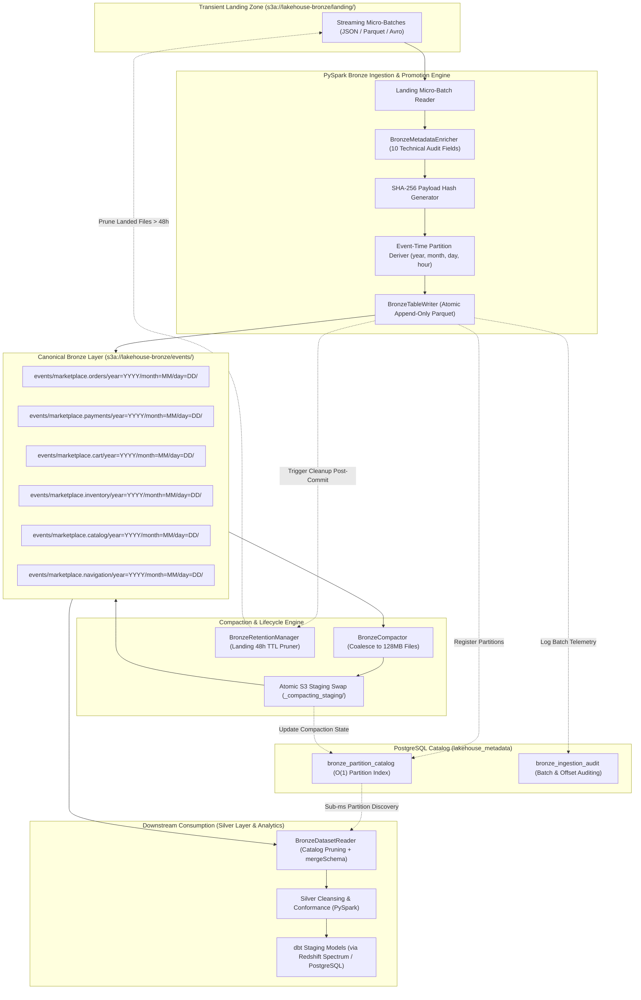
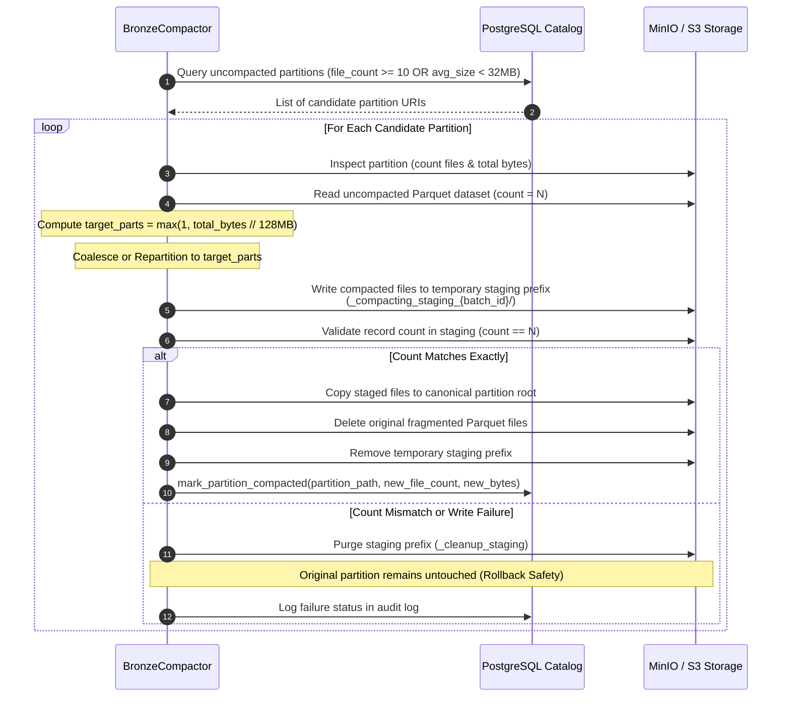

# Bronze Layer Architecture and Operations Guide

This guide provides comprehensive architectural, engineering, and operational documentation for the **Marketplace Sandbox Medallion Bronze Storage Layer** (Step 5 of the roadmap). It describes the canonical, immutable raw event lakehouse tier built on Apache Parquet columnar storage with Snappy compression, hierarchical time-based partitioning, a 10-column canonical technical metadata audit envelope, automated 128 MB small-file compaction with atomic staging swaps, a PostgreSQL relational metadata catalog (`lakehouse_metadata`), landing zone Time-to-Live (TTL) retention pruning, and catalog-pruned analytical dataset reading.

> [!NOTE]
> Architectural decisions governing this storage tier are formalized in [docs/adr/0008-bronze-layer-storage-architecture.md](file:///home/rafael-siqueira/estudos/projetos/Marketplace-Sandbox/docs/adr/0008-bronze-layer-storage-architecture.md).
> Upstream streaming ingestion mechanics are detailed in [docs/adr/0007-streaming-ingestion-pipeline-architecture.md](file:///home/rafael-siqueira/estudos/projetos/Marketplace-Sandbox/docs/adr/0007-streaming-ingestion-pipeline-architecture.md) and [docs/streaming_ingestion_guide.md](file:///home/rafael-siqueira/estudos/projetos/Marketplace-Sandbox/docs/streaming_ingestion_guide.md).
> Storage is hosted locally in MinIO via Docker Compose ([infrastructure/docker-compose.yml](file:///home/rafael-siqueira/estudos/projetos/Marketplace-Sandbox/infrastructure/docker-compose.yml)) and maintains 100% architectural parity for cloud migration to managed **AWS S3 / Databricks** in Step 13.

---

## Table of Contents

1. [Executive Summary & Medallion Bronze Principles](#1-executive-summary--medallion-bronze-principles)
2. [Columnar Storage & Compression Layout](#2-columnar-storage--compression-layout)
3. [Canonical Technical Metadata Envelope](#3-canonical-technical-metadata-envelope)
4. [Partition Hierarchy & Storage Organization](#4-partition-hierarchy--storage-organization)
5. [Small-File Problem & Compaction Architecture](#5-small-file-problem--compaction-architecture)
6. [PostgreSQL Metadata Catalog & Ingestion Audit](#6-postgresql-metadata-catalog--ingestion-audit)
7. [Landing Zone Retention & TTL Pruning Lifecycle](#7-landing-zone-retention--ttl-pruning-lifecycle)
8. [Analytical Dataset Reader](#8-analytical-dataset-reader)
9. [Operational Runbooks & CLI Execution](#9-operational-runbooks--cli-execution)
10. [Observability & Telemetry](#10-observability--telemetry)

---

## 1. Executive Summary & Medallion Bronze Principles

The Medallion Bronze storage tier constitutes the immutable, enterprise-wide historical single source of truth for all inbound event telemetry across the six core business domains:
* `marketplace.orders` (Order placements, cancellations, and state updates)
* `marketplace.payments` (Payment authorizations, captures, and refunds)
* `marketplace.cart` (Cart additions, checkouts, and abandons)
* `marketplace.inventory` (Stock reservation and inventory balance updates)
* `marketplace.catalog` (Product definitions, category updates, and price changes)
* `marketplace.navigation` (High-volume user telemetry, page impressions, and clickstream)



### Core Medallion Bronze Tenets

1. **Raw Payload Fidelity**: Event payloads are captured non-destructively. Original domain schemas generated by upstream services and validated via Confluent Schema Registry are preserved verbatim without truncation, lossy typecasting, or premature schema restructuring.
2. **Write-Once-Read-Many (WORM) Immutability**: Bronze storage operates strictly in append-only mode (`mode("append")`). Updates (`UPDATE`) and in-place deletions (`DELETE`) are prohibited. Corrections or downstream reconciliations are addressed in the Silver or Gold layers.
3. **Decoupled Staging vs. Canonical Storage**: A clear boundary separates the transient streaming landing zone (`s3a://lakehouse-bronze/landing/`), which receives streaming micro-batches with minimal latency, from the canonical partitioned Bronze layer (`s3a://lakehouse-bronze/events/`), which guarantees columnar optimization, compaction, and catalog registration.
4. **Deterministic Lineage & Tamper Evidence**: Every record promoted into canonical Bronze is enveloped with immutable technical audit metadata, including execution batch UUIDs, Kafka broker offsets, processing hostnames, and cryptographic SHA-256 payload digests.
5. **Idempotent Reprocessability**: Reprocessing landing data or replaying Kafka topic offsets produces idempotent writes verified against the PostgreSQL metadata catalog (`lakehouse_metadata.bronze_ingestion_audit`), preventing duplicate ingestion.

---

## 2. Columnar Storage & Compression Layout

### Apache Parquet Format

The canonical Bronze layer standardizes on **Apache Parquet**, an open columnar storage format governed by the Apache Software Foundation. Parquet structures files into distinct row groups, column chunks, and pages, appending comprehensive footer metadata:

```text
+--------------------------------------------------------------------+
|                           PARQUET FILE                             |
|  +--------------------------------------------------------------+  |
|  | Header: Magic Bytes ("PAR1")                                 |  |
|  +--------------------------------------------------------------+  |
|  | Row Group 1 (e.g. 128 MB target size)                        |  |
|  |   Column Chunk 1 (_bronze_id)                                |  |
|  |   Column Chunk 2 (_ingested_at)                              |  |
|  |   ...                                                        |  |
|  |   Column Chunk N (payload domain fields)                     |  |
|  +--------------------------------------------------------------+  |
|  | Row Group 2 ...                                              |  |
|  +--------------------------------------------------------------+  |
|  | File Metadata Footer                                         |  |
|  |   Schema Definition (StructType)                             |  |
|  |   Row Group Offsets & Sizes                                  |  |
|  |   Column Chunk Statistics (min/max values, null counts)      |  |
|  |   Key-Value Metadata Tags                                    |  |
|  +--------------------------------------------------------------+  |
|  | Footer Length (4 bytes) + Magic Bytes ("PAR1")               |  |
+--------------------------------------------------------------------+
```

### Format Evaluation Matrix (ADR-0008)

| Dimension | Apache Parquet (Adopted) | Apache Avro | NDJSON | Delta Lake / Iceberg |
|:---|:---|:---|:---|:---|
| **Storage Layout** | Columnar | Row-oriented | Row-oriented (plain text) | Columnar (Parquet + Log) |
| **Column Projection** | Native (scans only requested columns) | Inefficient (deserializes entire row) | Inefficient (parses whole line) | Native |
| **Compression Ratios** | High (60%–75% reduction) | Moderate (35%–45%) | Poor (0%–20%) | High |
| **Vectorized Pushdown**| Min/Max row-group skipping | None (full record scan) | None | Metadata stats + file skipping |
| **Local Tool Footprint**| Universal (Spark, DuckDB, dbt, Redshift)| Spark, Kafka tools | Universal CLI (`jq`, `cat`) | Requires heavy query engines |
| **Docker Parity** | Lightweight, zero extra daemons | Lightweight | Lightweight | High JVM memory footprint |

### Snappy Compression

Canonical Bronze datasets are compressed using **Google Snappy** (`spark.sql.parquet.compression.codec=snappy`):
* **Throughput Optimization**: Snappy targets high write and decompression bandwidth rather than maximal byte compaction. In local Docker benchmarks, Snappy sustains decompression speeds exceeding 250 MB/s per CPU core.
* **Storage Reduction**: Balances CPU utilization with a 60%–70% reduction in object storage size compared to uncompressed JSON/Avro payloads.
* **Splittability**: Parquet splits row groups across Spark executor tasks independently, regardless of compression boundaries.

### Encoding Strategies

Parquet transparently applies advanced encodings:
1. **Dictionary Encoding**: Low-cardinality string attributes (`_source_topic`, `status`, `currency`, `event_type`) are mapped to integer lookup arrays, saving substantial memory during scans.
2. **Bit-Packing & Run-Length Encoding (RLE)**: Monotonically increasing numbers (such as `_kafka_offset` and temporal partitions `year`, `month`, `day`) are bit-packed into compact bit streams.

### Predicate Pushdown & Row-Group Pruning

Parquet footers record minimum and maximum scalar values for every column within a row group. When downstream consumers (such as [processing/bronze/reader.py](file:///home/rafael-siqueira/estudos/projetos/Marketplace-Sandbox/processing/bronze/reader.py) or dbt models) query data with range filters (e.g., `_ingested_at >= '2026-11-01'`), PySpark reads the Parquet footer, compares criteria against the min/max statistics, and skips non-matching row groups entirely without issuing HTTP GET byte-range requests to MinIO/S3.

---

## 3. Canonical Technical Metadata Envelope

The Bronze layer injects a standardized technical audit envelope into every record during promotion from the landing zone. Domain payload attributes remain untouched, while top-level metadata fields are appended.

### Envelope Specification

Implemented in [processing/bronze/schema.py](file:///home/rafael-siqueira/estudos/projetos/Marketplace-Sandbox/processing/bronze/schema.py) and injected via [processing/bronze/enrichment.py](file:///home/rafael-siqueira/estudos/projetos/Marketplace-Sandbox/processing/bronze/enrichment.py):

| Column Name | Spark Data Type | Nullable | Source & Description |
|:---|:---|:---|:---|
| `_bronze_id` | `StringType` | No | Globally unique UUIDv4 generated upon Bronze promotion. |
| `_ingested_at` | `TimestampType` | No | UTC timestamp when record was promoted into canonical Bronze storage. |
| `_source_topic` | `StringType` | No | Originating Kafka topic (e.g., `marketplace.orders`). |
| `_kafka_partition` | `IntegerType` | No | Kafka broker partition ID (0-indexed). |
| `_kafka_offset` | `LongType` | No | Monotonically increasing message offset in source Kafka partition. |
| `_schema_id` | `IntegerType` | No | Confluent Schema Registry schema ID parsed from the 5-byte wire header. |
| `_schema_version` | `IntegerType` | Yes | Subject version looked up from Schema Registry. |
| `_payload_hash` | `StringType` | No | Cryptographic SHA-256 hexadecimal digest computed over raw payload. |
| `_ingestion_batch_id`| `StringType` | No | Execution batch UUID tracking pipeline lineage and backfill runs. |
| `_processing_host` | `StringType` | No | Container hostname or worker node executing the promotion task. |

### Derived Partition Columns

Derived dynamically from payload event timestamps conforming to ADR-0008:

| Partition Column | Spark Data Type | Nullable | Extraction Rule & Fallback |
|:---|:---|:---|:---|
| `year` | `IntegerType` | No | `F.year(resolved_event_ts)` (UTC YYYY) |
| `month` | `IntegerType` | No | `F.month(resolved_event_ts)` (UTC 1–12) |
| `day` | `IntegerType` | No | `F.dayofmonth(resolved_event_ts)` (UTC 1–31) |
| `hour` | `IntegerType` | Yes | `F.hour(resolved_event_ts)` (UTC 0–23, optional) |

### Event-Time Derivation Hierarchy

To ensure deterministic, reproducible partition assignment during historical replays, [processing/bronze/enrichment.py](file:///home/rafael-siqueira/estudos/projetos/Marketplace-Sandbox/processing/bronze/enrichment.py) extracts timestamps in strict priority order:
1. `event_time` (ISO-8601 string or timestamp)
2. `event_timestamp_ms` (epoch milliseconds converted via `/ 1000.0`)
3. `timestamp` (epoch milliseconds or standard timestamp)
4. `kafka_timestamp` (Kafka broker record ingestion timestamp)
5. **Fallback**: `_ingested_at` (current UTC timestamp) if all payload timestamps are null

```python
# Partition derivation snippet from processing/bronze/enrichment.py
resolved_event_ts = F.coalesce(event_ts_col, F.col("_ingested_at"))
df = (
    df.withColumn("year", F.year(resolved_event_ts).cast(IntegerType()))
    .withColumn("month", F.month(resolved_event_ts).cast(IntegerType()))
    .withColumn("day", F.dayofmonth(resolved_event_ts).cast(IntegerType()))
)
```

### Cryptographic Tamper-Evidence & Deduplication

`_payload_hash` is computed as a SHA-256 digest over the serialized payload string or binary value (`F.sha2(payload_col, 256)`). This fulfills two core functions:
* **Tamper Evidence**: Provides cryptographic verification that raw domain records have not suffered bit corruption or unauthorized alterations in storage.
* **Offset-Agnostic Deduplication**: If an upstream producer retransmits duplicate events with new Kafka offsets, downstream extractors can detect duplicate records across watermark boundaries by filtering on `_payload_hash`.

### Contract Enforcement

[processing/bronze/schema.py](file:///home/rafael-siqueira/estudos/projetos/Marketplace-Sandbox/processing/bronze/schema.py) exposes validation routines (`validate_bronze_schema` and `validate_bronze_schema_or_raise`) that verify DataFrames before writing:
* Checks the presence of all 9 mandatory non-null technical fields.
* Checks presence of `year`, `month`, and `day` partition keys.
* Verifies data type compliance against expected Spark types, raising `BronzeSchemaValidationError` on contract breaches.

---

## 4. Partition Hierarchy & Storage Organization

Canonical Bronze datasets are stored in object storage under a deterministic, human-readable directory hierarchy:

```text
s3a://lakehouse-bronze/events/{topic}/year={YYYY}/month={MM}/day={DD}/
```

### Physical Storage Layout

```text
s3a://lakehouse-bronze/
├── checkpoints/
│   └── bronze/
│       └── ... (Streaming checkpoint state & WAL)
├── landing/
│   ├── marketplace.cart/
│   ├── marketplace.catalog/
│   ├── marketplace.inventory/
│   ├── marketplace.navigation/
│   ├── marketplace.orders/
│   └── marketplace.payments/
└── events/
    ├── marketplace.cart/
    │   └── year=2026/month=11/day=02/
    │       ├── part-00000-c000.snappy.parquet
    │       └── part-00001-c000.snappy.parquet
    ├── marketplace.catalog/
    ├── marketplace.inventory/
    ├── marketplace.navigation/
    ├── marketplace.orders/
    │   └── year=2026/month=11/day=02/
    │       ├── part-00000-c000.snappy.parquet
    │       └── part-00001-c000.snappy.parquet
    └── marketplace.payments/
        └── year=2026/month=11/day=02/
            └── part-00000-c000.snappy.parquet
```

### Rationale: Day-Level vs. Hour-Level Partitioning

* **Preventing Partition Explosion**: Partitioning by hour generates 24 directories per topic daily, resulting in 8,760 directories per topic annually (52,560 directories across all 6 topics). In object storage systems, this causes severe metadata degradation, high API latency on prefix listings, and severe small-file fragmentation.
* **Balanced Granularity**: Day-level partitioning yields 365 directories per topic per year (2,190 directories total), balancing fine-grained partition pruning for daily batch transformations against manageable directory volume.
* **Sub-Day Queries**: Downstream queries requiring hour-level filtering utilize the `hour` column within the Parquet files via column projection and Parquet min/max statistics pushdown without requiring distinct physical directory paths.

---

## 5. Small-File Problem & Compaction Architecture

### The Small-File Problem

High-frequency streaming micro-batches (executing every 5–60 seconds) produce files ranging from 50 KB to 5 MB. In cloud object storage (AWS S3 / MinIO), having tens of thousands of small files causes:
1. **API Overhead**: S3 requests are throttled, and prefix listings incur latency.
2. **Metadata Reading Overhead**: PySpark must issue individual HTTP range requests to read the Parquet footer of each small file.
3. **Execution Inefficiencies**: Spark schedules one task per partition split, causing driver scheduling bottlenecks and excessive context switching.

### Compaction Engine (`BronzeCompactor`)

Implemented in [processing/bronze/compaction.py](file:///home/rafael-siqueira/estudos/projetos/Marketplace-Sandbox/processing/bronze/compaction.py), `BronzeCompactor` coalesces fragmented partitions into optimal **128 MB** target Parquet files.



### Dynamic Coalescing Logic

The compactor determines the target partition count dynamically:

$$\text{target\_partitions} = \max\left(1, \left\lfloor \frac{\text{total\_partition\_bytes}}{128 \times 1024 \times 1024} \right\rfloor\right)$$

* **Coalesce vs. Repartition**:
  * If `target_partitions <= current_file_count`: Applies `df.coalesce(target_partitions)`, avoiding a full distributed shuffle across the network.
  * If `target_partitions > current_file_count`: Applies `df.repartition(target_partitions)` to balance executor load.

### Atomic Staging Swap & Rollback Safety

To guarantee read-isolation and prevent downstream pipelines from reading half-written datasets:
1. **Isolated Staging Write**: Compacted files are written to `events/{topic}/year=.../month=.../day=.../_compacting_staging_{batch_id}/`.
2. **Conservation Validation**: Record count is verified before and after (`records_before == records_after`). Any discrepancy aborts the cycle.
3. **Atomic File Swap**:
   * Staged files are moved/copied to the partition root directory.
   * Original fragmented files are unlinked.
   * The staging directory is deleted.
4. **Failure Cleanup**: If an error occurs during writing or verification, `_cleanup_staging()` purges the staging directory. The original fragmented files remain intact, guaranteeing zero data loss.

---

## 6. PostgreSQL Metadata Catalog & Ingestion Audit

To eliminate slow recursive `LIST` calls across S3 prefixes, the architecture uses a relational catalog in PostgreSQL schema `lakehouse_metadata` ([infrastructure/postgres/init.sql](file:///home/rafael-siqueira/estudos/projetos/Marketplace-Sandbox/infrastructure/postgres/init.sql)), managed by [processing/bronze/catalog.py](file:///home/rafael-siqueira/estudos/projetos/Marketplace-Sandbox/processing/bronze/catalog.py).

### Catalog DDL Specifications

```sql
-- Schema definition
CREATE SCHEMA IF NOT EXISTS lakehouse_metadata;

-- 1. Partition Discovery & Lifecycle Catalog
CREATE TABLE IF NOT EXISTS lakehouse_metadata.bronze_partition_catalog (
    id                  BIGSERIAL PRIMARY KEY,
    topic               VARCHAR(100) NOT NULL,
    year                INT NOT NULL,
    month               INT NOT NULL,
    day                 INT NOT NULL,
    partition_path      VARCHAR(500) NOT NULL,
    record_count        BIGINT NOT NULL DEFAULT 0,
    file_count          INT NOT NULL DEFAULT 0,
    total_bytes         BIGINT NOT NULL DEFAULT 0,
    min_event_timestamp TIMESTAMPTZ,
    max_event_timestamp TIMESTAMPTZ,
    min_kafka_offset    BIGINT,
    max_kafka_offset    BIGINT,
    is_compacted        BOOLEAN NOT NULL DEFAULT FALSE,
    last_compacted_at   TIMESTAMPTZ,
    status              VARCHAR(50) NOT NULL DEFAULT 'COMMITTED',
    created_at          TIMESTAMPTZ NOT NULL DEFAULT CURRENT_TIMESTAMP,
    updated_at          TIMESTAMPTZ NOT NULL DEFAULT CURRENT_TIMESTAMP,
    CONSTRAINT uq_bronze_partition UNIQUE (topic, year, month, day)
);

CREATE INDEX IF NOT EXISTS idx_bronze_partition_topic_date 
    ON lakehouse_metadata.bronze_partition_catalog (topic, year, month, day);
CREATE INDEX IF NOT EXISTS idx_bronze_partition_is_compacted 
    ON lakehouse_metadata.bronze_partition_catalog (is_compacted);

-- Automatic trigger for updated_at tracking
CREATE OR REPLACE FUNCTION lakehouse_metadata.trg_fn_update_bronze_partition_catalog_updated_at()
RETURNS TRIGGER AS $$
BEGIN
    NEW.updated_at = CURRENT_TIMESTAMP;
    RETURN NEW;
END;
$$ LANGUAGE plpgsql;

CREATE TRIGGER trg_bronze_partition_catalog_set_updated_at
    BEFORE UPDATE ON lakehouse_metadata.bronze_partition_catalog
    FOR EACH ROW
    EXECUTE FUNCTION lakehouse_metadata.trg_fn_update_bronze_partition_catalog_updated_at();

-- 2. Ingestion Batch Audit Trail
CREATE TABLE IF NOT EXISTS lakehouse_metadata.bronze_ingestion_audit (
    batch_id              VARCHAR(100) PRIMARY KEY,
    topic                 VARCHAR(100) NOT NULL,
    source_landing_path   VARCHAR(500),
    target_partition_path VARCHAR(500),
    records_ingested      BIGINT NOT NULL,
    records_failed        BIGINT NOT NULL DEFAULT 0,
    bytes_written         BIGINT NOT NULL DEFAULT 0,
    files_written         INT NOT NULL DEFAULT 0,
    schema_ids_observed   INT[],
    min_event_timestamp   TIMESTAMPTZ,
    max_event_timestamp   TIMESTAMPTZ,
    execution_duration_ms BIGINT,
    status                VARCHAR(50) NOT NULL DEFAULT 'SUCCESS',
    error_message         TEXT,
    ingested_at           TIMESTAMPTZ NOT NULL DEFAULT CURRENT_TIMESTAMP
);

CREATE INDEX IF NOT EXISTS idx_bronze_ingestion_audit_topic_ingested_at 
    ON lakehouse_metadata.bronze_ingestion_audit (topic, ingested_at DESC);
```

### Catalog Operations Interface (`BronzeCatalogManager`)

* `register_partition()`: Executes an atomic `INSERT ... ON CONFLICT (topic, year, month, day) DO UPDATE` to track record counts, file counts, byte sizes, and offset boundaries.
* `log_ingestion_audit()`: Records batch telemetry, durations, error diagnostics, and observed schema registry IDs.
* `get_uncompacted_partitions()`: Queries uncompacted partitions meeting file threshold criteria.
* `mark_partition_compacted()`: Updates catalog state post-compaction with consolidated file counts and sizes.
* `find_partitions()`: Returns chronologically sorted partition URIs filtered by `MAKE_DATE(year, month, day)` bounds.
* `reconcile_partitions()`: Crawls storage and reconciles partition metadata if writes succeeded but catalog commits failed.

---

## 7. Landing Zone Retention & TTL Pruning Lifecycle

### Retention Architecture (`BronzeRetentionManager`)

Landed streaming files in `s3a://lakehouse-bronze/landing/` are transient. Once micro-batches are promoted to canonical Bronze storage and registered in the PostgreSQL catalog, they are eligible for pruning.

Implemented in [processing/bronze/retention.py](file:///home/rafael-siqueira/estudos/projetos/Marketplace-Sandbox/processing/bronze/retention.py), the `BronzeRetentionManager` enforces lifecycle policies:
* **Default TTL**: 48 hours (`BRONZE_LANDING_TTL_HOURS = 48`).
* **Evaluation Mechanism**: Scans object prefixes using S3 paginators, comparing object `LastModified` UTC timestamps against `cutoff_time = now - timedelta(hours=ttl_hours)`.
* **Bounded Batch Deletion**: Purges up to `max_objects` (default: 1,000) per invocation to prevent API timeout bottlenecks.
* **Safety & Dry-Run**: Supports dry-run auditing (`dry_run=True`), returning a structured `RetentionPruneResult` without performing deletions.

```python
# Example lifecycle invocation via Python
from processing.bronze.retention import BronzeRetentionManager
from processing.bronze.config import BronzeStorageConfig

config = BronzeStorageConfig(landing_ttl_hours=48)
manager = BronzeRetentionManager(config=config)

# Execute dry-run inspection
result = manager.prune_landing_zone(dry_run=True)
print(f"Eligible for purging: {result.pruned_objects_count} objects ({result.pruned_bytes} bytes)")

# Execute production purge
live_result = manager.prune_landing_zone(dry_run=False)
```

---

## 8. Analytical Dataset Reader

Downstream Silver layer transformations and analytical query engines consume Bronze data via `BronzeDatasetReader` in [processing/bronze/reader.py](file:///home/rafael-siqueira/estudos/projetos/Marketplace-Sandbox/processing/bronze/reader.py).

### Reader Features

1. **Catalog-Driven Partition Pruning**:
   Queries `lakehouse_metadata.bronze_partition_catalog` directly to resolve physical partition paths for date ranges in sub-millisecond time, passing explicit partition paths to `spark.read.parquet(*paths)` without scanning S3 directories.
2. **Graceful Fallback**:
   If the PostgreSQL catalog is offline, the reader falls back to reading the root topic path directly (`s3a://lakehouse-bronze/events/{topic}`).
3. **Dynamic Schema-on-Read Merging**:
   Configured with `spark.sql.parquet.mergeSchema = true` to reconcile evolving payload schemas across different Avro subject versions.
4. **Column Projection**:
   Accepts a `columns` parameter to deserialize only required fields, leveraging Parquet columnar efficiency.

### Code Examples: Downstream Consumption

#### Reading a Specific Date Range for Orders

```python
from processing.bronze.reader import BronzeDatasetReader
from processing.bronze.config import BronzeStorageConfig

config = BronzeStorageConfig()
reader = BronzeDatasetReader(config=config)

# Pruned read for orders between Nov 1 and Nov 2, 2026
orders_df = reader.read_dataset(
    topic="marketplace.orders",
    start_date="2026-11-01",
    end_date="2026-11-02",
    columns=[
        "_bronze_id",
        "_ingested_at",
        "order_id",
        "customer_id",
        "total_amount",
        "status",
        "year",
        "month",
        "day",
    ],
    merge_schema=True,
    use_catalog=True,
)

orders_df.printSchema()
orders_df.show(5)
```

#### Reading Inventory Partitions with Custom SQL Filter

```python
# Read inventory events with explicit partition filter
inventory_df = reader.read_dataset(
    topic="marketplace.inventory",
    partition_filter="year = 2026 AND month = 11 AND day >= 1",
    columns=["sku", "warehouse_id", "quantity_delta", "reason", "_ingested_at"],
)
```

---

## 9. Operational Runbooks & CLI Execution

### CLI Reference

The Bronze layer provides two primary entry points:
* [scripts/run_bronze_ingestion.py](file:///home/rafael-siqueira/estudos/projetos/Marketplace-Sandbox/scripts/run_bronze_ingestion.py): Ingestion and landing promotion runner.
* [scripts/run_bronze_compaction.py](file:///home/rafael-siqueira/estudos/projetos/Marketplace-Sandbox/scripts/run_bronze_compaction.py): Small-file compaction runner.

#### Ingestion Runner Arguments (`run_bronze_ingestion.py`)

| Argument | Type | Default | Description |
|:---|:---|:---|:---|
| `--topics` | List | All 6 topics | Space- or comma-separated list of Kafka topics to promote. |
| `--landing-path` | String | `s3a://lakehouse-bronze/landing` | Source landing directory containing raw micro-batches. |
| `--bronze-path` | String | `s3a://lakehouse-bronze/events` | Canonical Bronze partitioned storage destination. |
| `--date` | String | `None` | Optional ISO date filter (`YYYY-MM-DD`) to restrict promotion. |
| `--landing-format` | String | `parquet` | Landing file format (`parquet`, `avro`, or `json`). |
| `--deduplicate` | Flag | `False` | Deduplicate batch on SHA-256 `_payload_hash` before commit. |
| `--dry-run` | Flag | `False` | Simulate promotion without committing writes or updating catalog. |
| `--compression` | String | `snappy` | Columnar compression codec (`snappy`, `gzip`, `zstd`, `lz4`). |
| `--push-metrics` | Flag | `False` | Push metrics to Prometheus Pushgateway upon completion. |
| `--pushgateway-url`| String | `http://localhost:9091` | Base URL of Prometheus Pushgateway. |
| `--skip-preflight` | Flag | `False` | Skip MinIO and PostgreSQL connectivity verification. |
| `--log-level` | String | `INFO` | Logging threshold (`DEBUG`, `INFO`, `WARNING`, `ERROR`). |

#### Compaction Runner Arguments (`run_bronze_compaction.py`)

| Argument | Type | Default | Description |
|:---|:---|:---|:---|
| `--topics` | List | All 6 topics | Topics to evaluate for small-file compaction. |
| `--date` | String | `None` | Restrict compaction to a specific partition date (`YYYY-MM-DD`). |
| `--target-file-size-mb`| Int | `128` | Target coalesced Parquet file size in megabytes. |
| `--compaction-threshold-files`| Int | `10` | Minimum file count in partition triggering compaction. |
| `--force` | Flag | `False` | Force compaction bypassing file count and size thresholds. |
| `--dry-run` | Flag | `False` | Simulate compaction without rewriting files or modifying catalog. |
| `--push-metrics` | Flag | `False` | Push compaction telemetry to Prometheus Pushgateway. |

---

### Operational Runbooks

#### Runbook 1: Standard Daily Bronze Promotion Ingestion

Executes promotion across all six business domains, validating preflight connectivity, enriching with metadata envelopes, and registering partitions.

```bash
# Execute standard promotion for all topics
python scripts/run_bronze_ingestion.py \
    --landing-path s3a://lakehouse-bronze/landing \
    --bronze-path s3a://lakehouse-bronze/events \
    --compression snappy \
    --push-metrics \
    --pushgateway-url http://localhost:9091

# Execute promotion for a single topic and partition date with deduplication
python scripts/run_bronze_ingestion.py \
    --topics marketplace.orders \
    --date 2026-11-02 \
    --deduplicate \
    --push-metrics
```

#### Runbook 2: Automated Small-File Compaction Cycle

Scans the catalog for fragmented partitions, coalesces small files into 128 MB blocks, and performs atomic staging swaps.

```bash
# Run compaction across all fragmented partitions
python scripts/run_bronze_compaction.py \
    --target-file-size-mb 128 \
    --compaction-threshold-files 10 \
    --push-metrics

# Dry-run inspection of compaction candidates for payments
python scripts/run_bronze_compaction.py \
    --topics marketplace.payments \
    --dry-run

# Force compaction on a specific historical date regardless of thresholds
python scripts/run_bronze_compaction.py \
    --topics marketplace.navigation \
    --date 2026-11-01 \
    --force
```

#### Runbook 3: Landing Zone Retention Pruning

Identifies and removes staging micro-batches older than 48 hours to reclaim storage capacity.

```python
# Execute via Python script or Airflow maintenance DAG
from processing.bronze.config import BronzeStorageConfig
from processing.bronze.retention import BronzeRetentionManager

config = BronzeStorageConfig(landing_ttl_hours=48)
retention = BronzeRetentionManager(config=config)

# Run safe deletion
result = retention.prune_landing_zone(raise_on_error=True)
print(f"Purged {result.pruned_objects_count} objects totaling {result.pruned_bytes} bytes.")
```

#### Runbook 4: Emergency Reprocessing & Historical Backfill

When backfilling historical data from Kafka replays or corrected landing dumps:

```bash
# 1. Promote backfilled landing micro-batches with explicit date targeting
python scripts/run_bronze_ingestion.py \
    --topics marketplace.orders \
    --date 2026-10-31 \
    --deduplicate

# 2. Immediately compact backfilled partition
python scripts/run_bronze_compaction.py \
    --topics marketplace.orders \
    --date 2026-10-31 \
    --force
```

#### Runbook 5: Metadata Catalog Partition Reconciliation

When object storage writes succeed but a network failure interrupts the PostgreSQL catalog registration:

```python
from processing.bronze.catalog import BronzeCatalogManager
from processing.bronze.compaction import BronzeCompactor
from processing.bronze.config import BronzeStorageConfig

config = BronzeStorageConfig()
compactor = BronzeCompactor(config=config)
catalog = BronzeCatalogManager(config=config)

# Discover physical partitions in object storage
discovered_parts = compactor.discover_partitions()

# Reconcile missing or outdated entries in catalog
reconciled_count = catalog.reconcile_partitions(discovered_parts)
print(f"Reconciled {reconciled_count} partitions in PostgreSQL catalog.")
```

---

## 10. Observability & Telemetry

### Prometheus Metrics Registry

Telemetry is instrumented in [processing/bronze/metrics.py](file:///home/rafael-siqueira/estudos/projetos/Marketplace-Sandbox/processing/bronze/metrics.py) via a thread-safe registry (`BronzeMetricsRegistry`), exposing Prometheus metrics conforming to format `0.0.4`:

| Metric Name | Type | Labels | Description |
|:---|:---|:---|:---|
| `bronze_ingestion_records_total` | Counter | `topic`, `status` | Total records ingested and committed into Bronze. |
| `bronze_ingestion_bytes_total` | Counter | `topic` | Total volume of Parquet data written to Bronze (bytes). |
| `bronze_ingestion_batches_total` | Counter | `topic`, `status` | Total micro-batch promotion runs executed. |
| `bronze_ingestion_duration_seconds` | Histogram | `topic` | Wall-clock execution duration of promotion runs. |
| `bronze_compaction_runs_total` | Counter | `topic`, `status` | Total partition compaction jobs executed. |
| `bronze_compaction_files_reduced_total`| Counter | `topic` | Net small files eliminated by compaction coalescing. |
| `bronze_compaction_bytes_saved_total` | Counter | `topic` | Storage bytes saved through compaction compression. |
| `bronze_compaction_duration_seconds`| Histogram | `topic` | Duration of compaction jobs in seconds. |
| `bronze_partition_file_count` | Gauge | `topic`, `partition` | Current count of Parquet files in a partition. |
| `bronze_partition_bytes` | Gauge | `topic`, `partition` | Current total byte size of a partition. |
| `bronze_uncompacted_partitions_count`| Gauge | `topic` | Count of partitions currently exceeding compaction threshold. |
| `bronze_landing_pruned_objects_total` | Counter | `bucket` | Count of expired objects purged from landing storage. |
| `bronze_landing_pruned_bytes_total` | Counter | `bucket` | Total volume of expired data purged from landing storage. |

### Prometheus Text Exposition Format

Metrics are exported directly or published to Prometheus Pushgateway:

```text
# HELP bronze_ingestion_records_total Total number of raw Kafka records ingested into Bronze layer
# TYPE bronze_ingestion_records_total counter
bronze_ingestion_records_total{status="SUCCESS",topic="marketplace.orders"} 142500
bronze_ingestion_records_total{status="SUCCESS",topic="marketplace.payments"} 138200

# HELP bronze_compaction_files_reduced_total Total number of small files eliminated by Bronze compaction
# TYPE bronze_compaction_files_reduced_total counter
bronze_compaction_files_reduced_total{topic="marketplace.orders"} 48

# HELP bronze_partition_file_count Current count of Parquet files in a Bronze partition
# TYPE bronze_partition_file_count gauge
bronze_partition_file_count{partition="year=2026/month=11/day=02",topic="marketplace.orders"} 2
```

### Structured JSON Logging

All ingestion, compaction, and lifecycle operations output single-line structured JSON logs formatted via `JsonLogFormatter`:

```json
{
  "timestamp": "2026-11-02T16:45:12.304Z",
  "level": "INFO",
  "logger": "processing.bronze.writer",
  "message": "Bronze Parquet batch committed",
  "batch_id": "952ec7a8-c45c-4da3-a651-4962384233ce",
  "topic": "marketplace.orders",
  "record_count": 5000,
  "partitions_written": [
    "s3a://lakehouse-bronze/events/marketplace.orders/year=2026/month=11/day=02"
  ],
  "bytes_written": 1428590,
  "files_written": 2,
  "status": "SUCCESS",
  "duration_ms": 340
}
```

Standard logging rules enforced across all Bronze modules:
* `print()` statements are strictly prohibited.
* Traceability is maintained via `batch_id`, `topic`, and partition URI fields in every log event.
* Stack traces and exception details are formatted in an `exception` field on errors.

---

## 11. Cross-Reference Architecture Index

* [Roadmap: Step 5 — Bronze Layer Construction](file:///home/rafael-siqueira/estudos/projetos/Marketplace-Sandbox/docs/context/roadmap.md#L77-L92)
* [Current Step Status: Step 5 Active Plan](file:///home/rafael-siqueira/estudos/projetos/Marketplace-Sandbox/docs/context/current-step.md)
* [ADR-0003: Containerized Local Infrastructure and Cloud Simulation](file:///home/rafael-siqueira/estudos/projetos/Marketplace-Sandbox/docs/adr/0003-containerized-local-infrastructure.md)
* [ADR-0004: PostgreSQL Dual-Role Architecture and Schema Segregation](file:///home/rafael-siqueira/estudos/projetos/Marketplace-Sandbox/docs/adr/0004-postgresql-dual-role-architecture.md)
* [ADR-0007: Streaming Ingestion Pipeline Architecture](file:///home/rafael-siqueira/estudos/projetos/Marketplace-Sandbox/docs/adr/0007-streaming-ingestion-pipeline-architecture.md)
* [ADR-0008: Bronze Layer Storage Architecture, Columnar Partitioning, and Metadata Catalog](file:///home/rafael-siqueira/estudos/projetos/Marketplace-Sandbox/docs/adr/0008-bronze-layer-storage-architecture.md)
* [Streaming Ingestion Guide](file:///home/rafael-siqueira/estudos/projetos/Marketplace-Sandbox/docs/streaming_ingestion_guide.md)
* [Storage & CLI Configuration: processing/bronze/config.py](file:///home/rafael-siqueira/estudos/projetos/Marketplace-Sandbox/processing/bronze/config.py)
* [Schema Contracts & Validation: processing/bronze/schema.py](file:///home/rafael-siqueira/estudos/projetos/Marketplace-Sandbox/processing/bronze/schema.py)
* [Envelope Enrichment: processing/bronze/enrichment.py](file:///home/rafael-siqueira/estudos/projetos/Marketplace-Sandbox/processing/bronze/enrichment.py)
* [Atomic Parquet Writer: processing/bronze/writer.py](file:///home/rafael-siqueira/estudos/projetos/Marketplace-Sandbox/processing/bronze/writer.py)
* [Small-File Compactor: processing/bronze/compaction.py](file:///home/rafael-siqueira/estudos/projetos/Marketplace-Sandbox/processing/bronze/compaction.py)
* [PostgreSQL Metadata Catalog: processing/bronze/catalog.py](file:///home/rafael-siqueira/estudos/projetos/Marketplace-Sandbox/processing/bronze/catalog.py)
* [Landing Retention Lifecycle: processing/bronze/retention.py](file:///home/rafael-siqueira/estudos/projetos/Marketplace-Sandbox/processing/bronze/retention.py)
* [Telemetry & Metrics Registry: processing/bronze/metrics.py](file:///home/rafael-siqueira/estudos/projetos/Marketplace-Sandbox/processing/bronze/metrics.py)
* [Analytical Dataset Reader: processing/bronze/reader.py](file:///home/rafael-siqueira/estudos/projetos/Marketplace-Sandbox/processing/bronze/reader.py)
* [Ingestion Runner CLI: scripts/run_bronze_ingestion.py](file:///home/rafael-siqueira/estudos/projetos/Marketplace-Sandbox/scripts/run_bronze_ingestion.py)
* [Compaction Runner CLI: scripts/run_bronze_compaction.py](file:///home/rafael-siqueira/estudos/projetos/Marketplace-Sandbox/scripts/run_bronze_compaction.py)
* [PostgreSQL Schema DDL: infrastructure/postgres/init.sql](file:///home/rafael-siqueira/estudos/projetos/Marketplace-Sandbox/infrastructure/postgres/init.sql)
