# Marketplace Business Domain Modeling & Data Contracts Specification

> [!NOTE]
> This document provides the authoritative, consolidated specification for the business domain modeling, event telemetry contracts, Avro schemas, Confluent Schema Registry integration, and serialization infrastructure of the **Marketplace Sandbox** platform.

---

## 1. Governance & Domain Architecture Overview

### 1.1 Architectural Context & Data Contract Governance
In a distributed event-driven marketplace architecture, microservices publish real-time telemetry and state changes across decoupled subsystems. Without strict data contracts, asynchronous pipelines risk silent schema drift, missing attributes, runtime deserialization errors, and downstream Medallion lakehouse corruption.

To guarantee data quality and system inter-operability, **Marketplace Sandbox** enforces explicit schema contracts governed by a local **Confluent Schema Registry**. All messages published to Kafka topics are validated against registered Avro schemas and encoded using the official Confluent 5-byte wire format.

```mermaid
flowchart LR
    subgraph Producers ["Event Producers (Subsystems)"]
        OrderSvc["Checkout / Order Service"]
        PaySvc["Payment Gateway"]
        CartSvc["Shopping Cart Telemetry"]
        StockSvc["Inventory Warehouse"]
        NavSvc["Clickstream Telemetry"]
        CatSvc["Catalog Merchant Admin"]
    end

    subgraph DataContract ["Data Governance Layer"]
        Registry["Confluent Schema Registry\n(http://localhost:8081)"]
        SerDe["ingestion/serialization.py\n(AvroSerializerDeserializer)"]
    end

    subgraph KafkaCluster ["Apache Kafka Cluster"]
        T1["marketplace.orders"]
        T2["marketplace.payments"]
        T3["marketplace.cart"]
        T4["marketplace.inventory"]
        T5["marketplace.navigation"]
        T6["marketplace.catalog"]
    end

    subgraph Consumers ["Downstream Consumers"]
        Ingestion["PySpark Streaming Ingestion"]
        Bronze["Medallion Bronze Layer"]
    end

    Producers -->|1. Validate Payload & Add Wire Header| SerDe
    SerDe <-->|2. Fetch / Verify Schema ID| Registry
    SerDe -->|3. Publish Binary Messages| KafkaCluster
    KafkaCluster -->|4. Consume & Deserialize| Ingestion
    Ingestion -->|5. Store Raw Avro / Parquet| Bronze
```



### 1.2 Messaging Infrastructure & Topic Conventions
All events are emitted to dedicated Kafka topics following domain-driven naming patterns (`marketplace.<subsystem>`). Partitioning strategies use primary entity identifiers to guarantee strict in-order event processing per business entity.

| Event Identifier | Kafka Topic Name | Schema Registry Subject | Primary Partition Key | Business Subsystem |
| :--- | :--- | :--- | :--- | :--- |
| `order_creation` | `marketplace.orders` | `marketplace.orders-value` | `order_id` | Checkout / Order Management |
| `payment_updates` | `marketplace.payments` | `marketplace.payments-value` | `payment_id` | Payment Gateway & Financial |
| `cart_events` | `marketplace.cart` | `marketplace.cart-value` | `cart_id` | Shopping Cart Telemetry |
| `stock_updates` | `marketplace.inventory` | `marketplace.inventory-value` | `product_id` | Inventory & Warehousing |
| `user_navigation` | `marketplace.navigation` | `marketplace.navigation-value` | `session_id` | Clickstream Telemetry |
| `catalog_changes` | `marketplace.catalog` | `marketplace.catalog-value` | `product_id` | Product Catalog & Merchant Admin |

### 1.3 Universal Data Standards
1. **Timestamp Format**: All event timestamps MUST be UTC ISO 8601 strings with millisecond precision (`YYYY-MM-DDTHH:MM:SS.sssZ`).
2. **Identifier Format**: Primary entity keys (`event_id`, `order_id`, `customer_id`, etc.) MUST use 128-bit UUID v4 strings.
3. **Monetary Precision**: Currency amounts are formatted as double-precision floating points accompanied by 3-letter uppercase ISO 4217 currency codes (e.g. `"BRL"`, `"USD"`).
4. **Ordering & Partitioning**: Messages are partitioned by core entity IDs (`order_id`, `product_id`, etc.) to guarantee sequential evaluation across Kafka consumer groups.

---

## 2. Business Events Specifications

---

### 2.1 Order Creation Event (`order_creation`)

* **Kafka Topic**: `marketplace.orders`
* **Schema Subject**: `marketplace.orders-value`
* **Avro Schema File**: [order_creation.avsc](file:///home/rafael-siqueira/Estudos/Projetos/Marketplace-Sandbox/ingestion/schemas/avro/order_creation.avsc)
* **Business Subsystem**: Checkout & Order Management
* **Trigger Condition**: Emitted when a user successfully completes checkout and submits a new order.
* **Semantic Meaning**: Formal inception of a commercial contract between customer and seller. Requires downstream inventory reservation, payment authorization, and fulfillment tracking.
* **Partition Key**: `order_id`

#### Attribute Table

| Field Name | Type | Description | Required / Nullable | Validation Rules & Constraints | Example Value |
| :--- | :--- | :--- | :--- | :--- | :--- |
| `event_id` | String | Telemetry event identifier | Required | Valid UUID v4 | `"550e8400-e29b-41d4-a716-446655440000"` |
| `event_type` | String | Event discriminator | Required | Must be `"ORDER_CREATED"` | `"ORDER_CREATED"` |
| `timestamp` | String | Event UTC timestamp | Required | ISO 8601 (`YYYY-MM-DDTHH:MM:SS.sssZ`) | `"2026-07-26T17:25:00.000Z"` |
| `order_id` | String | Created order ID | Required | Valid UUID v4 | `"ord-88392-4920"` |
| `customer_id` | String | Purchasing customer ID | Required | Valid UUID v4 | `"cust-10293"` |
| `seller_id` | String | Primary fulfilling seller ID | Required | Valid UUID v4 | `"sell-99201"` |
| `order_status` | String | Initial order status | Required | Allowed: `"PENDING_PAYMENT"`, `"CREATED"` | `"PENDING_PAYMENT"` |
| `currency` | String | ISO currency code | Required | 3 uppercase letters | `"BRL"` |
| `subtotal_amount` | Double | Line items total | Required | Double `> 0.00` | `250.00` |
| `discount_amount` | Double | Discount applied | Required | Double `>= 0.00` | `10.00` |
| `shipping_fee` | Double | Freight fee | Required | Double `>= 0.00` | `15.00` |
| `total_amount` | Double | Total payable amount | Required | Double `> 0.00` (`subtotal - discount + shipping`) | `255.00` |
| `payment_method` | String | Payment instrument | Required | Allowed: `"CREDIT_CARD"`, `"PIX"`, `"BOLETO"`, `"DEBIT_CARD"` | `"PIX"` |
| `shipping_address` | Record | Delivery address details | Required | Nested `ShippingAddress` record | `{...}` |
| `shipping_address.street` | String | Street name | Required | Non-empty string | `"Av. Paulista"` |
| `shipping_address.number` | String | House / building number | Required | Non-empty string | `"1000"` |
| `shipping_address.complement` | String / Null | Apartment / unit details | Nullable | Optional string or null | `"Apt 42"` |
| `shipping_address.city` | String | Destination city | Required | Non-empty string | `"São Paulo"` |
| `shipping_address.state` | String | State / province code | Required | 2 uppercase letters | `"SP"` |
| `shipping_address.zip_code` | String | Postal code | Required | Valid postal format | `"01310-100"` |
| `shipping_address.country` | String | Country code | Required | 2 uppercase letters | `"BR"` |
| `items` | Array[Record] | Purchased line items | Required | Minimum 1 item | `[...]` |
| `items[].item_id` | String | Unique line item ID | Required | Valid UUID v4 | `"item-001"` |
| `items[].product_id` | String | Catalog SKU / Product ID | Required | Valid UUID v4 | `"prod-77123"` |
| `items[].product_name` | String | Product name at checkout | Required | Non-empty string | `"Wireless Headphones"` |
| `items[].quantity` | Integer | Units purchased | Required | Integer `>= 1` | `2` |
| `items[].unit_price` | Double | Unit price | Required | Double `> 0.00` | `125.00` |
| `items[].subtotal` | Double | Line total | Required | Double `> 0.00` (`unit_price * quantity`) | `250.00` |

#### Canonical Payload Sample

```json
{
  "event_id": "550e8400-e29b-41d4-a716-446655440000",
  "event_type": "ORDER_CREATED",
  "timestamp": "2026-07-26T17:25:00.000Z",
  "order_id": "ord-88392-4920",
  "customer_id": "cust-10293",
  "seller_id": "sell-99201",
  "order_status": "PENDING_PAYMENT",
  "currency": "BRL",
  "subtotal_amount": 250.00,
  "discount_amount": 10.00,
  "shipping_fee": 15.00,
  "total_amount": 255.00,
  "payment_method": "PIX",
  "shipping_address": {
    "street": "Av. Paulista",
    "number": "1000",
    "complement": "Apt 42",
    "city": "São Paulo",
    "state": "SP",
    "zip_code": "01310-100",
    "country": "BR"
  },
  "items": [
    {
      "item_id": "item-001",
      "product_id": "prod-77123",
      "product_name": "Wireless Headphones",
      "quantity": 2,
      "unit_price": 125.00,
      "subtotal": 250.00
    }
  ]
}
```

---

### 2.2 Payment Updates Event (`payment_updates`)

* **Kafka Topic**: `marketplace.payments`
* **Schema Subject**: `marketplace.payments-value`
* **Avro Schema File**: [payment_updates.avsc](file:///home/rafael-siqueira/Estudos/Projetos/Marketplace-Sandbox/ingestion/schemas/avro/payment_updates.avsc)
* **Business Subsystem**: Payment Gateway & Financial
* **Trigger Condition**: Published whenever an external gateway or internal ledger updates transaction status.
* **Semantic Meaning**: Controls order progression. `APPROVED` advances order to fulfillment; `DECLINED` or `FAILED` cancels the order and releases reserved inventory.
* **Partition Key**: `payment_id`

#### Attribute Table

| Field Name | Type | Description | Required / Nullable | Validation Rules & Constraints | Example Value |
| :--- | :--- | :--- | :--- | :--- | :--- |
| `event_id` | String | Telemetry event identifier | Required | Valid UUID v4 | `"e01104a3-2391-4e7a-8f81-550186981290"` |
| `event_type` | String | Event discriminator | Required | Must be `"PAYMENT_STATUS_UPDATED"` | `"PAYMENT_STATUS_UPDATED"` |
| `timestamp` | String | Event UTC timestamp | Required | ISO 8601 (`YYYY-MM-DDTHH:MM:SS.sssZ`) | `"2026-07-26T17:25:05.120Z"` |
| `payment_id` | String | Unique transaction ID | Required | Valid UUID v4 | `"pay-44910-8812"` |
| `order_id` | String | Associated order ID | Required | Valid UUID v4 | `"ord-88392-4920"` |
| `customer_id` | String | Purchasing customer ID | Required | Valid UUID v4 | `"cust-10293"` |
| `payment_method` | String | Payment instrument | Required | Allowed: `"CREDIT_CARD"`, `"PIX"`, `"BOLETO"`, `"DEBIT_CARD"` | `"PIX"` |
| `payment_status` | String | Gateway status | Required | Allowed: `"AUTHORIZED"`, `"APPROVED"`, `"DECLINED"`, `"REFUNDED"`, `"FAILED"` | `"APPROVED"` |
| `amount` | Double | Processed amount | Required | Double `> 0.00` | `255.00` |
| `currency` | String | ISO currency code | Required | 3 uppercase letters | `"BRL"` |
| `gateway_provider` | String | Gateway service ID | Required | Allowed: `"STRIPE"`, `"PAGSEGURO"`, `"MOCK_GATEWAY"` | `"MOCK_GATEWAY"` |
| `transaction_reference` | String / Null | Gateway ref string | Nullable | External reference or null | `"tx_pix_991823712"` |
| `failure_reason` | String / Null | Error code/reason | Nullable | Required if status is `"DECLINED"` / `"FAILED"` | `null` |
| `installments` | Integer | Installment count | Required | Integer `>= 1` | `1` |

#### Canonical Payload Sample

```json
{
  "event_id": "e01104a3-2391-4e7a-8f81-550186981290",
  "event_type": "PAYMENT_STATUS_UPDATED",
  "timestamp": "2026-07-26T17:25:05.120Z",
  "payment_id": "pay-44910-8812",
  "order_id": "ord-88392-4920",
  "customer_id": "cust-10293",
  "payment_method": "PIX",
  "payment_status": "APPROVED",
  "amount": 255.00,
  "currency": "BRL",
  "gateway_provider": "MOCK_GATEWAY",
  "transaction_reference": "tx_pix_991823712",
  "failure_reason": null,
  "installments": 1
}
```

---

### 2.3 Cart Events (`cart_events`)

* **Kafka Topic**: `marketplace.cart`
* **Schema Subject**: `marketplace.cart-value`
* **Avro Schema File**: [cart_events.avsc](file:///home/rafael-siqueira/Estudos/Projetos/Marketplace-Sandbox/ingestion/schemas/avro/cart_events.avsc)
* **Business Subsystem**: Shopping Cart & Pre-Purchase Telemetry
* **Trigger Condition**: Emitted when a user modifies items in their digital shopping cart.
* **Semantic Meaning**: Real-time intent telemetry. Used for cart abandonment analytics, live recommendations, and conversion funnel computation.
* **Partition Key**: `cart_id`

#### Attribute Table

| Field Name | Type | Description | Required / Nullable | Validation Rules & Constraints | Example Value |
| :--- | :--- | :--- | :--- | :--- | :--- |
| `event_id` | String | Telemetry event identifier | Required | Valid UUID v4 | `"91823ab1-1293-4819-aa29-881273619283"` |
| `event_type` | String | Cart operation discriminator | Required | Allowed: `"CART_ITEM_ADDED"`, `"CART_ITEM_REMOVED"`, `"CART_QUANTITY_UPDATED"`, `"CART_CLEARED"` | `"CART_ITEM_ADDED"` |
| `timestamp` | String | Event UTC timestamp | Required | ISO 8601 (`YYYY-MM-DDTHH:MM:SS.sssZ`) | `"2026-07-26T17:20:12.450Z"` |
| `cart_id` | String | Active shopping cart ID | Required | Valid UUID v4 | `"cart-991283"` |
| `user_id` | String / Null | Authenticated customer ID | Nullable | Valid UUID v4 if logged in, else null | `"cust-10293"` |
| `session_id` | String | Web/App session ID | Required | Valid UUID v4 | `"sess-88192-3312"` |
| `product_id` | String / Null | Target product SKU/ID | Nullable | Valid UUID v4; null when `"CART_CLEARED"` | `"prod-77123"` |
| `quantity` | Integer / Null | Delta or set quantity | Nullable | Integer `>= 1`; null when `"CART_CLEARED"` | `2` |
| `unit_price` | Double / Null | Unit price at time of action | Nullable | Double `> 0.00`; null when `"CART_CLEARED"` | `125.00` |
| `cart_total_items` | Integer | Total count of items post-event | Required | Integer `>= 0` | `3` |
| `cart_total_value` | Double | Accumulated cart value | Required | Double `>= 0.00` | `375.00` |

#### Canonical Payload Sample

```json
{
  "event_id": "91823ab1-1293-4819-aa29-881273619283",
  "event_type": "CART_ITEM_ADDED",
  "timestamp": "2026-07-26T17:20:12.450Z",
  "cart_id": "cart-991283",
  "user_id": "cust-10293",
  "session_id": "sess-88192-3312",
  "product_id": "prod-77123",
  "quantity": 2,
  "unit_price": 125.00,
  "cart_total_items": 3,
  "cart_total_value": 375.00
}
```

---

### 2.4 Stock Updates Event (`stock_updates`)

* **Kafka Topic**: `marketplace.inventory`
* **Schema Subject**: `marketplace.inventory-value`
* **Avro Schema File**: [stock_updates.avsc](file:///home/rafael-siqueira/Estudos/Projetos/Marketplace-Sandbox/ingestion/schemas/avro/stock_updates.avsc)
* **Business Subsystem**: Inventory & Warehousing
* **Trigger Condition**: Emitted by inventory management when physical stock changes due to reservations, cancellations, replenishment, or audits.
* **Semantic Meaning**: Maintains exact real-time inventory levels across warehouses to prevent overselling and trigger automated stock replenishment.
* **Partition Key**: `product_id`

#### Attribute Table

| Field Name | Type | Description | Required / Nullable | Validation Rules & Constraints | Example Value |
| :--- | :--- | :--- | :--- | :--- | :--- |
| `event_id` | String | Telemetry event identifier | Required | Valid UUID v4 | `"a1b2c3d4-e5f6-7890-abcd-ef1234567890"` |
| `event_type` | String | Inventory discriminator | Required | Allowed: `"STOCK_RESERVED"`, `"STOCK_RELEASED"`, `"STOCK_REPLENISHED"`, `"STOCK_ADJUSTED"` | `"STOCK_RESERVED"` |
| `timestamp` | String | Event UTC timestamp | Required | ISO 8601 (`YYYY-MM-DDTHH:MM:SS.sssZ`) | `"2026-07-26T17:25:01.000Z"` |
| `inventory_id` | String | Inventory record ID | Required | Valid UUID v4 | `"inv-55102"` |
| `product_id` | String | Catalog Product SKU / ID | Required | Valid UUID v4 | `"prod-77123"` |
| `seller_id` | String | Merchant seller ID | Required | Valid UUID v4 | `"sell-99201"` |
| `warehouse_id` | String | Fulfillment warehouse ID | Required | Valid UUID v4 or code | `"wh-sp-01"` |
| `quantity_change` | Integer | Quantity variation delta | Required | Negative for reserves, positive for stock-in | `-2` |
| `previous_stock` | Integer | Stock count before update | Required | Integer `>= 0` | `50` |
| `new_stock` | Integer | Stock count after update | Required | Integer `>= 0` (`previous_stock + quantity_change`) | `48` |
| `reason` | String | Business rationale | Required | Allowed: `"ORDER_RESERVATION"`, `"CANCELLED_ORDER"`, `"REPLENISHMENT"`, `"DAMAGED_ITEM"` | `"ORDER_RESERVATION"` |
| `order_id` | String / Null | Triggering order ID | Nullable | Valid UUID v4 if order-driven, else null | `"ord-88392-4920"` |

#### Canonical Payload Sample

```json
{
  "event_id": "a1b2c3d4-e5f6-7890-abcd-ef1234567890",
  "event_type": "STOCK_RESERVED",
  "timestamp": "2026-07-26T17:25:01.000Z",
  "inventory_id": "inv-55102",
  "product_id": "prod-77123",
  "seller_id": "sell-99201",
  "warehouse_id": "wh-sp-01",
  "quantity_change": -2,
  "previous_stock": 50,
  "new_stock": 48,
  "reason": "ORDER_RESERVATION",
  "order_id": "ord-88392-4920"
}
```

---

### 2.5 User Navigation Event (`user_navigation`)

* **Kafka Topic**: `marketplace.navigation`
* **Schema Subject**: `marketplace.navigation-value`
* **Avro Schema File**: [user_navigation.avsc](file:///home/rafael-siqueira/Estudos/Projetos/Marketplace-Sandbox/ingestion/schemas/avro/user_navigation.avsc)
* **Business Subsystem**: Clickstream Telemetry & User Behavior
* **Trigger Condition**: Emitted continuously by web frontends and mobile apps as users view pages, click products, or search categories.
* **Semantic Meaning**: Ultra-high volume clickstream telemetry powering CTR analysis, search ranking features, and real-time user session profiling.
* **Partition Key**: `session_id`

#### Attribute Table

| Field Name | Type | Description | Required / Nullable | Validation Rules & Constraints | Example Value |
| :--- | :--- | :--- | :--- | :--- | :--- |
| `event_id` | String | Telemetry event identifier | Required | Valid UUID v4 | `"77128441-2990-11ec-abcd-001122334455"` |
| `event_type` | String | Interaction type | Required | Allowed: `"PAGE_VIEW"`, `"PRODUCT_CLICK"`, `"SEARCH_QUERY"`, `"CATEGORY_BROWSE"` | `"PRODUCT_CLICK"` |
| `timestamp` | String | Event UTC timestamp | Required | ISO 8601 (`YYYY-MM-DDTHH:MM:SS.sssZ`) | `"2026-07-26T17:18:40.000Z"` |
| `session_id` | String | User session ID | Required | Valid UUID v4 | `"sess-88192-3312"` |
| `user_id` | String / Null | Authenticated user ID | Nullable | Valid UUID v4 if logged in, else null | `"cust-10293"` |
| `device_type` | String | Hardware category | Required | Allowed: `"DESKTOP"`, `"MOBILE"`, `"TABLET"` | `"MOBILE"` |
| `ip_address` | String | Client IP address | Required | Valid IPv4 or IPv6 string | `"189.100.22.15"` |
| `user_agent` | String | Client User-Agent | Required | Non-empty string | `"Mozilla/5.0 (iPhone; CPU OS 17_5...)"` |
| `page_url` | String | Full page URL | Required | Valid URL format | `"https://marketplace.com/products/prod-77123"` |
| `referrer_url` | String / Null | Prior referrer URL | Nullable | Valid URL or null | `"https://marketplace.com/categories/electronics"` |
| `product_id` | String / Null | Product ID viewed/clicked | Nullable | Valid UUID v4 if product interaction | `"prod-77123"` |
| `category_id` | String / Null | Category ID browsed | Nullable | Valid UUID v4 if category browse | `"cat-elec-01"` |
| `search_term` | String / Null | Query string | Nullable | Non-null only when `event_type` is `"SEARCH_QUERY"` | `null` |

#### Canonical Payload Sample

```json
{
  "event_id": "77128441-2990-11ec-abcd-001122334455",
  "event_type": "PRODUCT_CLICK",
  "timestamp": "2026-07-26T17:18:40.000Z",
  "session_id": "sess-88192-3312",
  "user_id": "cust-10293",
  "device_type": "MOBILE",
  "ip_address": "189.100.22.15",
  "user_agent": "Mozilla/5.0 (iPhone; CPU OS 17_5 like Mac OS X)",
  "page_url": "https://marketplace.com/products/prod-77123",
  "referrer_url": "https://marketplace.com/categories/electronics",
  "product_id": "prod-77123",
  "category_id": "cat-elec-01",
  "search_term": null
}
```

---

### 2.6 Catalog Changes Event (`catalog_changes`)

* **Kafka Topic**: `marketplace.catalog`
* **Schema Subject**: `marketplace.catalog-value`
* **Avro Schema File**: [catalog_changes.avsc](file:///home/rafael-siqueira/Estudos/Projetos/Marketplace-Sandbox/ingestion/schemas/avro/catalog_changes.avsc)
* **Business Subsystem**: Product Catalog & Merchant Administration
* **Trigger Condition**: Emitted when a seller or administrator creates, updates, re-prices, or deactivates a product listing.
* **Semantic Meaning**: Signals downstream search indexers, product cache layers, and pricing analytics engines to reflect catalog updates.
* **Partition Key**: `product_id`

#### Attribute Table

| Field Name | Type | Description | Required / Nullable | Validation Rules & Constraints | Example Value |
| :--- | :--- | :--- | :--- | :--- | :--- |
| `event_id` | String | Telemetry event identifier | Required | Valid UUID v4 | `"c9981234-4412-9901-0012-aabbccddeeff"` |
| `event_type` | String | Catalog action | Required | Allowed: `"PRODUCT_CREATED"`, `"PRODUCT_UPDATED"`, `"PRICE_CHANGED"`, `"PRODUCT_DEACTIVATED"` | `"PRICE_CHANGED"` |
| `timestamp` | String | Event UTC timestamp | Required | ISO 8601 (`YYYY-MM-DDTHH:MM:SS.sssZ`) | `"2026-07-26T16:00:00.000Z"` |
| `product_id` | String | Target product ID | Required | Valid UUID v4 | `"prod-77123"` |
| `seller_id` | String | Merchant seller ID | Required | Valid UUID v4 | `"sell-99201"` |
| `sku` | String | Merchant SKU code | Required | Non-empty alphanumeric string | `"AUDIO-HD-WIFI-01"` |
| `product_name` | String | Commercial product title | Required | Non-empty string | `"Wireless Headphones Noise Cancelling"` |
| `category_id` | String | Primary category ID | Required | Valid UUID v4 | `"cat-elec-01"` |
| `brand` | String / Null | Brand name | Nullable | Optional string or null | `"AudioTech"` |
| `price` | Double | New list price | Required | Double `> 0.00` | `125.00` |
| `previous_price` | Double / Null | Prior list price | Nullable | Double `> 0.00`; null if `"PRODUCT_CREATED"` | `149.99` |
| `is_active` | Boolean | Catalog availability flag | Required | `true` or `false` | `true` |
| `updated_by` | String | Admin or seller user ID | Required | Non-empty user string | `"user-admin-04"` |

#### Canonical Payload Sample

```json
{
  "event_id": "c9981234-4412-9901-0012-aabbccddeeff",
  "event_type": "PRICE_CHANGED",
  "timestamp": "2026-07-26T16:00:00.000Z",
  "product_id": "prod-77123",
  "seller_id": "sell-99201",
  "sku": "AUDIO-HD-WIFI-01",
  "product_name": "Wireless Headphones Noise Cancelling",
  "category_id": "cat-elec-01",
  "brand": "AudioTech",
  "price": 125.00,
  "previous_price": 149.99,
  "is_active": true,
  "updated_by": "user-admin-04"
}
```

---

## 3. Avro Schema Structure & Summary Matrix

All 6 data contract schemas are formally specified using Apache Avro IDL (JSON structure) located under `ingestion/schemas/avro/`.

### 3.1 Schema Consolidation Table

| Event File Stem | Record Name | Avro Namespace | Schema File Path | Registry Subject | Kafka Topic |
| :--- | :--- | :--- | :--- | :--- | :--- |
| `cart_events` | `CartEvent` | `com.marketplace.cart` | [cart_events.avsc](file:///home/rafael-siqueira/Estudos/Projetos/Marketplace-Sandbox/ingestion/schemas/avro/cart_events.avsc) | `marketplace.cart-value` | `marketplace.cart` |
| `catalog_changes` | `CatalogChangeEvent` | `com.marketplace.catalog` | [catalog_changes.avsc](file:///home/rafael-siqueira/Estudos/Projetos/Marketplace-Sandbox/ingestion/schemas/avro/catalog_changes.avsc) | `marketplace.catalog-value` | `marketplace.catalog` |
| `order_creation` | `OrderCreationEvent` | `com.marketplace.order` | [order_creation.avsc](file:///home/rafael-siqueira/Estudos/Projetos/Marketplace-Sandbox/ingestion/schemas/avro/order_creation.avsc) | `marketplace.orders-value` | `marketplace.orders` |
| `payment_updates` | `PaymentUpdateEvent` | `com.marketplace.payment` | [payment_updates.avsc](file:///home/rafael-siqueira/Estudos/Projetos/Marketplace-Sandbox/ingestion/schemas/avro/payment_updates.avsc) | `marketplace.payments-value` | `marketplace.payments` |
| `stock_updates` | `StockUpdateEvent` | `com.marketplace.inventory` | [stock_updates.avsc](file:///home/rafael-siqueira/Estudos/Projetos/Marketplace-Sandbox/ingestion/schemas/avro/stock_updates.avsc) | `marketplace.inventory-value` | `marketplace.inventory` |
| `user_navigation` | `UserNavigationEvent` | `com.marketplace.navigation` | [user_navigation.avsc](file:///home/rafael-siqueira/Estudos/Projetos/Marketplace-Sandbox/ingestion/schemas/avro/user_navigation.avsc) | `marketplace.navigation-value` | `marketplace.navigation` |

### 3.2 Avro Structural Highlights
1. **Nullability Unions**: Optional fields utilize Avro union types (e.g. `["null", "string"]` with `"default": null`) to maintain backward compatibility when evolving fields.
2. **Complex Nested Structs**: `order_creation.avsc` incorporates nested records (`ShippingAddress`) and record arrays (`OrderItem`) to model multi-item orders atomically.
3. **Primitive Mapping**: Text identifiers map to Avro `string`, quantities map to `int`, monetary/ratio values map to `double`, and flags map to `boolean`.

---

## 4. Schema Registry Configuration & Confluent Wire Format

### 4.1 Host & Environment Resolution
The Schema Registry manager resolves the target service URL dynamically in order of precedence:
1. Direct instantiation parameter (`url="http://localhost:8081"`).
2. Environment variable `SCHEMA_REGISTRY_URL`.
3. Default fallback `http://localhost:${SCHEMA_REGISTRY_PORT:-8081}`.

### 4.2 Subject Naming Conventions
Messages use the Confluent **TopicNameStrategy**, appending `-value` to the Kafka topic name. The default mapping in [ingestion/schema_registry.py](file:///home/rafael-siqueira/Estudos/Projetos/Marketplace-Sandbox/ingestion/schema_registry.py) is:

```python
DEFAULT_SUBJECT_MAPPING: dict[str, str] = {
    "cart_events": "marketplace.cart-value",
    "catalog_changes": "marketplace.catalog-value",
    "order_creation": "marketplace.orders-value",
    "payment_updates": "marketplace.payments-value",
    "stock_updates": "marketplace.inventory-value",
    "user_navigation": "marketplace.navigation-value",
}
```

### 4.3 Confluent Wire Format Binary Specification
Messages emitted to Kafka do not embed the entire Avro schema payload (which would waste network bandwidth). Instead, they follow the **Confluent Wire Format** 5-byte header specification:

```
+-------------------+---------------------+-----------------------------------+
| Byte 0            | Bytes 1-4           | Bytes 5...                        |
| Magic Byte (0x00) | Schema ID (int32)   | Schemaless Avro Binary Data       |
+-------------------+---------------------+-----------------------------------+
```

* **Magic Byte (`0x00`)**: 1 byte (`WIRE_FORMAT_MAGIC_BYTE = b"\x00"`), signaling Confluent wire protocol format.
* **Schema ID**: 4-byte big-endian unsigned integer (`struct.pack(">I", schema_id)`), referencing the unique global ID assigned by Schema Registry upon registration.
* **Payload**: Compact binary Avro schemaless payload generated via `fastavro.schemaless_writer`.

### 4.4 Ingestion & SerDe Core Modules

#### `ingestion/schema_registry.py`
The [SchemaRegistryManager](file:///home/rafael-siqueira/Estudos/Projetos/Marketplace-Sandbox/ingestion/schema_registry.py#L45-L327) class handles HTTP REST interactions with Schema Registry:
* `register_schema(subject, schema_dict_or_str)`: POSTs schema to `/subjects/<subject>/versions` and returns assigned `schema_id`.
* `get_latest_schema(subject)`: Fetches the latest registered schema dict and ID.
* `get_schema_by_id(schema_id)`: Resolves a schema definition from `/schemas/ids/<schema_id>`.
* `check_compatibility(subject, schema_dict_or_str)`: Checks compatibility against existing subject versions.
* `register_all_schemas_in_dir(schemas_dir)`: Loads all `.avsc` files in a directory and registers them using `DEFAULT_SUBJECT_MAPPING`.
* **Resilience**: Features exponential backoff retries (`_request_with_retry`) for network tolerance.

#### `ingestion/serialization.py`
The [AvroSerializerDeserializer](file:///home/rafael-siqueira/Estudos/Projetos/Marketplace-Sandbox/ingestion/serialization.py#L37-L192) class manages validation and binary conversion:
* `validate(payload, schema)`: Verifies payload compliance against Avro schema using `fastavro.validate`.
* `serialize(payload, schema, schema_id, include_wire_header=True)`: Validates payload, prepends 5-byte wire format header `\x00 + struct.pack('>I', schema_id)`, and encodes payload.
* `deserialize(data, reader_schema=None, has_wire_header=True)`: Parses 5-byte header, extracts `schema_id`, dynamically fetches schema via `SchemaRegistryManager` if `reader_schema` is omitted, and decodes binary data.

---

## 5. Operations & Verification Guide

### 5.1 Programmatic Schema Registration
To register all 6 Avro schemas into the running Confluent Schema Registry container:

1. Ensure the infrastructure Docker containers are running:
   ```bash
   docker compose -f infrastructure/docker-compose.yml up -d schema-registry
   ```
2. Execute the registration script:
   ```bash
   python scripts/register_schemas.py
   ```
3. Script implementation details: [scripts/register_schemas.py](file:///home/rafael-siqueira/Estudos/Projetos/Marketplace-Sandbox/scripts/register_schemas.py). The script loads environment variables, initializes `SchemaRegistryManager`, scans `ingestion/schemas/avro/*.avsc`, registers each subject, and outputs structured JSON logs.

### 5.2 Test Execution Suite
Automated test suites validate schema parsing, registration, serialization/deserialization, and error handling.

To run the complete unit and integration test suite:

```bash
pytest -v
```

Or run individual module test files:

```bash
pytest tests/test_schema_registry.py tests/test_serialization.py -v
```

#### Test Suite Breakdown
* [tests/test_schema_registry.py](file:///home/rafael-siqueira/Estudos/Projetos/Marketplace-Sandbox/tests/test_schema_registry.py):
  - Validates `.avsc` syntax and `fastavro.parse_schema` for all 6 schema files.
  - Tests HTTP registration success, 400 error handling, and retry mechanisms using `unittest.mock`.
  - Includes conditional integration test (`test_live_schema_registry_registration`) executing against `localhost:8081` when the container is operational.
* [tests/test_serialization.py](file:///home/rafael-siqueira/Estudos/Projetos/Marketplace-Sandbox/tests/test_serialization.py):
  - Tests schema validation success across all 6 sample event payloads.
  - Validates failure modes (missing required fields, invalid primitive types).
  - Tests roundtrip raw Avro and 5-byte Confluent wire format serialization/deserialization.
  - Validates error handling for missing `schema_id`, invalid magic byte (`!= 0x00`), and truncated headers (`< 5 bytes`).
  - Verifies dynamic schema resolution via `SchemaRegistryManager` during deserialization.
