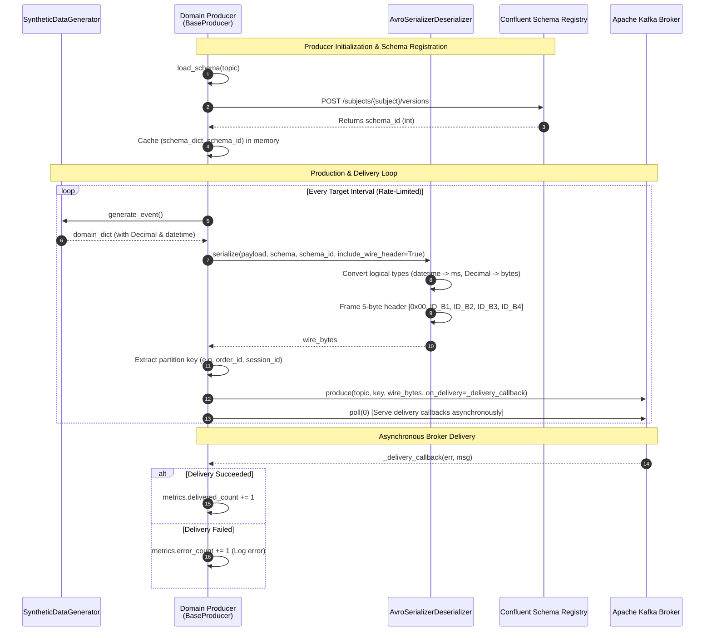
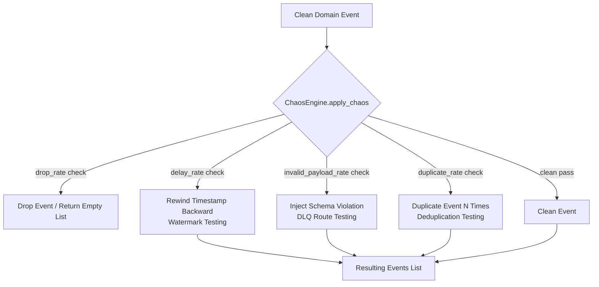

# Marketplace Sandbox — Event Producers Technical Guide & Reference Manual

## 1. Executive Summary & Architecture Overview

The **Event Ingestion Subsystem** of the [Marketplace Sandbox](file:///home/rafael-siqueira/estudos/projetos/Marketplace-Sandbox/README.md) platform provides high-throughput, schema-validated, real-time streaming data ingestion. It bridges synthetic domain data generation with the central Apache Kafka event backbone, establishing reliable data contracts through the Confluent Schema Registry before events are propagated to downstream medallion lakehouse layers (Bronze, Silver, Gold).

Built natively on **Python 3.12+**, the producer subsystem leverages `confluent-kafka` (powered by the high-performance C-library `librdkafka`), Apache Avro binary serialization with custom logical types, resilient backoff and queue-buffering policies, and a configurable chaos injection engine for chaos engineering and stream resilience validation.

```
+---------------------------------------------------------------------------------------------------+
|                                     PRODUCER ARCHITECTURE                                         |
|                                                                                                   |
|  +---------------------------+       +-------------------------+       +-----------------------+  |
|  |  SyntheticDataGenerator   | ----> |      BaseProducer       | ----> | Confluent Wire Format |  |
|  | (Faker pt_BR + Pools)     |       | (Rate Limiting, Queues) |       | (0x00 + 4B Schema ID) |  |
|  +---------------------------+       +-------------------------+       +-----------------------+  |
|                                                  |                                 |              |
|                                                  v                                 v              |
|                                      +-------------------------+       +-----------------------+  |
|                                      | Confluent Schema Reg.   |       |   Apache Kafka Bus    |  |
|                                      | (Cached Registration)   |       | (6 Partitioned Topics)|  |
|                                      +-------------------------+       +-----------------------+  |
+---------------------------------------------------------------------------------------------------+
```

### 1.1 Confluent Wire Format Framing

Every event published to the Kafka cluster strictly implements the **Confluent Schema Registry Wire Format**. Rather than serializing raw JSON or unbounded Avro schemas inside each message payload, the producer prepends a lightweight 5-byte header to the serialized binary Avro payload:

*   **Byte 0 (Magic Byte):** Constant `0x00` indicating Confluent Wire Format compliance.
*   **Bytes 1–4 (Schema ID):** 32-bit big-endian unsigned integer referencing the exact schema version registered in Confluent Schema Registry.
*   **Bytes 5+ (Payload):** Compact binary Avro-encoded record without schema metadata overhead.

> [!NOTE]
> Downstream consumers and PySpark structured streaming jobs inspect the 4-byte schema ID in the header to look up the exact Avro schema from the Schema Registry (or local LRU cache), guaranteeing zero-copy parsing and seamless backward schema evolution.

### 1.2 End-to-End Ingestion Flow

The following sequence diagram details the interaction between the Synthetic Data Generator, Domain Producers, the Confluent Schema Registry, and the Apache Kafka Brokers:



---

## 2. Base Producer Framework (`ingestion/producers/base_producer.py`)

The abstract base class [`BaseProducer`](file:///home/rafael-siqueira/estudos/projetos/Marketplace-Sandbox/ingestion/producers/base_producer.py#L57-L424) enforces standard producer mechanics across all marketplace domains using the **Template Method** design pattern. It unifies client configuration, Schema Registry integration, throughput pacing, partition key extraction, and graceful termination.

### 2.1 Core Components & Responsibilities

| Component | Responsibility |
| :--- | :--- |
| [`BaseProducer`](file:///home/rafael-siqueira/estudos/projetos/Marketplace-Sandbox/ingestion/producers/base_producer.py#L57) | Abstract base class establishing lifecycle hooks (`setup`, `produce_one`, `run`, `close`). |
| [`ProducerMetrics`](file:///home/rafael-siqueira/estudos/projetos/Marketplace-Sandbox/ingestion/producers/base_producer.py#L30-L55) | Telemetry dataclass tracking produced, delivered, error counts, elapsed time, and effective throughput. |
| **Schema Resolver** | Automatically resolves `.avsc` files from [ingestion/schemas/avro/](file:///home/rafael-siqueira/estudos/projetos/Marketplace-Sandbox/ingestion/schemas/avro/) based on topic mappings. |
| **Multi-Topic Schema Cache** | In-memory maps `_topic_schemas` and `_topic_schema_ids` eliminating redundant HTTP lookups during multi-topic publishing. |
| **Rate Limiter** | High-precision monotonic sleep loop maintaining exact target events-per-second (`events_per_second`). |
| **Delivery Callback** | Asynchronous delivery report listener updating telemetry counters on broker acknowledgement. |

### 2.2 Telemetry Tracking (`ProducerMetrics`)

The [`ProducerMetrics`](file:///home/rafael-siqueira/estudos/projetos/Marketplace-Sandbox/ingestion/producers/base_producer.py#L30-L55) dataclass provides real-time auditability:

```python
@dataclass
class ProducerMetrics:
    produced_count: int = 0
    delivered_count: int = 0
    error_count: int = 0
    start_time: float = 0.0
    end_time: float | None = None

    @property
    def elapsed_seconds(self) -> float:
        if self.start_time == 0.0:
            return 0.0
        current = self.end_time if self.end_time is not None else time.monotonic()
        return max(0.0, current - self.start_time)

    @property
    def effective_throughput(self) -> float:
        elapsed = self.elapsed_seconds
        return self.delivered_count / elapsed if elapsed > 0.0 else 0.0
```

### 2.3 Partition Key Extraction Heuristic

To guarantee that events for the same entity are routed to the same Kafka partition (preserving strict chronological order per partition), [`BaseProducer.get_event_key`](file:///home/rafael-siqueira/estudos/projetos/Marketplace-Sandbox/ingestion/producers/base_producer.py#L240-L261) evaluates domain-specific primary keys in priority order:

```python
key_candidates = [
    "order_id",
    "payment_id",
    "cart_id",
    "session_id",
    "inventory_id",
    "product_id",
    "event_id",
]
```

### 2.4 Backpressure & Queue Saturation Handling

When local message queues within `librdkafka` reach capacity (for instance, during high-throughput bursts or temporary broker latency), `produce()` raises `confluent_kafka.BufferError`. [`BaseProducer.produce_one`](file:///home/rafael-siqueira/estudos/projetos/Marketplace-Sandbox/ingestion/producers/base_producer.py#L263-L324) intercepts this condition gracefully:

```python
except BufferError:
    logger.warning("Kafka local queue full; waiting for queue clearance.")
    self.producer.poll(1.0)  # Drain callbacks and free buffer memory
    self.producer.produce(
        topic=target_topic,
        key=key_bytes,
        value=payload_bytes,
        on_delivery=self._delivery_callback,
    )
    self.metrics.produced_count += 1
    return True
```

> [!TIP]
> Always use `BaseProducer` as a context manager (`with CheckoutProducer(...) as producer:`) to guarantee that `flush()` drains pending messages before the process exits.

---

## 3. Producer Configuration & CLI Engine (`ingestion/producers/config.py`)

The [`ProducerConfig`](file:///home/rafael-siqueira/estudos/projetos/Marketplace-Sandbox/ingestion/producers/config.py#L32-L74) dataclass encapsulates connection parameters, serialization paths, and throttling profiles.

### 3.1 Default Topic and Schema Mappings

The configuration engine declares standard mappings connecting Kafka topics to Schema Registry subjects and local Avro schema files:

| Topic | Default Subject | Schema Stem (`.avsc`) |
| :--- | :--- | :--- |
| `marketplace.orders` | `marketplace.orders-value` | `order_creation.avsc` |
| `marketplace.cart` | `marketplace.cart-value` | `cart_events.avsc` |
| `marketplace.payments` | `marketplace.payments-value` | `payment_updates.avsc` |
| `marketplace.inventory` | `marketplace.inventory-value` | `stock_updates.avsc` |
| `marketplace.catalog` | `marketplace.catalog-value` | `catalog_changes.avsc` |
| `marketplace.navigation` | `marketplace.navigation-value` | `user_navigation.avsc` |

### 3.2 Kafka Client Configuration Conversion

The [`ProducerConfig.to_kafka_config()`](file:///home/rafael-siqueira/estudos/projetos/Marketplace-Sandbox/ingestion/producers/config.py#L58-L73) method builds the dictionary supplied to `confluent_kafka.Producer`:

```python
def to_kafka_config(self) -> dict[str, Any]:
    return {
        "bootstrap.servers": self.bootstrap_servers,
        "client.id": self.client_id,
        "acks": self.acks,  # 'all' ensures full in-sync replica durability
        "retries": self.retries,  # default 5
        "retry.backoff.ms": self.retry_backoff_ms,  # default 100ms
        "compression.type": self.compression_type,  # default 'snappy'
    }
```

---

## 4. Synthetic Data Generation Engine (`ingestion/producers/generator.py`)

The [`SyntheticDataGenerator`](file:///home/rafael-siqueira/estudos/projetos/Marketplace-Sandbox/ingestion/producers/generator.py) provides realistic, referentially coherent mock data tailored to the Brazilian marketplace ecosystem using `Faker("pt_BR")`.

### 4.1 In-Memory Relational State Pools

To ensure cross-entity consistency (e.g. orders reference existing customers and products), the generator initializes state pools:

*   **50 Brazilian Customers:** Unique `customer_id` (UUID), realistic Brazilian names, CPFs, email domains, phone numbers, and full addresses across states (`SP`, `RJ`, `MG`, `PR`, `BA`, `AM`, etc.).
*   **15 Marketplace Sellers:** CNPJ, company trade names, seller ratings (3.5 to 5.0), and headquarters locations.
*   **10 Product Categories:** Hierarchy spanning Electronics, Smartphones, Computers, Fashion, Home & Appliance, Sports, Books, Beauty, Toys, and Automotive.
*   **30 Realistic Products:** Real-world items (e.g. *iPhone 15 Pro 128GB*, *Dell XPS 13*, *Smart TV 55" 4K LG*) with SKU codes, categories, and decimal unit prices ranging from R$ 49.90 to R$ 9,299.00.

### 4.2 Avro Logical Types Compliance

The generator adheres strictly to the Avro schema specifications finalized in Step 2:

1.  **`timestamp-millis` (Logical Timestamp):** Emitted as UTC-aware Python `datetime.datetime` objects. During serialization, [`AvroSerializerDeserializer`](file:///home/rafael-siqueira/estudos/projetos/Marketplace-Sandbox/ingestion/serialization.py) transforms them into 64-bit Unix epoch millisecond integers (`int`).
2.  **`decimal(18,4)` (Logical Fixed Decimal):** Monetary values (`unit_price`, `subtotal`, `shipping_fee`, `total_amount`, `amount`) are generated as Python `decimal.Decimal` objects with exactly 4 decimal places (e.g., `Decimal("199.9900")`), preventing floating-point rounding inaccuracies.

---

## 5. Domain Event Producers Reference

The platform features 5 specialized domain event producers, each tailored to specific operational requirements.

```
+---------------------------------------------------------------------------------------------------+
|                                  DOMAIN PRODUCERS ECOSYSTEM                                       |
|                                                                                                   |
|  [CheckoutProducer] ---------> marketplace.orders, marketplace.cart  (Funnel: Cart -> Order)     |
|  [PaymentProducer]  ---------> marketplace.payments                  (Status Lifecycle)           |
|  [NavigationProducer] -------> marketplace.navigation                (High-Volume Clickstream)    |
|  [InventoryProducer] --------> marketplace.inventory, marketplace.catalog (Stock & Catalog)       |
|  [AntiFraudProducer] --------> marketplace.orders, marketplace.payments (Anomalous Signatures)    |
+---------------------------------------------------------------------------------------------------+
```

### 5.1 Checkout Producer (`CheckoutProducer`)

*   **File:** [`ingestion/producers/checkout_producer.py`](file:///home/rafael-siqueira/estudos/projetos/Marketplace-Sandbox/ingestion/producers/checkout_producer.py)
*   **Target Topics:** `marketplace.orders`, `marketplace.cart`
*   **Supported Modes:**
    *   `orders`: Generates order creation events (`ORDER_CREATED`).
    *   `cart`: Generates shopping cart interactions (`CART_ITEM_ADDED`, `CART_ITEM_REMOVED`, `CART_CLEARED`).
    *   `blended` *(default)*: Simulates a realistic e-commerce conversion funnel with 70% cart events and 30% order creations.

```python
producer = CheckoutProducer(mode="blended")
# Automatic dynamic topic routing based on event structure:
producer.produce_one()
```

### 5.2 Payment Producer (`PaymentProducer`)

*   **File:** [`ingestion/producers/payment_producer.py`](file:///home/rafael-siqueira/estudos/projetos/Marketplace-Sandbox/ingestion/producers/payment_producer.py)
*   **Target Topic:** `marketplace.payments`
*   **Lifecycle Simulation:** Method [`simulate_payment_lifecycle()`](file:///home/rafael-siqueira/estudos/projetos/Marketplace-Sandbox/ingestion/producers/payment_producer.py#L73-L154) emits state transitions:
    1.  **Initial Authorization (`AUTHORIZED`):** Emitted at $t_0$.
    2.  **Terminal Settlement:** Emitted after a realistic gateway lag (200ms to 1500ms):
        *   **90% Probability:** `APPROVED` (Successful payment).
        *   **7% Probability:** `DECLINED` (Reasons: `INSUFFICIENT_FUNDS`, `CARD_EXPIRED`, `FRAUD_SUSPICION`).
        *   **3% Probability:** `FAILED` (Reason: `GATEWAY_TIMEOUT`).

```python
producer = PaymentProducer()
# Emits authorized followed by final approved/declined event
producer.produce_payment_lifecycle(
    order_id="b9e289c0-827d-4c31-9f9e-3d168328bf9e",
    customer_id="c5a3d702-53b9-4672-8877-e6fba0429f63",
    amount=Decimal("459.9000"),
    payment_method="CREDIT_CARD",
)
```

### 5.3 Navigation Producer (`NavigationProducer`)

*   **File:** [`ingestion/producers/navigation_producer.py`](file:///home/rafael-siqueira/estudos/projetos/Marketplace-Sandbox/ingestion/producers/navigation_producer.py)
*   **Target Topic:** `marketplace.navigation`
*   **Throughput Profile:** High-volume clickstream telemetry (default: 20.0 events/sec).
*   **User Journey Simulation:** Method [`simulate_user_journey()`](file:///home/rafael-siqueira/estudos/projetos/Marketplace-Sandbox/ingestion/producers/navigation_producer.py#L73-L171) constructs chronologically linked events sharing a single `session_id`:
    1.  `PAGE_VIEW`: Landing on Home page.
    2.  `SEARCH_QUERY`: User executes search (e.g., `"smartphone"` or `"notebook i7"`).
    3.  `CATEGORY_BROWSE`: User navigates into the relevant category page.
    4.  `PRODUCT_CLICK`: User inspects a specific product detail page.

### 5.4 Inventory Producer (`InventoryProducer`)

*   **File:** [`ingestion/producers/inventory_producer.py`](file:///home/rafael-siqueira/estudos/projetos/Marketplace-Sandbox/ingestion/producers/inventory_producer.py)
*   **Target Topics:** `marketplace.inventory`, `marketplace.catalog`
*   **Supported Modes:**
    *   `stock`: Stock reservations, releases, replenishments, adjustments (`stock_updates.avsc`).
    *   `catalog`: Product catalog updates, price adjustments, status edits (`catalog_changes.avsc`).
    *   `blended` *(default)*: 80% stock adjustments/reservations and 20% catalog edits.

### 5.5 Anti-Fraud Producer (`AntiFraudProducer`)

*   **File:** [`ingestion/producers/antifraud_producer.py`](file:///home/rafael-siqueira/estudos/projetos/Marketplace-Sandbox/ingestion/producers/antifraud_producer.py)
*   **Target Topics:** `marketplace.orders`, `marketplace.payments`
*   **Fraud Patterns Simulated:**

| Pattern | Target Topic | Description | Anomaly Characteristics |
| :--- | :--- | :--- | :--- |
| `high_value` | `marketplace.orders` | Massive purchases exceeding normal retail velocity. | Unit prices multiplied by $10\times$ on expensive electronics, total amounts exceeding R$ 50,000.00. |
| `velocity` | `marketplace.orders` | Rapid automated checkout bursts (botting / credential stuffing). | 5+ orders for the identical `customer_id` generated within milliseconds ($t + 250\text{ms} \times i$). |
| `geo` | `marketplace.orders` | Account takeover / impossible travel. | Order 1 placed in São Paulo (`SP`), followed 2 seconds later by Order 2 placed in Amazonas (`AM`). |
| `card_testing` | `marketplace.payments` | Automated card testing fraud. | Multiple consecutive `DECLINED` / `FAILED` payments on the same order with cycling transaction references. |

---

## 6. Chaos & Stream Resilience Engine (`ingestion/producers/chaos.py`)

The [`ChaosEngine`](file:///home/rafael-siqueira/estudos/projetos/Marketplace-Sandbox/ingestion/producers/chaos.py#L81-L606) injects controlled anomalies into the event stream, validating that downstream consumers, watermarking logic, deduplication pipelines, and Dead Letter Queues (DLQ) function correctly under adverse conditions.



### 6.1 Resilience Features & Parameters

| Chaos Capability | Parameter in `ChaosConfig` | Target Failure Mode / Pipeline Test |
| :--- | :--- | :--- |
| **Out-of-Order / Delayed Events** | `delay_rate`, `max_delay_seconds` | Validates streaming window watermarks and late-arriving data policies in PySpark structured streaming. |
| **Duplicate Events** | `duplicate_rate` | Emits multiple identical records with identical `event_id` to test idempotent ingestion and Gold-layer deduplication. |
| **Schema Violations (DLQ)** | `invalid_payload_rate` | Corrupts data types, removes required fields, or inserts negative numbers to verify Dead Letter Queue routing. |
| **Wire Header Corruption** | `corrupt_wire_format()` | Flips magic byte (`0x00` -> `0xff`) or truncates header to verify serializer error handling. |
| **Dynamic Traffic Bursts** | `burst_probability`, `burst_multiplier` | Simulates flash sales (e.g. $5\times$ base rate for 10s windows) to test queue backpressure and consumer lag scaling. |
| **Exponential Retry Helper** | `simulate_retry_connection()` | Wraps produce operations with exponential backoff on transient network failures. |

### 6.2 Schema Violation Types (`SchemaViolationType`)

The enumeration [`SchemaViolationType`](file:///home/rafael-siqueira/estudos/projetos/Marketplace-Sandbox/ingestion/producers/chaos.py#L26-L32) supports 4 distinct corruption strategies for DLQ testing:

```python
class SchemaViolationType(StrEnum):
    MISSING_REQUIRED = "missing_required"  # Deletes mandatory fields (order_id, event_id)
    INVALID_TYPE = "invalid_type"  # Sets numeric decimal fields to invalid string
    NEGATIVE_AMOUNT = "negative_amount"  # Sets total_amount or quantity to negative numbers
    CORRUPTED_STRUCTURE = "corrupted_structure"  # Deletes nested records (shipping_address, items)
```

### 6.3 Exponential Backoff Retry Utility

To guarantee zero message loss during transient network partitions or broker rebalances, [`ChaosEngine.simulate_retry_connection()`](file:///home/rafael-siqueira/estudos/projetos/Marketplace-Sandbox/ingestion/producers/chaos.py#L512-L606) executes produce operations with geometric backoff:

$$\text{sleep\_time} = \text{backoff\_base} \times 2^{\text{attempt}}$$

```python
ChaosEngine.simulate_retry_connection(
    produce_func=producer.produce_one,
    max_retries=3,
    backoff_base=0.1,  # 100ms -> 200ms -> 400ms
    retryable_exceptions=(confluent_kafka.KafkaException, BufferError, TimeoutError),
)
```

---

## 7. Simulation Orchestrator CLI (`scripts/run_producer_simulation.py`)

The orchestrator script provides a multi-threaded CLI harness capable of executing all domain producers simultaneously within a unified process.

### 7.1 Multi-Threaded Execution Architecture

```
+---------------------------------------------------------------------------------------------------+
|                                  SIMULATION RUNNER ARCHITECTURE                                   |
|                                                                                                   |
|                                  +--------------------------+                                     |
|                                  |   SimulationRunner CLI   |                                     |
|                                  | (Signal Handling, JSON)  |                                     |
|                                  +--------------------------+                                     |
|                                                |                                                  |
|                      +-------------------------+-------------------------+                        |
|                      |             ThreadPoolExecutor Workers            |                        |
|                      v                         v                         v                        |
|             +-----------------+       +-----------------+       +-----------------+               |
|             | Checkout Worker |       | Payment Worker  |       | Navigation Wkr  | ... [etc]     |
|             | (Thread 1)      |       | (Thread 2)      |       | (Thread 3)      |               |
|             +-----------------+       +-----------------+       +-----------------+               |
|                      |                         |                         |                        |
|                      +-------------------------+-------------------------+                        |
|                                                v                                                  |
|                                  +--------------------------+                                     |
|                                  |    Aggregated Summary    |                                     |
|                                  | (Throughput, Chaos Stats)|                                     |
|                                  +--------------------------+                                     |
+---------------------------------------------------------------------------------------------------+
```

### 7.2 CLI Options Reference

The orchestrator accepts rich configuration flags via [`build_simulation_arg_parser()`](file:///home/rafael-siqueira/estudos/projetos/Marketplace-Sandbox/scripts/run_producer_simulation.py#L526-L606):

| CLI Flag | Type | Default | Description |
| :--- | :--- | :--- | :--- |
| `--producers` | List[str] | `['all']` | Producers to run: `checkout`, `payment`, `navigation`, `inventory`, `antifraud`, or `all`. |
| `--bootstrap-servers`| str | `$KAFKA_BOOTSTRAP_SERVERS` or `localhost:9092` | Comma-separated Kafka broker addresses. |
| `--schema-registry-url` | str | `$SCHEMA_REGISTRY_URL` or `http://localhost:8081` | Confluent Schema Registry base URL. |
| `--rate` | float | `5.0` (std) / `20.0` (nav) | Target events per second per producer. |
| `--runtime-seconds` | float | `None` (Infinite) | Max execution runtime in seconds before graceful shutdown. |
| `--max-events` | int | `None` (Infinite) | Max events to produce per producer before exiting. |
| `--enable-chaos` | flag | `False` | Enable the `ChaosEngine` failure injector. |
| `--chaos-duplicate-rate`| float | `0.0` | Probability $[0.0, 1.0]$ of duplicating events. |
| `--chaos-delay-rate` | float | `0.0` | Probability $[0.0, 1.0]$ of injecting late timestamps. |
| `--chaos-invalid-rate` | float | `0.0` | Probability $[0.0, 1.0]$ of corrupting schemas (DLQ). |
| `--chaos-burst-prob` | float | `0.0` | Probability $[0.0, 1.0]$ of triggering rate spikes. |
| `--log-level` | str | `INFO` | Logging threshold (`DEBUG`, `INFO`, `WARNING`, `ERROR`). |

### 7.3 Practical Execution Recipes

#### A. Standard Sandbox Simulation (All Producers for 30 Seconds)
```bash
python scripts/run_producer_simulation.py \
    --producers all \
    --runtime-seconds 30 \
    --rate 10 \
    --log-level INFO
```

#### B. High-Volume Clickstream & Checkout Pipeline
```bash
python scripts/run_producer_simulation.py \
    --producers navigation,checkout \
    --rate 50 \
    --max-events 5000 \
    --log-level WARNING
```

#### C. Full Chaos & Resilience Test (DLQ and Watermark Verification)
```bash
python scripts/run_producer_simulation.py \
    --producers all \
    --runtime-seconds 60 \
    --enable-chaos \
    --chaos-duplicate-rate 0.05 \
    --chaos-delay-rate 0.10 \
    --chaos-invalid-rate 0.03 \
    --chaos-burst-prob 0.15
```

---

## 8. Testing and Quality Assurance

The producer framework is accompanied by comprehensive automated test coverage spanning unit testing, chaos scenario testing, and live end-to-end integration streaming.

```
tests/
+-- test_producers.py       # Unit tests for BaseProducer, Config, and SyntheticDataGenerator
+-- test_chaos.py           # Unit tests for ChaosEngine, DLQ corruption, bursts, and retries
+-- test_live_producers.py  # Live end-to-end integration streaming against Kafka & Schema Registry
```

### 8.1 Unit Test Suites

*   **[`tests/test_producers.py`](file:///home/rafael-siqueira/estudos/projetos/Marketplace-Sandbox/tests/test_producers.py):**
    *   Verifies default and custom `ProducerConfig` properties and CLI parsing.
    *   Validates `SyntheticDataGenerator` Avro logical types (`Decimal` precision, `datetime` UTC timestamps).
    *   Mocks `confluent_kafka.Producer` to verify `produce_one()` callbacks, `BufferError` handling, and rate limiting.
    *   Confirms key extraction across all domain identifiers (`order_id`, `payment_id`, `cart_id`, `session_id`, `inventory_id`, `product_id`).
*   **[`tests/test_chaos.py`](file:///home/rafael-siqueira/estudos/projetos/Marketplace-Sandbox/tests/test_chaos.py):**
    *   Validates parameter validation bounds in `ChaosConfig`.
    *   Tests out-of-order timestamp injection across `datetime`, millisecond epochs, and ISO strings.
    *   Verifies payload cloning and deep copy isolation during duplicate generation.
    *   Validates all 4 schema violations (`missing_required`, `invalid_type`, `negative_amount`, `corrupted_structure`).
    *   Validates Confluent wire format binary alterations (magic byte flipping and truncation).
    *   Tests periodic and stochastic burst calculations.
    *   Validates exponential backoff in `simulate_retry_connection()`.

### 8.2 Live Integration Testing (`tests/test_live_producers.py`)

The integration test suite [`tests/test_live_producers.py`](file:///home/rafael-siqueira/estudos/projetos/Marketplace-Sandbox/tests/test_live_producers.py) tests live Kafka streaming against the local Docker Compose environment:

*   **Socket Reachability Checks:** Uses `socket.create_connection` to gracefully verify Kafka (port 9092) and Schema Registry (port 8081).
*   **End-to-End Publishing and Consumption:**
    1.  Subscribes a test consumer to domain topics (`marketplace.orders`, `marketplace.payments`, etc.).
    2.  Executes `produce_one()` using the domain producer.
    3.  Consumes the live message from Kafka.
    4.  Extracts and verifies the 5-byte Confluent Wire Format header (`magic_byte == 0x00`).
    5.  Deserializes the Avro binary body and verifies that logical types match expected types (`datetime` and `Decimal`).

```bash
# Execute full unit test suite
pytest tests/test_producers.py tests/test_chaos.py -v

# Execute live integration tests (requires docker compose up)
pytest tests/test_live_producers.py -v
```

---

## 9. Troubleshooting & Operational Guide

### 9.1 Kafka Local Queue Full (`BufferError`)
*   **Symptom:** Logs indicate `BufferError: Local: Queue full`.
*   **Cause:** Producer throughput exceeds broker absorption capacity, or network I/O thread is starved.
*   **Remedy:** `BaseProducer` automatically invokes `poll(1.0)` to drain the internal queue. For sustained high throughput, increase `queue.buffering.max.messages` via `extra_kafka_config`.

### 9.2 Schema Registry Connection Refused
*   **Symptom:** `requests.exceptions.ConnectionError: Failed to establish a new connection: [Errno 111] Connection refused`.
*   **Cause:** Confluent Schema Registry container is starting up or down.
*   **Remedy:** Ensure the Docker container is healthy:
    ```bash
    docker compose ps schema-registry
    curl -s http://localhost:8081/subjects
    ```

### 9.3 Avro Serialization Validation Errors
*   **Symptom:** `ingestion.serialization.SchemaValidationError: Event payload does not adhere to schema`.
*   **Cause:** A domain field does not match the Avro schema specification (e.g. monetary float instead of Decimal, or string instead of timestamp).
*   **Remedy:** Ensure numerical fields are instantiated using Python's `decimal.Decimal` and timestamps use UTC `datetime.datetime`.
