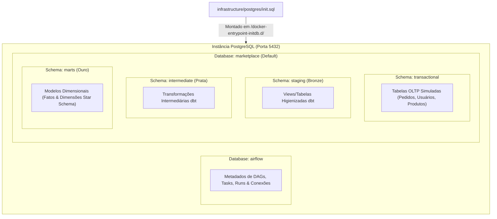

# Sessão 02: Inicialização do PostgreSQL, Separação de Metadados e Schemas da Arquitetura Medalhão

## 1. Resumo da Sessão

* **Tarefa(s) do Roadmap Concluída(s):**
  - Etapa 1 — Estruturação Inicial do Projeto (Fase 2: Configuração da Inicialização do Banco de Dados)
* **Objetivos Alcançados:**
  - Criação do script SQL de inicialização em [infrastructure/postgres/init.sql](file:///home/rafael-siqueira/Estudos/Projetos/Marketplace-Sandbox/infrastructure/postgres/init.sql) para ser montado no contêiner do PostgreSQL.
  - Configuração do banco de dados isolado `airflow` dedicado à persistência de metadados de orquestração (DAGs, execuções, conexões, XComs).
  - Atribuição de permissões administrativas integrais (`GRANT ALL PRIVILEGES`) ao usuário superadministrador (`postgres`).
  - Definição dos schemas relacionais e analíticos no banco primário `marketplace`: `transactional` (dados fontes OLTP simulados), `staging` (camada Bronze/higienização dbt), `intermediate` (camada Prata/regras de negócio dbt) e `marts` (camada Ouro/modelagem dimensional Star Schema).
* **Arquivos Modificados / Criados:**
  - [infrastructure/postgres/init.sql](file:///home/rafael-siqueira/Estudos/Projetos/Marketplace-Sandbox/infrastructure/postgres/init.sql)
  - [docs/context/current-step.md](file:///home/rafael-siqueira/Estudos/Projetos/Marketplace-Sandbox/docs/context/current-step.md)
  - [docs/learning/step-01-initial-project-structuring/2026-07-25-session-02-postgres-database-initialization.md](file:///home/rafael-siqueira/Estudos/Projetos/Marketplace-Sandbox/docs/learning/step-01-initial-project-structuring/2026-07-25-session-02-postgres-database-initialization.md)
  - [docs/learning/README.md](file:///home/rafael-siqueira/Estudos/Projetos/Marketplace-Sandbox/docs/learning/README.md)
* **Principais Decisões Arquiteturais Tomadas:**
  - **Isolamento Rígido de Metadados de Orquestração:** Segregação do banco de dados `airflow` para evitar acoplamento entre o estado do Apache Airflow e a camada de dados analíticos do marketplace.
  - **Modelagem de Schemas Multi-camadas (Medallion Pattern):** Adoção das convenções de nomenclatura do dbt (`staging`, `intermediate`, `marts`) diretamente no PostgreSQL para refletir a transição de dados brutos até datamarts dimensionais.

---

## 2. O Que Foi Construído

Nesta sessão, desenvolvemos o script SQL de bootstrap de infraestrutura [infrastructure/postgres/init.sql](file:///home/rafael-siqueira/Estudos/Projetos/Marketplace-Sandbox/infrastructure/postgres/init.sql). Esse script é executado automaticamente pelo motor do PostgreSQL quando o contêiner Docker do banco de dados é iniciado pela primeira vez.

```sql
-- ============================================================================
-- Infrastructure Initialization Script for PostgreSQL
-- Target Container Path: /docker-entrypoint-initdb.d/init.sql
-- Database context on initial entry: 'marketplace' (default database)
-- ============================================================================

-- ----------------------------------------------------------------------------
-- 1. Apache Airflow Metadata Database Setup
-- ----------------------------------------------------------------------------
CREATE DATABASE airflow;
GRANT ALL PRIVILEGES ON DATABASE airflow TO postgres;

-- ----------------------------------------------------------------------------
-- 2. Medallion & Transactional Schemas Setup in Primary Database ('marketplace')
-- ----------------------------------------------------------------------------
CREATE SCHEMA IF NOT EXISTS transactional;
CREATE SCHEMA IF NOT EXISTS staging;
CREATE SCHEMA IF NOT EXISTS intermediate;
CREATE SCHEMA IF NOT EXISTS marts;
```

### Arquitetura de Bancos e Schemas no PostgreSQL



### Organização de Responsabilidades
1. **Banco `airflow`:** Armazena internamente todas as tabelas de estado da ferramenta de orquestração Apache Airflow (ex: `dag_run`, `task_instance`, `connection`, `xcom`).
2. **Banco `marketplace` (Banco Primário):** Servirá como o *Data Warehouse / Data Lakehouse relacional* local do projeto, contendo as tabelas do sistema de origem simulado (`transactional`) e os modelos analíticos gerenciados pelo dbt (`staging`, `intermediate`, `marts`).

---

## 3. Por Que Foi Construído Dessa Forma

### 1. Mecanismo Autônomo de Provisionamento em Contêineres (Docker Entrypoint)
A imagem oficial do PostgreSQL no Docker (`postgres:15-alpine` ou similar) possui um recurso nativo de inicialização: ao iniciar com um diretório de dados (`PGDATA`) vazio, o script de entrypoint do contêiner busca e executa sequencialmente todos os arquivos `.sql`, `.sql.gz` ou `.sh` localizados no diretório `/docker-entrypoint-initdb.d/`. 

Ao mapear [infrastructure/postgres/init.sql](file:///home/rafael-siqueira/Estudos/Projetos/Marketplace-Sandbox/infrastructure/postgres/init.sql) para esse diretório no `docker-compose.yml`, garantimos que o ambiente de banco de dados nasce totalmente configurado sem a necessidade de comandos manuais pós-inicialização.

### 2. Separação de Domínios entre Orquestração e Negócio
O Apache Airflow exige um banco de dados relacional (PostgreSQL ou MySQL) para guardar seu próprio metadado de execução. Misturar essas tabelas de controle no mesmo banco de dados ou no mesmo schema onde ficam as tabelas de negócio do marketplace cria sérios problemas:
* **Poluição de Schema:** Centenas de tabelas internas do Airflow misturadas com modelos de dados de analytics.
* **Riscos de Segurança e Concorrência:** O scheduler do Airflow realiza leituras e escritas intensivas no banco. Um bloqueio de tabela (lock) ou uma falha de conexão na aplicação de analytics não deve impactar a saúde do orquestrador.
* **Isolamento Operacional:** Possibilita efetuar backup, restauração ou reset do banco de negócios sem perder o histórico de execuções do Airflow, e vice-versa.

### 3. Estruturação em Schemas Alinhada à Arquitetura Medalhão e ao dbt
No PostgreSQL, um único banco de dados pode conter múltiplos *schemas* (namespaces de tabelas). Adotamos uma estrutura de schemas que reflete a jornada de dados (Arquitetura Medalhão):
* `transactional`: Funciona como o banco transacional de origem (OLTP). É onde os simuladores de eventos e scripts de ingestão gravarão os dados raw relacionais.
* `staging` (Bronze): Camada inicial gerenciada pelo dbt. Aplica renomeação estandardizada de colunas, conversão de tipos de dados (casting) e limpeza básica.
* `intermediate` (Prata): Camada de transformação do dbt onde ocorrem deduplicações, junções entre entidades, cálculos de métricas intermediárias e aplicação de regras de negócio.
* `marts` (Ouro): Camada analítica final exposta para ferramentas de BI e SQL Analytics. Contém tabelas de dimensão (ex: `dim_customers`, `dim_products`) e tabelas fato (ex: `fct_orders`).

---

## 4. Conceitos Importantes

### `/docker-entrypoint-initdb.d/`
* **Definição:** Convenção de diretório interno em imagens Docker de bancos de dados (PostgreSQL, MySQL, MariaDB) destinada a scripts de inicialização de schema e dados.
* **Por que existe:** Permite automatizar o *bootstrapping* de infraestrutura em ambientes de desenvolvimento e testes.
* **Onde é usado:** No arquivo `docker-compose.yml`, configurado como um volume montado: `./infrastructure/postgres/init.sql:/docker-entrypoint-initdb.d/init.sql:ro`.
* **Relação com a tarefa:** Garante a criação determinística das bases `airflow` e schemas `marketplace` na primeira subida da stack Docker.

### Database vs. Schema no PostgreSQL
* **Definição:** 
  - **Database (Banco de Dados):** O nível mais alto de isolamento lógico no PostgreSQL. As consultas SQL não podem realizar junções (`JOIN`) nativas entre tabelas localizadas em databases diferentes.
  - **Schema:** Um namespace lógico dentro de um único banco de dados. Um banco pode ter múltiplos schemas, e consultas SQL podem relacionar tabelas de schemas diferentes usando a notação `schema_name.table_name`.
* **Por que existe:** Fornece níveis distintos de isolamento (Database para controle de acesso/conexão e isolamento de aplicações; Schema para organização de domínio dentro de uma mesma aplicação).
* **Onde é usado:** `airflow` foi criado como um **Database** separado (isolamento de aplicação), enquanto `transactional`, `staging`, `intermediate` e `marts` foram criados como **Schemas** dentro do database `marketplace` (organização de camadas analíticas).

### Arquitetura Medalhão (Medallion Architecture)
* **Definição:** Padrão de design de arquitetura de dados que organiza os dados em um lakehouse/warehouse em três camadas lógicas de qualidade progressiva: Bronze (Raw/Staging), Prata (Intermediate/Cleaned) e Ouro (Marts/Curated).
* **Por que existe:** Garante rastreabilidade (lineage), modulação do código de transformação e facilidade de depuração em pipelines de engenharia de dados.
* **Onde é usado:** Mapeado nos schemas `staging`, `intermediate` e `marts` no PostgreSQL.

---

## 5. Abordagens Alternativas

### Comparação: Estratégias de Inicialização e Isolamento de Banco

| Critério | Script Estático em `/docker-entrypoint-initdb.d/` (Escolhido) | Ferramenta de Migration Externa (Flyway / Liquibase / Alembic) | Múltiplas Instâncias de PostgreSQL (Contêineres Separados) |
| :--- | :--- | :--- | :--- |
| **Complexidade** | **Muito Baixa** (único script SQL montado nativamente via Docker) | Média-Alta (exige conteinerizar ou rodar CLI de migração dedicada) | Média (exige gerenciar duas instâncias de banco no `docker-compose.yml`) |
| **Consumo de Recursos** | **Baixo** (uma única instância Postgres consumindo memória/CPU) | Baixo | Alto (duplica processos, buffers e portas do PostgreSQL) |
| **Versionamento de Schema** | Estático (ideal para setup inicial de infraestrutura base) | Dinâmico (gerencia controle de versão incremental de DDL ao longo do tempo) | Estático/Dinâmico |
| **Isolamento de Performance** | Compartilhado (Airflow e Marketplace usam o mesmo engine) | Compartilhado | Total (recursos de RAM e CPU isolados por contêiner) |
| **Por que foi escolhido** | **Selecionado** pela simplicidade de configuração local e por atender plenamente o setup de infraestrutura inicial. | Avaliado. Será complementar no dbt para as camadas analíticas, mas desnecessário para o init de infra. | Rejeitado para economizar memória RAM no ambiente de desenvolvimento sandbox local. |

---

## 6. Trade-offs

### 1. Instância Única de Banco vs. Instâncias Dedicadas
* **Trade-off:** Executar `airflow` e `marketplace` na mesma instância de banco PostgreSQL reduz o consumo de recursos do computador local (RAM/CPU), mas faz com que ambos compartilhem a mesma pool de conexões e disco I/O.
* **Racional:** Em um ambiente local/sandbox de aprendizado, a otimização de recursos de hardware é prioritária. Em produção na nuvem, o Airflow costuma utilizar uma instância gerenciada dedicada (ex: AWS RDS PostgreSQL / Cloud SQL).

### 2. Script SQL Estático vs. Migrações Increnamentais Gerenciadas
* **Trade-off:** Utilizar um arquivo SQL estático (`init.sql`) é extramente simples para a fase de provisionamento de infraestrutura, mas não trata alterações incrementais de schema (`ALTER TABLE`, adições de colunas) em bancos de dados em execução contínua.
* **Racional:** As estruturas administrativas de schemas (`CREATE SCHEMA IF NOT EXISTS`) e bancos (`CREATE DATABASE`) são idempotentes e universais para a subida inicial do projeto. A evolução do modelo analítico será tratada declarativamente pelo dbt.

---

## 7. Perspectiva de Mercado

* **Bancos de Metadados em Ambientes de Produção:** Em arquiteturas de dados enterprise, orquestradores como Apache Airflow jamais compartilham banco com aplicações finalísticas. Utilizam-se serviços gerenciados como **AWS MWAA (Managed Workflows for Apache Airflow)** ou **GCP Cloud Composer**, onde a nuvem provisiona uma instância Postgres isolada com alta disponibilidade (HA) e backup automatizado para os metadados do orquestrador.
* **Data Warehouses Modernos:** Em plataformas de Data Warehousing em nuvem (Snowflake, Databricks, Google BigQuery), a separação por schemas (`staging`, `intermediate`, `marts`) é o padrão de mercado recomendado pela dbt Labs. No Snowflake, por exemplo, isso traduz-se na estrutura `DATABASE.SCHEMA.TABLE` (ex: `ANALYTICS.MARTS.FCT_ORDERS`).
* **Princípio do Menor Privilégio (Least Privilege):** Embora no sandbox tenhamos concedido permissões para a conta superuser `postgres`, ambientes corporativos criam papéis específicos (ex: `airflow_user`, `dbt_user`, `ingestion_user`) com permissões restritas a cada schema (ex: `dbt_user` tem apenas acesso de leitura em `transactional` e gravação em `staging`/`marts`).

---

## 8. Erros Comuns

1. **Alterar o `init.sql` e Esperar que o Docker Atualize o Banco sem Deletar o Volume:**
   - *Por que ocorre:* O PostgreSQL Docker executa scripts em `/docker-entrypoint-initdb.d/` **apenas uma vez**, na criação inicial do volume de dados (`PGDATA`). Subsequentes `docker compose up` ignoram o script pois o diretório de dados já está inicializado.
   - *Como evitar:* Ao modificar o `init.sql`, deve-se recriar o contêiner e seu volume associado executando `docker compose down -v` seguido de `docker compose up -d`.

2. **Tentativa de Executar Comandos de Diferentes Databases em um Único Script SQL sem Tratar Conexão:**
   - *Por que ocorre:* No PostgreSQL, um script `.sql` padrão roda no contexto do database definido pela variável `POSTGRES_DB` (`marketplace`). O comando `CREATE DATABASE airflow;` cria o banco, mas comandos DDL subsequentes continuam sendo executados dentro do database `marketplace`.
   - *Como evitar:* Não tentar criar schemas do `airflow` no mesmo script sem utilizar comandos de troca de contexto de cliente (como `\c airflow` em ferramentas psql) ou deixar que o próprio Airflow execute suas migrations internas no banco `airflow` durante a subida do serviço.

3. **Esquecer a Cláusula `IF NOT EXISTS` na Criação de Schemas:**
   - *Por que ocorre:* Caso o script seja re-executado manualmente em uma instância viva, comandos como `CREATE SCHEMA transactional;` falharão caso o schema já exista.
   - *Como evitar:* Sempre utilizar `CREATE SCHEMA IF NOT EXISTS schema_name;` para garantir a idempotência das instruções SQL.

---

## 9. Leituras Recomendadas

* [Documentação Oficial da Imagem PostgreSQL no Docker Hub (Initialization Scripts)](https://hub.docker.com/_/postgres)
* [Documentação Oficial do Apache Airflow — Set up a Database Backend](https://airflow.apache.org/docs/apache-airflow/stable/howto/set-up-database.html)
* [Guia da Databricks — What is a Medallion Architecture?](https://www.databricks.com/glossary/medallion-architecture)
* [dbt Labs — How we structure our dbt projects (Staging, Intermediate, Marts)](https://docs.getdbt.com/guides/best-practices/how-we-structure-our-dbt-projects)

---

## 10. Principais Aprendizados

- **Provisionamento Declarativo:** O uso da pasta `/docker-entrypoint-initdb.d/` permite automatizar completamente o setup inicial do banco de dados na subida de contêineres Docker.
- **Isolamento Rígido de Responsabilidades:** Manter um banco de dados dedicado (`airflow`) para metadados de orquestração protege a estabilidade do orquestrador e mantém o banco analítico (`marketplace`) limpo.
- **Estrutura Medalhão Pré-configurada:** A pré-criação dos schemas `transactional`, `staging`, `intermediate` e `marts` estabelece as bases fundamentais para a ingestão transacional e a modelagem modular com dbt.
