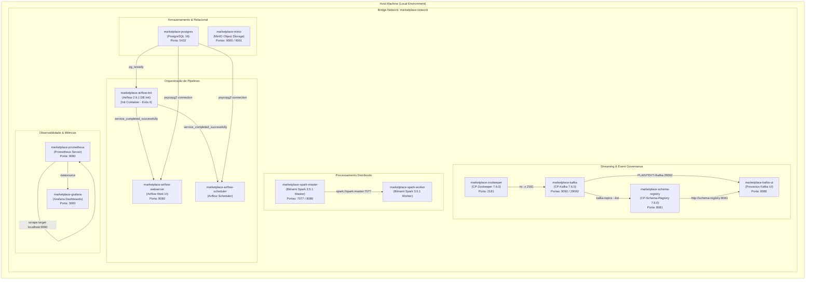

# Sessão 03: Infraestrutura Containerizada da Plataforma via Docker Compose

## 1. Resumo da Sessão

* **Tarefa(s) do Roadmap Concluída(s):**
  - Etapa 1 — Estruturação Inicial do Projeto (Fase 3: Configuração da Infraestrutura Containerizada via Docker Compose)
* **Objetivos Alcançados:**
  - Criação do manifesto de orquestração de contêineres [infrastructure/docker-compose.yml](file:///home/rafael-siqueira/Estudos/Projetos/Marketplace-Sandbox/infrastructure/docker-compose.yml), provisionando a pilha completa de serviços de dados e observabilidade da plataforma.
  - Orquestração declarativa de 13 serviços / contêineres (PostgreSQL 16, MinIO, Zookeeper, Apache Kafka, Kafka UI, Confluent Schema Registry, Apache Spark Master, Apache Spark Worker, Apache Airflow Init, Apache Airflow Webserver, Apache Airflow Scheduler, Prometheus e Grafana).
  - Implementação de grafo de dependências resiliente orientado a *healthchecks* (`condition: service_healthy` e `condition: service_completed_successfully`), eliminando *race conditions* na inicialização da pilha.
  - Configuração da rede interna compartilhada `marketplace-network` (*bridge driver*) para resolução de nomes DNS entre os contêineres.
  - Gerenciamento de volumes de persistência (*named volumes* para bancos/armazenamento e *bind mounts* para scripts de inicialização, DAGs, logs, plugins e configurações).
  - Isolamento de portas de host parametrizado via arquivo de ambiente [config/.env.example](file:///home/rafael-siqueira/Estudos/Projetos/Marketplace-Sandbox/config/.env.example) para prevenir conflitos com serviços locais.
  - Configuração do arquivo de monitoramento [infrastructure/prometheus/prometheus.yml](file:///home/rafael-siqueira/Estudos/Projetos/Marketplace-Sandbox/infrastructure/prometheus/prometheus.yml) para coleta de métricas da infraestrutura.
* **Arquivos Modificados / Criados:**
  - [infrastructure/docker-compose.yml](file:///home/rafael-siqueira/Estudos/Projetos/Marketplace-Sandbox/infrastructure/docker-compose.yml)
  - [infrastructure/prometheus/prometheus.yml](file:///home/rafael-siqueira/Estudos/Projetos/Marketplace-Sandbox/infrastructure/prometheus/prometheus.yml)
  - [docs/context/current-step.md](file:///home/rafael-siqueira/Estudos/Projetos/Marketplace-Sandbox/docs/context/current-step.md)
  - [docs/learning/step-01-initial-project-structuring/2026-07-26-session-03-containerized-infrastructure-docker-compose.md](file:///home/rafael-siqueira/Estudos/Projetos/Marketplace-Sandbox/docs/learning/step-01-initial-project-structuring/2026-07-26-session-03-containerized-infrastructure-docker-compose.md)
  - [docs/learning/README.md](file:///home/rafael-siqueira/Estudos/Projetos/Marketplace-Sandbox/docs/learning/README.md)
* **Principais Decisões Arquiteturais Tomadas:**
  - **Orquestração Monolítica Declarativa Local:** Consolidação de todos os componentes da plataforma em um único arquivo `docker-compose.yml` utilizando Docker Compose Specification v2 (`name: marketplace-sandbox`).
  - **Padrão de Inicialização Epêmera (*Init Container Pattern*):** Separação do processo de bootstrapping de banco do Airflow em um contêiner efêmero (`airflow-init`) que executa `airflow db init` e cria o usuário administrador, finalizando antes da inicialização do `airflow-webserver` e `airflow-scheduler`.
  - **Arquitetura de Dual-Listener no Apache Kafka:** Separação entre a porta de comunicação interna da rede Docker (`PLAINTEXT://kafka:29092`) e a porta exposta para o host (`PLAINTEXT_HOST://localhost:9092`), garantindo interoperabilidade entre serviços internos e clientes externos.
  - **Parametrização Total via Variáveis de Ambiente:** Mapeamento de portas e credenciais no `docker-compose.yml` utilizando a sintaxe `${VAR_NAME}`, acoplado ao arquivo `.env` para portabilidade e segurança.

---

## 2. O Que Foi Construído

Nesta sessão, projetamos e construímos a especificação completa da infraestrutura local containerizada em [infrastructure/docker-compose.yml](file:///home/rafael-siqueira/Estudos/Projetos/Marketplace-Sandbox/infrastructure/docker-compose.yml) e a configuração de raspagem do Prometheus em [infrastructure/prometheus/prometheus.yml](file:///home/rafael-siqueira/Estudos/Projetos/Marketplace-Sandbox/infrastructure/prometheus/prometheus.yml).

### Visão Geral da Arquitetura de Contêineres e Rede



### Detalhamento dos Componentes Orquestrados

1. **PostgreSQL 16 (`marketplace-postgres`):**
   - **Imagem:** `postgres:16-alpine`
   - **Função:** Armazena metadados do Apache Airflow e simula a base relacional OLTP do marketplace.
   - **Persistência & Init:** Volume nomeado `postgres_data` montado em `/var/lib/postgresql/data` e bind mount ro do script [infrastructure/postgres/init.sql](file:///home/rafael-siqueira/Estudos/Projetos/Marketplace-Sandbox/infrastructure/postgres/init.sql) em `/docker-entrypoint-initdb.d/init.sql`.
   - **Healthcheck:** `pg_isready -U ${POSTGRES_USER} -d ${POSTGRES_DB}` a cada 10s.

2. **MinIO Object Storage (`marketplace-minio`):**
   - **Imagem:** `minio/minio:RELEASE.2024-05-10T01-41-38Z`
   - **Função:** Emulador local de Amazon S3 para armazenamento de objetos de dados (Camadas Bronze, Prata, Ouro e Landing Zone).
   - **Persistência:** Volume nomeado `minio_data` montado em `/data`.
   - **Healthcheck:** `curl -f http://localhost:9000/minio/health/live`.

3. **Apache Zookeeper (`marketplace-zookeeper`):**
   - **Imagem:** `confluentinc/cp-zookeeper:7.6.0`
   - **Função:** Serviço de coordenação distribuída para gerenciamento do cluster Apache Kafka.
   - **Healthcheck:** `nc -z localhost 2181`.

4. **Apache Kafka Broker (`marketplace-kafka`):**
   - **Imagem:** `confluentinc/cp-kafka:7.6.0`
   - **Função:** Barramento de streaming de eventos em tempo real para dados transacionais e logs do marketplace.
   - **Dependência:** `zookeeper` (condição `service_healthy`).
   - **Healthcheck:** Execução do utilitário nativo `kafka-topics --bootstrap-server localhost:9092 --list`.

5. **Kafka UI (`marketplace-kafka-ui`):**
   - **Imagem:** `provectuslabs/kafka-ui:latest`
   - **Função:** Interface web intuitiva para inspeção de tópicos Kafka, mensagens Avro/JSON, partições e consumidor de offsets.
   - **Dependência:** `kafka` (condição `service_healthy`).

6. **Confluent Schema Registry (`marketplace-schema-registry`):**
   - **Imagem:** `confluentinc/cp-schema-registry:7.6.0`
   - **Função:** Governança e gerenciamento de schemas de mensagens Avro/Protobuf trafegadas no Kafka.
   - **Dependência:** `kafka` (condição `service_healthy`).
   - **Healthcheck:** `curl -f http://localhost:8081/subjects`.

7. **Apache Spark Master (`marketplace-spark-master`):**
   - **Imagem:** `bitnami/spark:3.5.1`
   - **Função:** Nó mestre do cluster Spark para coordenação de processamento distribuído (Batch e Structured Streaming).

8. **Apache Spark Worker (`marketplace-spark-worker`):**
   - **Imagem:** `bitnami/spark:3.5.1`
   - **Função:** Nó executor do Spark configurado com 1 core e 1GB de RAM dedicada.
   - **Dependência:** `spark-master`.

9. **Apache Airflow Init (`marketplace-airflow-init`):**
   - **Imagem:** `apache/airflow:2.9.1-python3.11`
   - **Função:** Contêiner efêmero de bootstrapping que executa `airflow db init` e cria o usuário administrador `admin`.
   - **Dependência:** `postgres` (condição `service_healthy`).

10. **Apache Airflow Webserver (`marketplace-airflow-webserver`):**
    - **Imagem:** `apache/airflow:2.9.1-python3.11`
    - **Função:** Interface gráfica de usuário para monitoramento, disparo e gestão de DAGs de orquestração.
    - **Dependências:** `airflow-init` (`service_completed_successfully`) e `postgres` (`service_healthy`).
    - **Healthcheck:** `curl -f http://localhost:8080/health`.

11. **Apache Airflow Scheduler (`marketplace-airflow-scheduler`):**
    - **Imagem:** `apache/airflow:2.9.1-python3.11`
    - **Função:** Agendador e disparador de DAGs e tarefas do Airflow executando sob o modelo `LocalExecutor`.
    - **Dependências:** `airflow-init` (`service_completed_successfully`) e `postgres` (`service_healthy`).

12. **Prometheus Server (`marketplace-prometheus`):**
    - **Imagem:** `prom/prometheus:latest`
    - **Função:** Banco de dados de séries temporais para coleta e raspagem de métricas de infraestrutura.
    - **Configuração:** Mount ro de [infrastructure/prometheus/prometheus.yml](file:///home/rafael-siqueira/Estudos/Projetos/Marketplace-Sandbox/infrastructure/prometheus/prometheus.yml).
    - **Healthcheck:** `wget --spider http://localhost:9090/-/healthy`.

13. **Grafana Dashboards (`marketplace-grafana`):**
    - **Imagem:** `grafana/grafana:latest`
    - **Função:** Plataforma de visualização e criação de dashboards analíticos de observabilidade.
    - **Dependência:** `prometheus`.
    - **Healthcheck:** `curl -f http://localhost:3000/api/health`.

---

## 3. Por Que Foi Construído Dessa Forma

### 1. Grafo de Inicialização Orientado a *Healthchecks* (`service_healthy` / `service_completed_successfully`)
No Docker Compose padrão, a diretiva simples `depends_on: [postgres]` apenas garante a ordem de criação do contêiner, mas não aguarda que o processo interno do banco ou broker esteja pronto para aceitar conexões TCP. Em pilhas complexas, isso provoca falhas em cascata de "Connection Refused".

Para resolver essa limitação, adotamos a sintaxe expandida do Docker Compose v2:
```yaml
depends_on:
  postgres:
    condition: service_healthy
```
Cada serviço crítico possui um teste ativo de saúde (`healthcheck`). Por exemplo:
* O PostgreSQL executa `pg_isready` no banco de destino.
* O Kafka valida a comunicação via `kafka-topics --list`.
* O Schema Registry valida a API via `curl` na rota `/subjects`.
* O Airflow Webserver/Scheduler aguardam a conclusão com sucesso do contêiner `airflow-init` através da condição `service_completed_successfully`.

### 2. Padrão de Contêiner Efêmero de Inicialização (*Init Container Pattern*)
O Apache Airflow requer a criação de dezenas de tabelas no banco de metadados (`airflow db init`) e a criação do usuário administrativo antes que a UI web ou o Scheduler possam rodar. 

Se o `airflow-webserver` e o `airflow-scheduler` tentassem rodar `airflow db init` simultaneamente ao iniciar, ocorreriam conflitos de bloqueio DDL (*race conditions*) e falhas na migração do banco. A criação do serviço dedicado `airflow-init` isola esse processo: o contêiner sobe, executa as migrações e a criação do usuário, e encerra com código de saída 0. Somente após a conclusão com sucesso (`service_completed_successfully`), os serviços persistentes do Airflow iniciam.

### 3. Comunicação em Rede Interna com Resolução DNS Nativa (`marketplace-network`)
Ao definir uma rede *bridge* dedicada (`marketplace-network`), o Docker Compose ativa um servidor DNS embutido. Isso permite que todos os contêineres conversem entre si utilizando diretamente os nomes dos serviços definidos no YAML (ex: `postgres:5432`, `zookeeper:2181`, `kafka:29092`, `spark-master:7077`, `schema-registry:8081`), totalmente desacoplados dos endereços IP dinâmicos da máquina host.

### 4. Configuração de Dual-Listener no Apache Kafka
O Apache Kafka possui um desafio clássico de rede em ambientes containerizados: a necessidade de comunicar-se tanto com serviços dentro da mesma rede Docker quanto com clientes rodando diretamente na máquina host.

Solucionamos isso através da configuração de múltiplos ouvintes (`KAFKA_LISTENERS` e `KAFKA_ADVERTISED_LISTENERS`):
```yaml
environment:
  KAFKA_ADVERTISED_LISTENERS: PLAINTEXT://kafka:29092,PLAINTEXT_HOST://localhost:${KAFKA_BROKER_PORT}
  KAFKA_LISTENER_SECURITY_PROTOCOL_MAP: PLAINTEXT:PLAINTEXT,PLAINTEXT_HOST:PLAINTEXT
```
* **Ouvinte Interno (`PLAINTEXT://kafka:29092`):** Utilizado por contêineres na rede `marketplace-network` (Kafka UI, Schema Registry, Spark).
* **Ouvinte Externo (`PLAINTEXT_HOST://localhost:9092`):** Utilizado por aplicações Python, scripts ou CLIs rodando diretamente no SO do desenvolvedor.

---

## 4. Conceitos Importantes

### Docker Compose Healthcheck & Dependency Conditions
* **Definição:** Mecanismo do Docker que executa periodicamente um comando dentro do contêiner para checar seu estado de saúde (`healthy` ou `unhealthy`).
* **Parâmetros-chave:**
  - `test`: O comando executado no contêiner (ex: `pg_isready` ou `curl`).
  - `interval`: Frequência de execução do teste (ex: 10s).
  - `timeout`: Tempo limite para resposta do comando (ex: 5s).
  - `retries`: Número de falhas consecutivas necessárias para marcar o contêiner como `unhealthy`.
* **Utilidade:** Permite expressar dependências condicionais exatas no Compose (`service_healthy` e `service_completed_successfully`), garantindo inicializações ordenadas e sem erros de conexão.

### Kafka Advertised Listeners
* **Definição:** Metadados retornados pelo broker Kafka aos clientes durante o aperto de mão (*handshake*) inicial, indicando em quais endereços IP/porta o broker aceitará conexões de leitura e escrita.
* **Por que é crítico:** Se o Kafka anunciar apenas `localhost` internamente, outros contêineres na rede Docker tentarão conectar em seus próprios `localhost` e falharão. Se anunciar apenas `kafka:29092`, os scripts no host não conseguirão resolver o nome de host interno.

### Named Volumes vs. Bind Mounts
* **Named Volumes (`postgres_data`, `minio_data`):** Volumes gerenciados diretamente pelo daemon do Docker em um diretório isolado do sistema operacional. Oferecem máxima performance de I/O e isolamento contra alterações acidentais do host.
* **Bind Mounts (`./postgres/init.sql`, `../observability/dags`):** Mapeamento direto de um arquivo ou diretório da máquina host para dentro do contêiner. Ideal para arquivos de configuração e código em desenvolvimento que exigem *hot-reloading* (ex: DAGs do Airflow).

### Airflow LocalExecutor
* **Definição:** Modo de execução do Apache Airflow em que os processos das tarefas (*tasks*) são executados como subprocessos no próprio nó onde o Scheduler reside.
* **Por que foi adotado:** Exige uma base relacional compartilhada (PostgreSQL) para coordenação de estado, oferecendo alta performance e simplicidade em setups locais sem a necessidade da complexidade de um cluster Celery/Redis ou Kubernetes.

---

## 5. Abordagens Alternativas

### Comparação: Estratégias de Arquitetura para Infraestrutura Local de Engenharia de Dados

| Critério | Docker Compose Monolítico (Escolha Atual) | Local Kubernetes (Kind / Minikube + Helm Charts) | Serviços Gerenciados em Nuvem (AWS MSK, MWAA, EMR) | Container File Splits (Múltiplos `docker-compose.yml`) |
| :--- | :--- | :--- | :--- | :--- |
| **Complexidade de Setup** | **Muitíssimo Baixa** (`docker compose up -d`) | Alta (requer instalação do kubectl, helm, clusters locais e manifestos K8s) | Alta (requer credenciais AWS, IaC Terraform, custos financeiros) | Média (requer flags `-f` repetitivas na CLI do Docker) |
| **Consumo de Recursos (RAM/CPU)** | **Moderado** (~6GB RAM para 12 contêineres otimizados) | Alto (sobretaxa do control plane do Kubernetes) | Nulo na máquina local (transferido para a nuvem) | Identico ao Compose único |
| **Paridade com Produção** | Média (representa fielmente a arquitetura lógica, mas não o orquestrador K8s) | **Alta** (simula manifestos e deployments de produção) | **Máxima** (ambiente idêntico à nuvem) | Média |
| **Tempo de Inicialização** | **Rápido** (20-30 segundos para a pilha completa) | Lento (pulling e staging de pods Kubernetes) | Dependente de provisionamento de nuvem (10-20 min) | Rápido |
| **Por Que Foi Escolhido** | **Selecionado** para este estágio do sandbox por permitir interatividade imediata, determinismo e baixo consumo de recursos no workstation local. | Rejeitado no momento devido à sobrecarga de complexidade operacional e consumo extra de memória RAM. | Rejeitado nesta etapa para permitir desenvolvimento offline e custo zero no sandbox. | Rejeitado pela facilidade de subir a pilha completa com um único comando declarativo. |

---

## 6. Trade-offs

### 1. Desempenho Local vs. Paridade de Escala
* **Trade-off:** Executar 12 contêineres simultâneos (incluindo Spark Master/Worker, Airflow e Kafka) em uma máquina local de desenvolvimento consome em torno de 6GB de memória RAM. Para viabilizar isso em computadores pessoais, limitamos os recursos dos trabalhadores (ex: Spark Worker configurado com `SPARK_WORKER_CORES: 1` e `SPARK_WORKER_MEMORY: 1G`).
* **Racional:** Para um ambiente sandbox de testes e validação de código de pipeline, o foco é a funcionalidade lógica das APIs, e não o processamento de terabytes de dados.

### 2. Zookeeper vs. Kafka KRaft Mode
* **Trade-off:** Optamos por utilizar o Apache Kafka na versão 7.6 acompanhado do Apache Zookeeper (`cp-zookeeper`), em vez de utilizar o modo KRaft (*Kafka Raft Metadata mode* sem Zookeeper).
* **Racional:** Embora o modo KRaft elimine o contêiner do Zookeeper, o ecossistema com Zookeeper ainda é amplamente consolidado em deployments legados corporativos e garante suporte maduro com imagens oficiais Confluent 7.6.0.

### 3. Chave Fernet do Airflow Estática vs. Gestor de Segredos
* **Trade-off:** A chave de criptografia do Airflow (`AIRFLOW__CORE__FERNET_KEY`) foi mantida estática no arquivo `docker-compose.yml` para facilitar a reprodução do ambiente local por qualquer desenvolvedor sem necessidade de etapas de geração manual.
* **Racional:** Em um ambiente sandbox local, a simplicidade de setup sobressai. Em ambientes de homologação/produção, essa chave é injetada dinamicamente via AWS Secrets Manager ou HashiCorp Vault.

---

## 7. Perspectiva de Mercado

### Transição do Docker Compose Local para Nuvem / Kubernetes
No mercado corporativo de Engenharia de Dados, o Docker Compose é o padrão da indústria para **desenvolvimento local, testes de integração e testes de CI/CD**. Contudo, o ciclo de vida dessas ferramentas na nuvem segue padrões distintos:

1. **Orquestração de Pipelines (Airflow):**
   - **Local:** Airflow em contêineres Docker executando `LocalExecutor`.
   - **Produção Nuvem:** Serviços totalmente gerenciados como **AWS MWAA** (Managed Workflows for Apache Airflow) ou **Google Cloud Composer**, eliminando a gestão de infraestrutura dos schedulers e bancos de metadados.

2. **Event Streaming (Kafka & Schema Registry):**
   - **Local:** CP-Kafka + CP-Zookeeper em Docker Compose com Kafka UI.
   - **Produção Nuvem:** **Confluent Cloud** ou **AWS MSK** (Managed Streaming for Apache Kafka) provisionados via Terraform, utilizando múltiplos brokers replicados em zonas de disponibilidade (Multi-AZ).

3. **Processamento Distribuído (Spark):**
   - **Local:** Bitnami Spark Master/Worker Standalone.
   - **Produção Nuvem:** Clusters elásticos gerenciados como **Databricks**, **AWS EMR** (Elastic MapReduce) ou tarefas efêmeras executadas via **Spark on Kubernetes (K8s)**.

4. **Object Storage:**
   - **Local:** MinIO Server (porta 9000/9001) simulando buckets S3.
   - **Produção Nuvem:** **Amazon S3** ou **Google Cloud Storage (GCS)** nativos.

---

## 8. Erros Comuns

### 1. *Race Conditions* na Subida da Pilha
* **Sintoma:** O contêiner do Airflow Scheduler ou Kafka UI falha imediatamente após `docker compose up` com logs indicando `Connection refused` no PostgreSQL ou Kafka.
* **Causa Raiz:** O contêiner dependente iniciou antes do banco/broker estar pronto para responder a chamadas de rede.
* **Como Evitar:** Definir blocos de `healthcheck` explícitos em cada serviço de infraestrutura e utilizar a sintaxe `depends_on: { service: { condition: service_healthy } }`.

### 2. Configuração Incorreta de *Listeners* no Kafka
* **Sintoma:** Aplicações rodando fora do Docker (ou no Spark) conseguem conectar no Kafka na porta 9092, mas não conseguem publicar ou ler mensagens, ou o Kafka UI indica que o cluster está inacessível.
* **Causa Raiz:** Definir `KAFKA_ADVERTISED_LISTENERS` com `localhost` para o listener interno ou omitir a porta `29092`.
* **Como Evitar:** Manter estritamente mapeado os dois ouvintes: `PLAINTEXT://kafka:29092` para a rede Docker interna e `PLAINTEXT_HOST://localhost:9092` para o host.

### 3. Problemas de Permissão de Arquivo com `AIRFLOW_UID`
* **Sintoma:** O Airflow falha ao criar logs ou carregar DAGs lançando exceções de `Permission Denied` nos volumes mapeados em `../observability/logs`.
* **Causa Raiz:** Os contêineres oficiais do Airflow rodam sob um UID não-root (padrão 50000). Se os diretórios no host pertencerem ao `root` ou a outro UID sem permissão de escrita para o grupo/usuário 50000, o contêiner falhará.
* **Como Evitar:** Definir a variável `AIRFLOW_UID` no arquivo `.env` (ex: `AIRFLOW_UID=50000` ou igual ao UID do usuário logado no Linux `id -u`) e garantir permissões adequadas nos diretórios locais.

### 4. Conflito de Portas no Host (`bind: address already in use`)
* **Sintoma:** Erro ao executar `docker compose up` informando que a porta 5432 ou 8080 já está em uso.
* **Causa Raiz:** A máquina host possui um serviço PostgreSQL local ou outro servidor web rodando nas mesmas portas padrão.
* **Como Evitar:** Mapear todas as portas do host através de variáveis parametrizadas no `.env` (ex: `${POSTGRES_PORT}:5432`, `${AIRFLOW_WEBSERVER_PORT}:8080`), permitindo alterar a porta exposta no host sem modificar a arquitetura interna do contêiner.

---

## 9. Leituras Recomendadas

* **Documentação Oficial do Docker Compose:** [Compose file version 3/v2 reference - Healthchecks](https://docs.docker.com/compose/compose-file/compose-file-v3/#healthcheck)
* **Confluent Technical Blog:** [KAFKA_ADVERTISED_LISTENERS: Explained - Running Kafka in Docker](https://www.confluent.io/blog/kafka-listeners-explained/)
* **Apache Airflow Documentation:** [Running Airflow in Docker - Customizing & Architecture](https://airflow.apache.org/docs/apache-airflow/stable/howto/docker-compose/index.html)
* **Bitnami Spark Container Guide:** [Bitnami Docker Image for Apache Spark](https://github.com/bitnami/containers/tree/main/bitnami/spark)
* **Prometheus Docs:** [Configuration & Scrape Targets Guide](https://prometheus.io/docs/prometheus/latest/configuration/configuration/)

---

## 10. Principais Aprendizados

1. **Orquestração Declarativa e Determinística:** O arquivo `docker-compose.yml` atua como a infraestrutura como código (IaC) local da plataforma, permitindo que todo o ambiente de dados (12+ serviços) seja destruído e reconstruído de forma determinística com um único comando.
2. **Resiliência via Healthchecks:** Dependências entre contêineres em ambientes distribuídos não podem basear-se apenas no tempo de inicialização; o uso de `healthcheck` ativo é essencial para garantir a ordem correta de prontidão operacional dos serviços.
3. **Isolamento de Rede vs. Acesso Externo:** O entendimento da rede *bridge* interna do Docker e da configuração de ouvintes duplos (*dual-listener*) no Kafka é fundamental para integrar ferramentas visuais (Kafka UI), engines de processamento (Spark) e aplicações do host.
4. **Padronização do Bootstrapping de Metadados:** O padrão de utilizar contêineres efêmeros (`airflow-init`) garante a execução segura e limpa de migrações de banco de dados e criação de acessos antes da subida das aplicações persistentes.
