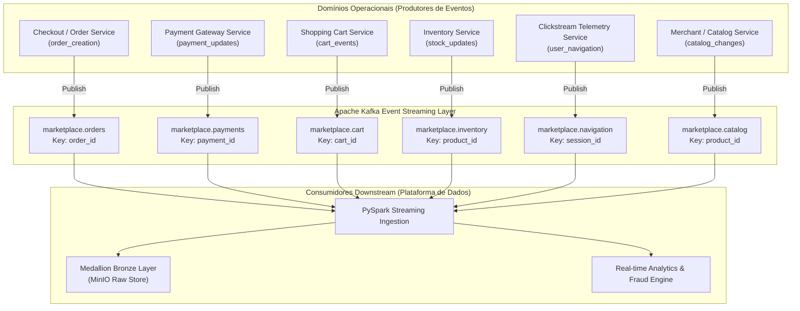
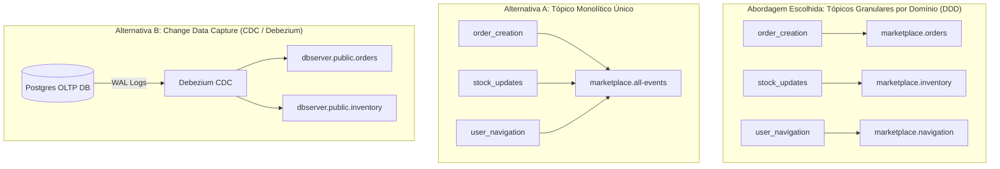
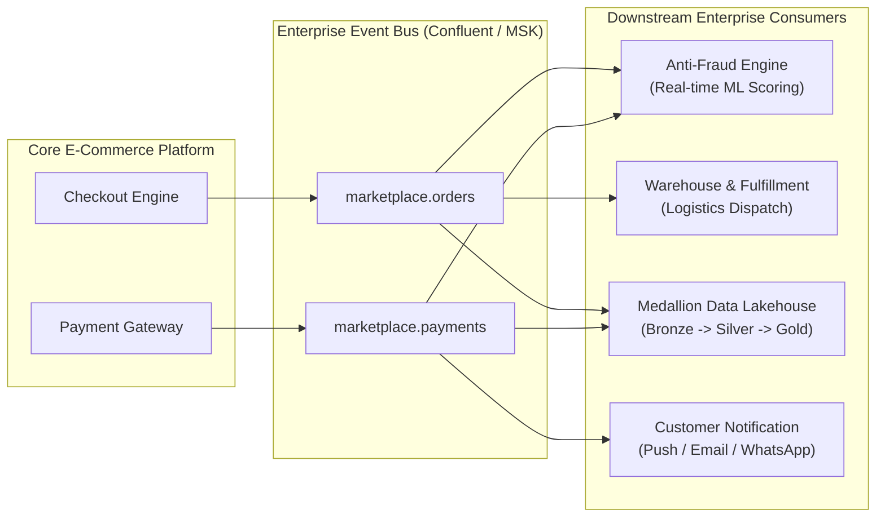

# Guia de Aprendizado — Etapa 2: Modelagem de Domínio de Negócio (Business Domain Modeling) — Sessão 05: Especificação de Eventos de Negócio

---

## 1. Resumo da Sessão

A **Sessão 05** marca a conclusão da **Fase 1 da Etapa 2 (Modelagem de Domínio de Negócio)** do [roadmap.md](file:///home/rafael-siqueira/Estudos/Projetos/Marketplace-Sandbox/docs/context/roadmap.md). O objetivo fundamental desta sessão é definir o contexto funcional e a especificação formal dos **6 eventos centrais de negócio** da plataforma de dados do **Marketplace Sandbox**.

Em uma arquitetura moderna orientada a eventos (*Event-Driven Architecture - EDA*), os eventos de negócio representam fatos imutáveis que ocorreram no ecossistema operacional (ex: um pedido foi realizado, um pagamento foi aprovado, um item foi adicionado ao carrinho). A especificação rigorosa desses eventos atua como a espinha dorsal para a governança de dados, servindo de base direta para os contratos de dados (*Data Contracts*) em Avro/JSON Schema e para o registro de esquemas no Confluent Schema Registry.

O trabalho concluído nesta fase encontra-se totalmente documentado no arquivo de referência [docs/events_specification.md](file:///home/rafael-siqueira/Estudos/Projetos/Marketplace-Sandbox/docs/events_specification.md).

### Objetivos Alcançados na Sessão 05

- **Padronização de Convenções de Nomenclatura:** Definição da hierarquia de tópicos Apache Kafka no padrão `marketplace.<subsistema_de_dominio>`.
- **Especificação dos 6 Eventos de Negócio:** Mapeamento completo dos eventos `order_creation`, `payment_updates`, `cart_events`, `stock_updates`, `user_navigation` e `catalog_changes`.
- **Definição de Padrões Universais de Envelope:** Estabelecimento do padrão ISO 8601 UTC para timestamps, UUID v4 para identificadores únicos e padrão ISO 4217 para moedas.
- **Estratégias de Chave de Particionamento:** Escolha determinística de chaves por entidade primária para garantir a ordem sequencial de mensagens por partição no Kafka.
- **Payloads Canônicos em JSON:** Elaboração de exemplos JSON representativos para cada um dos 6 eventos, incluindo esquemas de atributos, tipos de dados e regras de validação.

### Visão Geral da Arquitetura de Eventos do Marketplace



---

## 2. O Que Foi Construído

Conforme especificado em [docs/events_specification.md](file:///home/rafael-siqueira/Estudos/Projetos/Marketplace-Sandbox/docs/events_specification.md), foram definidos os parâmetros estruturais, de governança e funcionais para os 6 eventos de negócio da plataforma.

### 2.1 Padrões Universais de Governança e Infraestrutura

1. **Nomenclatura de Tópicos Kafka:** Segue o padrão de *Bounded Contexts* do DDD: `marketplace.<subsistema>`.
2. **Formato de Timestamps:** Padrão estrito UTC ISO 8601 com precisão de milissegundos (`YYYY-MM-DDTHH:MM:SS.sssZ`). Exemplo: `"2026-07-26T17:25:00.000Z"`.
3. **Identificadores Únicos:** Formato UUID v4 de 128 bits para todos os IDs de eventos (`event_id`) e chaves operacionais (`order_id`, `customer_id`, `product_id`, etc.). Exemplo: `"550e8400-e29b-41d4-a716-446655440000"`.
4. **Valores Monetários:** Representados por decimais de alta precisão acompanhados obrigatoriamente do código ISO 4217 de 3 letras da moeda (ex: `BRL`, `USD`).
5. **Garantia de Particionamento:** Garantida pela publicação de mensagens utilizando a chave primária da entidade (`order_id`, `payment_id`, `cart_id`, `product_id`, `session_id`).

### 2.2 Detalhamento dos 6 Eventos de Negócio

#### 1. Criacão de Pedidos (`order_creation`)
* **Tópico Kafka:** `marketplace.orders`
* **Subsistema:** Checkout & Order Management
* **Gatilho de Negócio:** Emitido no instante em que o cliente finaliza o fluxo de checkout e confirma a ordem de compra.
* **Significado Semântico:** Início formal do contrato comercial entre comprador e vendedor. Dispara reserva de estoque, cobrança no gateway e fluxo de atendimento (*fulfillment*).
* **Chave de Particionamento:** `order_id`
* **Campos Chave:** `event_id`, `event_type` (`"ORDER_CREATED"`), `timestamp`, `order_id`, `customer_id`, `seller_id`, `order_status`, `currency`, `subtotal_amount`, `discount_amount`, `shipping_fee`, `total_amount`, `payment_method`, `shipping_address` (objeto aninhado), `items` (array de itens).

*Exemplo de Payload Canônico:*
```json
{
  "event_id": "550e8400-e29b-41d4-a716-446655440000",
  "event_type": "ORDER_CREATED",
  "timestamp": "2026-07-26T17:25:00.000Z",
  "order_id": "ord-88392-4920",
  "customer_id": "cust-10293",
  "seller_id": "sell-99201",
  "order_status": "PENDING_PAYMENT",
  "currency": "BRL",
  "subtotal_amount": 250.00,
  "discount_amount": 10.00,
  "shipping_fee": 15.00,
  "total_amount": 255.00,
  "payment_method": "PIX",
  "shipping_address": {
    "street": "Av. Paulista",
    "number": "1000",
    "complement": "Apt 42",
    "city": "São Paulo",
    "state": "SP",
    "zip_code": "01310-100",
    "country": "BR"
  },
  "items": [
    {
      "item_id": "item-001",
      "product_id": "prod-77123",
      "product_name": "Wireless Headphones",
      "quantity": 2,
      "unit_price": 125.00,
      "subtotal": 250.00
    }
  ]
}
```

#### 2. Atualizações de Pagamento (`payment_updates`)
* **Tópico Kafka:** `marketplace.payments`
* **Subsistema:** Payments & Financial Gateway
* **Gatilho de Negócio:** Emitido quando o gateway financeiro ou adquirente atualiza o status transacional do pagamento de um pedido.
* **Significado Semântico:** Altera o estado de avanço do pedido. Status `APPROVED` avança o pedido para separação/envio; status `DECLINED` ou `FAILED` cancela a reserva de estoque e notifica o comprador.
* **Chave de Particionamento:** `payment_id`
* **Campos Chave:** `event_id`, `event_type` (`"PAYMENT_STATUS_UPDATED"`), `timestamp`, `payment_id`, `order_id`, `customer_id`, `payment_method`, `payment_status` (`"AUTHORIZED"`, `"APPROVED"`, `"DECLINED"`, `"REFUNDED"`, `"FAILED"`), `amount`, `currency`, `gateway_provider`, `transaction_reference`, `failure_reason`, `installments`.

*Exemplo de Payload Canônico:*
```json
{
  "event_id": "e01104a3-2391-4e7a-8f81-550186981290",
  "event_type": "PAYMENT_STATUS_UPDATED",
  "timestamp": "2026-07-26T17:25:05.120Z",
  "payment_id": "pay-44910-8812",
  "order_id": "ord-88392-4920",
  "customer_id": "cust-10293",
  "payment_method": "PIX",
  "payment_status": "APPROVED",
  "amount": 255.00,
  "currency": "BRL",
  "gateway_provider": "MOCK_GATEWAY",
  "transaction_reference": "tx_pix_991823712",
  "failure_reason": null,
  "installments": 1
}
```

#### 3. Eventos de Carrinho (`cart_events`)
* **Tópico Kafka:** `marketplace.cart`
* **Subsistema:** Shopping Cart & Pre-Purchase Telemetry
* **Gatilho de Negócio:** Emitido a cada modificação efetuada pelo cliente em seu carrinho de compras (adição, remoção, alteração de quantidade ou limpeza do carrinho).
* **Significado Semântico:** Captura a intenção de compra em tempo real. Alimentador crucial para algoritmos de recomendação, cálculo de abandono de carrinho e funil de conversão.
* **Chave de Particionamento:** `cart_id`
* **Campos Chave:** `event_id`, `event_type` (`"CART_ITEM_ADDED"`, `"CART_ITEM_REMOVED"`, `"CART_QUANTITY_UPDATED"`, `"CART_CLEARED"`), `timestamp`, `cart_id`, `user_id`, `session_id`, `product_id`, `quantity`, `unit_price`, `cart_total_items`, `cart_total_value`.

*Exemplo de Payload Canônico:*
```json
{
  "event_id": "91823ab1-1293-4819-aa29-881273619283",
  "event_type": "CART_ITEM_ADDED",
  "timestamp": "2026-07-26T17:20:12.450Z",
  "cart_id": "cart-991283",
  "user_id": "cust-10293",
  "session_id": "sess-88192-3312",
  "product_id": "prod-77123",
  "quantity": 2,
  "unit_price": 125.00,
  "cart_total_items": 3,
  "cart_total_value": 375.00
}
```

#### 4. Movimentações de Estoque (`stock_updates`)
* **Tópico Kafka:** `marketplace.inventory`
* **Subsistema:** Inventory & Warehousing
* **Gatilho de Negócio:** Emitido pelos centros de distribuição ou sistemas de inventário quando ocorrem variações físicas ou lógicas no saldo de produtos (reserva por pedido, cancelamento, reposição ou ajuste de inventário).
* **Significado Semântico:** Mantém visibilidade contínua e em tempo real sobre a disponibilidade de itens por armazém, evitando *overselling* (vendas sem estoque) e disparando reabastecimentos automáticos.
* **Chave de Particionamento:** `product_id`
* **Campos Chave:** `event_id`, `event_type` (`"STOCK_RESERVED"`, `"STOCK_RELEASED"`, `"STOCK_REPLENISHED"`, `"STOCK_ADJUSTED"`), `timestamp`, `inventory_id`, `product_id`, `seller_id`, `warehouse_id`, `quantity_change`, `previous_stock`, `new_stock`, `reason`, `order_id`.

*Exemplo de Payload Canônico:*
```json
{
  "event_id": "a1b2c3d4-e5f6-7890-abcd-ef1234567890",
  "event_type": "STOCK_RESERVED",
  "timestamp": "2026-07-26T17:25:01.000Z",
  "inventory_id": "inv-55102",
  "product_id": "prod-77123",
  "seller_id": "sell-99201",
  "warehouse_id": "wh-sp-01",
  "quantity_change": -2,
  "previous_stock": 50,
  "new_stock": 48,
  "reason": "ORDER_RESERVATION",
  "order_id": "ord-88392-4920"
}
```

#### 5. Navegação do Usuário (`user_navigation`)
* **Tópico Kafka:** `marketplace.navigation`
* **Subsistema:** Clickstream Telemetry & User Behavior
* **Gatilho de Negócio:** Emitido de forma contínua por aplicações web e mobile conforme usuários navegam por páginas, realizam pesquisas ou visualizam categorias.
* **Significado Semântico:** Eventos de clickstream de ultra-alta vazão para cálculo de CTR, taxa de rejeição (*bounce rate*), tempo de sessão, perfilamento comportamental e personalização em tempo real.
* **Chave de Particionamento:** `session_id`
* **Campos Chave:** `event_id`, `event_type` (`"PAGE_VIEW"`, `"PRODUCT_CLICK"`, `"SEARCH_QUERY"`, `"CATEGORY_BROWSE"`), `timestamp`, `session_id`, `user_id`, `device_type`, `ip_address`, `user_agent`, `page_url`, `referrer_url`, `product_id`, `category_id`, `search_term`.

*Exemplo de Payload Canônico:*
```json
{
  "event_id": "77128441-2990-11ec-abcd-001122334455",
  "event_type": "PRODUCT_CLICK",
  "timestamp": "2026-07-26T17:18:40.000Z",
  "session_id": "sess-88192-3312",
  "user_id": "cust-10293",
  "device_type": "MOBILE",
  "ip_address": "189.100.22.15",
  "user_agent": "Mozilla/5.0 (iPhone; CPU OS 17_5 like Mac OS X)",
  "page_url": "https://marketplace.com/products/prod-77123",
  "referrer_url": "https://marketplace.com/categories/electronics",
  "product_id": "prod-77123",
  "category_id": "cat-elec-01",
  "search_term": null
}
```

#### 6. Alterações de Catálogo (`catalog_changes`)
* **Tópico Kafka:** `marketplace.catalog`
* **Subsistema:** Product Catalog & Merchant Administration
* **Gatilho de Negócio:** Emitido quando vendedores ou administradores criam produtos, alteram preços, atualizam descrições ou desativam anúncios.
* **Significado Semântico:** Notifica indexadores de busca (Elasticsearch/OpenSearch), caches de catálogo (Redis) e rastreadores de preços sobre mudanças no catálogo comercial.
* **Chave de Particionamento:** `product_id`
* **Campos Chave:** `event_id`, `event_type` (`"PRODUCT_CREATED"`, `"PRODUCT_UPDATED"`, `"PRICE_CHANGED"`, `"PRODUCT_DEACTIVATED"`), `timestamp`, `product_id`, `seller_id`, `sku`, `product_name`, `category_id`, `brand`, `price`, `previous_price`, `is_active`, `updated_by`.

*Exemplo de Payload Canônico:*
```json
{
  "event_id": "c9981234-4412-9901-0012-aabbccddeeff",
  "event_type": "PRICE_CHANGED",
  "timestamp": "2026-07-26T16:00:00.000Z",
  "product_id": "prod-77123",
  "seller_id": "sell-99201",
  "sku": "AUDIO-HD-WIFI-01",
  "product_name": "Wireless Headphones Noise Cancelling",
  "category_id": "cat-elec-01",
  "brand": "AudioTech",
  "price": 125.00,
  "previous_price": 149.99,
  "is_active": true,
  "updated_by": "user-admin-04"
}
```

### 2.3 Matriz Comparativa Cruzada dos Eventos

| Nome do Evento | Tópico Kafka | Chave de Particionamento | Perfil de Vazão (*Throughput*) | Principais Consumidores Downstream |
| :--- | :--- | :--- | :--- | :--- |
| `order_creation` | `marketplace.orders` | `order_id` | Médio Volume / Alta Prioridade | Pipeline de Ingestão Spark, Serviço de Estoque, Gateway de Pagamento, Camada Bronze |
| `payment_updates` | `marketplace.payments` | `payment_id` | Médio Volume / Alta Prioridade | Pipeline de Ingestão Spark, Worker de Status de Pedidos, Camada Bronze |
| `cart_events` | `marketplace.cart` | `cart_id` | Alto Volume / Média Prioridade | Pipeline de Ingestão Spark, Analytics de Abandono de Carrinho, Camada Bronze |
| `stock_updates` | `marketplace.inventory` | `product_id` | Alto Volume / Alta Prioridade | Pipeline de Ingestão Spark, Disponibilidade no Catálogo, Camada Bronze |
| `user_navigation` | `marketplace.navigation` | `session_id` | Ultra-Alto Volume / Baixa Latência | Pipeline de Ingestão Spark, Analytics de Clickstream, Camada Bronze |
| `catalog_changes` | `marketplace.catalog` | `product_id` | Baixo Volume / Média Prioridade | Indexador de Busca, Cache Redis de Catálogo, Camada Bronze |

---

## 3. Por Que Foi Construído Dessa Forma

As decisões de modelagem e arquitetura de eventos tomadas na Fase 1 do Step 2 sustentam o crescimento sustentável da plataforma de dados.

### 1. Separação por *Bounded Contexts* do Domain-Driven Design (DDD)
Em vez de unificar todos os eventos da empresa em um único tópico genérico (ex: `marketplace-events`), optou-se pela segregação estrita por subsistemas de negócio (`marketplace.orders`, `marketplace.payments`, `marketplace.cart`, etc.).
- **Isolamento de Falhas:** Um pico massivo de eventos de navegação (`user_navigation`) não causa *head-of-line blocking* na ingestão crítica de pedidos (`order_creation`).
- **Escalabilidade Independente:** Permite ajustar a contagem de partições e o fator de replicação no Kafka de acordo com o perfil de vazão de cada subsistema.

### 2. Padrão de Envelope Estruturado de Evento (*Header Standard*)
Todos os 6 eventos compartilham um conjunto comum de atributos no primeiro nível do payload: `event_id`, `event_type` e `timestamp`.
- **Roteamento e Filtro Genérico:** Consumidores genéricos e pipelines de roteamento (como Dead Letter Queues ou gravadores da camada Bronze) conseguem ler a identidade e o momento da mensagem sem precisar inspecionar regras profundas específicas do corpo do evento.
- **Rastreabilidade e Auditoria:** Garante que qualquer mensagem no ecossistema seja univocamente identificável e temporalmente situada.

### 3. Seleção Determinística da Chave de Particionamento (*Partitioning Key Strategy*)
No Apache Kafka, mensagens com a mesma chave (*key*) são enviadas obrigatoriamente para a mesma partição dentro de um tópico, garantindo ordem estrita de entrega (*FIFO - First In, First Out*).
- **Por que `order_id` para pedidos e `product_id` para estoque?** Notificações relativas ao mesmo pedido ou variações do estoque do mesmo produto devem ser processadas na sequência exata em que ocorreram. Se os eventos de um produto caíssem em partições diferentes, concorrência de leitura poderia causar reordenamento (ex: processar uma adição de estoque após uma reserva de pedido e calcular saldo negativo).

### 4. Padrão Temporal UTC ISO 8601 com Milissegundos
Adotou-se rigorosamente a string ISO 8601 em UTC (`YYYY-MM-DDTHH:MM:SS.sssZ`).
- **Prevenção de Ambiguidade de Fuso Horário:** Elimina falhas de interpretação entre fusos horários de produtores (ex: servidores em São Paulo UTC-3 vs. Virginia UTC-4 vs. UTC).
- **Processamento em Janelas de Tempo no Spark:** O Spark Structured Streaming consegue converter nativamente a string ISO 8601 em tipos `TimestampType` para operações de marca d'água (*watermarking*) e janelas deslizantes (*tumbling/sliding windows*).

### 5. Identificadores Únicos Universais (UUID v4) e Idempotência
O uso de UUID v4 de 128 bits para `event_id` permite que os consumidores downstream implementem tabelas de deduplicação (*deduplication stores*) na camada Silver. Caso o produtor reenvie uma mensagem devido a retry de rede (semântica *at-least-once*), a camada de processamento descarta a duplicata conferindo idempotência ao pipeline.

---

## 4. Conceitos Importantes

### 1. Eventos de Negócio & Arquitetura Orientada a Eventos (EDA)
Um **Evento de Negócio** é uma declaração imutável de um fato passado que tem relevância comercial. Na Arquitetura Orientada a Eventos (EDA):
- O produtor **notifica** a ocorrência do fato sem conhecer quem são os consumidores.
- O evento é mantido em um *log* de append-only (Kafka) onde múltiplos consumidores desacoplados podem ler no seu próprio ritmo.

### 2. Domain-Driven Design (DDD) & Contextos Delimitados (*Bounded Contexts*)
O DDD preconiza que grandes sistemas devem ser divididos em *Bounded Contexts* (Contextos Delimitados), onde cada contexto possui sua própria linguagem ubíqua e modelos conceituais. Na nossa especificação:
- O domínio de **Checkout** fala em `order_id` e `total_amount`.
- O domínio de **Estoque** fala em `warehouse_id`, `quantity_change` e `sku`.
- A separação de tópicos reflete os limites desses *Bounded Contexts*.

### 3. Esquemas de Mensagem e Contratos de Dados (*Data Contracts*)
Um **Contrato de Dados** é um acordo formal entre os times produtores de dados e os times de consumo (engenharia de dados, analytics, IA). Ele define:
- Estrutura exata dos campos (nomes e aninhamentos).
- Tipos de dados (string, integer, double, boolean).
- Regras de obrigatoriedade/nulabilidade.
- Regras de validação (ex: regex para CEP, intervalos para valores monetários).

### 4. Chaves de Particionamento & Ordenação no Apache Kafka
O Kafka garante ordenação estrita de mensagens **apenas dentro da mesma partição**.
- Se um tópico possui 8 partições e a chave for nula (`null`), o Kafka distribui as mensagens via *round-robin* ou *sticky partitioner*. As mensagens chegam fora de ordem global.
- Ao definir uma chave (ex: `product_id`), o algoritmo de hash `murmur2(key) % num_partitions` direciona todas as alterações daquele `product_id` para a mesma partição, garantindo ordenação perfeita por entidade.

### 5. Idempotência, Deduplicação & UUID v4
- **Semântica *At-Least-Once*:** Sistemas de mensageria de alta performance garantem a entrega de mensagens pelo menos uma vez, podendo ocorrer duplicatas em falhas de rede.
- **Idempotência:** Propriedade de uma operação de produzir o mesmo resultado independentemente de quantas vezes for executada.
- **UUID v4:** Algoritmo aleatório de 128 bits com probabilidade irrisória de colisão ($2^{122}$ combinações únicas), ideal para gerar `event_id` globalmente único sem coordenação central.

### 6. Padronização UTC ISO 8601
A norma ISO 8601 estipula o formato `YYYY-MM-DDTHH:MM:SS.sssZ`.
- O sufixo `Z` representa *Zero Offset* (UTC / Zulu time).
- A especificação de milissegundos (`.sss`) é necessária para desempate temporal em sistemas de alta frequência (como clickstream ou atualizações de estoque).

---

## 5. Abordagens Alternativas

Nesta seção, analisamos arquiteturas alternativas que poderiam ter sido adotadas na modelagem dos eventos e por que foram preteridas.



### Matriz Comparativa de Abordagens Alternativas

| Critério | Tópicos Granulares por Domínio (Escolhida) | Tópico Monolítico Único | Change Data Capture (CDC via Debezium) |
| :--- | :--- | :--- | :--- |
| **Organização de Tópicos** | Tópicos dedicados por domínio (`marketplace.orders`, etc.) | Tópico único global (`marketplace.all-events`) | Tópicos espelhados das tabelas relacionais SQL |
| **Acoplamento de Domínio** | Baixo — Desacoplamento funcional completo via DDD | Baixo — Produtores compartilham o mesmo tópico | Alto — Eventos acoplados ao schema das tabelas do banco OLTP |
| **Isolamento de Performance** | Excelente — Tráfego de clickstream não afeta pedidos | Ruim — *Head-of-line blocking* se navegação subir muito | Médio — Depende da taxa de escrita no banco transacional |
| **Expressividade de Negócio** | Máxima — Eventos expressam a intenção do negócio | Média — Necessita de headers pesados para filtro | Baixa — Reflete `INSERT`, `UPDATE`, `DELETE` de linhas SQL |
| **Complexidade Operacional** | Média — Gerenciamento de 6+ tópicos no Kafka | Baixa — Gerenciamento de apenas 1 tópico | Alta — Exige infraestrutura Debezium + acesso aos WALs |

### Por Que Não Usar Tópico Monolítico Único?
Um tópico único centralizado simplifica a criação no Kafka, mas exige que todos os consumidores processem o *firehose* completo de dados e descartem mensagens irrelevantes via código. O volume massivo de clickstream inviabilizaria a leitura eficiente de consumidores focados em pagamentos.

### Por Que Não Adotar CDC (Change Data Capture) nesta Fase?
O CDC escuta os logs de gravação física do banco de dados (Write-Ahead Logs - WAL) e emite eventos de mutação em tabelas. No entanto, o CDC gera eventos focados na persistência (`INSERT`, `UPDATE`), perdendo a semântica rica do negócio (ex: a diferença entre um pedido cancelado por falta de pagamento vs. cancelado pelo cliente). Eventos de aplicação explicitamente modelados capturam o contexto funcional completo.

---

## 6. Trade-offs

Toda decisão de engenharia de dados envolve ponderações entre vantagens e desvantagens.

### 1. JSON Canônico vs. Avro/Protobuf na Fase 1 de Especificação

> [!NOTE]
> Na Fase 1 (Especificação), documentou-se o modelo canônico em **JSON**. Na Fase 2 do Step 2, esses contratos serão formalizados em **Avro / JSON Schema** para registro no Confluent Schema Registry.

* **Vantagens do JSON na Fase 1:** Legibilidade humana imediata, facilidade para inspecionar payloads em arquivos de documentação e suporte nativo em ferramentas de simulação rápida.
* **Desvantagens do JSON:** Payload verboso (as chaves textuais se repetem em cada mensagem), falta de validação binária nativa e ausência de travamento rígido contra *schema drift* sem um Schema Registry acoplado.
* **Decisão:** Utilizar JSON como formato canônico legível na documentação da Fase 1 e evoluir para esquemas binários compilados (Avro) no Schema Registry nas fases subsequentes.

### 2. Tópicos Granulares vs. Tópicos Genéricos

* **Vantagens dos Tópicos Granulares:** Controle fino sobre retenção de dados (ex: retenção de 7 dias para navegação vs. retenção de 30 dias para pedidos), alocação de partições sob medida e política de acesso (ACLs) simplificada por equipe.
* **Desvantagens:** Maior número de recursos gerenciados no cluster Kafka (metadados de tópicos e partições no Zookeeper/KRaft).
* **Decisão:** A clareza arquitetural e o isolamento de performance superam o overhead mínimo de gerenciamento de tópicos.

### 3. Payloads Ricos ("Fat Events") vs. Notificações Enxutas ("Thin Events")

* **Thin Events (Notificação Enxuta):** O evento contém apenas o ID da entidade (ex: `{"order_id": "ord-123", "status": "CREATED"}`). O consumidor precisa fazer chamadas HTTP/gRPC de volta para o microserviço de origem para buscar os dados completos.
* **Fat Events (Payload Rico):** O evento carrega o estado completo ou o contexto necessário para processamento (como itens do pedido, endereço, dados do comprador).
* **Decisão Adotada:** Optamos por **Fat Events** (Payloads Ricos). Isso elimina a necessidade de os consumidores downstream sobrecarregarem os bancos OLTP operacionais com consultas *back-to-source* durante a ingestão streaming no Spark.

---

## 7. Perspectiva de Mercado

Na indústria de tecnologia e em plataformas de e-commerce de grande escala (como **Mercado Livre**, **Amazon**, **Shopify** e **Magalu**), a governança e especificação de eventos de negócio é um pilar estratégico.

### Arquitetura Orientada a Eventos no E-Commerce de Grande Escala



### Casos de Uso Práticos na Indústria:

1. **Combate a Fraudes em Tempo Real:** O evento `order_creation` é consumido simultaneamente pelo pipeline de ingestão e por um motor de machine learning de anti-fraude. Se o valor total ou padrão de itens fugir do perfil habitual do `customer_id`, a transação é enviada para análise antes do evento de pagamento.
2. **Reserva Inteligente de Estoque & Preventa:** O evento `stock_updates` garante sincronização contínua com os marketplaces parceiros. Se o estoque de um produto atinge zero no armazém central (`warehouse_id`), a desativação no catálogo ocorre em milissegundos, evitando multas por descumprimento de SLA de entrega.
3. **Analytics de Abandono de Carrinho:** Unindo os eventos `cart_events` e `order_creation` via janelas de sessão no Spark Streaming, a equipe de CRM identifica clientes que adicionaram produtos de alto valor mas não emitiram o evento de checkout em até 30 minutos, disparando cupons de incentivo personalizados.

---

## 8. Erros Comuns

Abaixo estão listados os erros clássicos cometidos em projetos de engenharia de dados ao modelar eventos de negócio, acompanhados das estratégias de prevenção adotadas na nossa plataforma.

### Erro 1: Ausência de Timestamp do Evento ou Ambiguidade de Fuso Horário
* **O Problema:** Emitir eventos sem timestamp ou utilizar apenas a data local do servidor (ex: `2026-07-26 17:25:00` sem indicação de fuso). Quando o consumidor lê a mensagem, não consegue diferenciar se o horário refere-se ao momento do fato, ao envio ao Kafka ou ao fuso de Greenwich.
* **Solução Adotada:** Exigência estrita de timestamps UTC com precisão de milissegundos no padrão ISO 8601 (`YYYY-MM-DDTHH:MM:SS.sssZ`) em todas as especificações.

### Erro 2: Tópicos sem Chave de Particionamento (Mensagens Fora de Ordem)
* **O Problema:** Publicar mensagens em tópicos com múltiplas partições sem passar a chave da entidade. O Kafka distribui as mensagens aleatoriamente entre as partições. O consumidor pode ler a mensagem de "Pedido Pago" na partição 1 antes de ler a mensagem de "Pedido Criado" na partição 2, causando falhas de integridade referencial ou inversão de estados no banco analítico.
* **Solução Adotada:** Mapeamento explícito da chave de particionamento primária para cada evento (`order_id`, `payment_id`, `product_id`, `session_id`).

### Erro 3: Utilização de IDs Sequenciais Inteiros de Banco Relacional
* **O Problema:** Utilizar IDs numéricos auto-incrementais gerados por tabelas SQL (ex: `order_id: 1042`). Em arquiteturas distribuídas com múltiplos microserviços ou bancos fragmentados (*sharded databases*), há risco iminente de colisão de IDs entre instâncias.
* **Solução Adotada:** Padronização absoluta do formato **UUID v4 (128 bits)** para todos os identificadores globais.

### Erro 4: Notificações Tão Enxutas que Exigem Consultas *Back-to-Source* (Gargalo N+1)
* **O Problema:** Enviar apenas o ID do objeto no evento e forçar a camada de processamento de Big Data a disparar requisições HTTP para a API transacional para buscar detalhes do pedido. Sob carga streaming de mil mensagens por segundo, o banco OLTP da aplicação cai por excesso de conexões.
* **Solução Adotada:** Adopção de payloads auto-contidos (*Fat Events*) com contexto de negócio suficiente para o processamento analítico.

### Erro 5: Mudanças Destrutivas sem Governança de Esquema (*Schema Drift*)
* **O Problema:** O time de desenvolvimento renomeia um campo (ex: de `total_amount` para `order_total`) ou altera o tipo de dado sem notificar os consumidores streaming, quebrando pipelines no Spark.
* **Solução Adotada:** Formalização prévia da documentação em `docs/events_specification.md` que servirá de contrato estrito no Schema Registry.

---

## 9. Leituras Recomendadas

Para aprofundamento conceitual nos temas abordados nesta sessão, recomenda-se a leitura dos seguintes materiais de referência da indústria:

1. **Confluent Event-Driven Architecture Guides**
   - *Designing Event-Driven Systems* (Ben Stopford). Livro de referência sobre padrões de arquitetura com Apache Kafka, governança de dados e modelagem de eventos.
2. **Enterprise Integration Patterns (EIP)**
   - *Enterprise Integration Patterns: Designing, Building, and Deploying Messaging Solutions* (Gregor Hohpe & Bobby Woolf). O guia definitivo sobre padrões de mensageria, envelopes de dados, roteamento e transformação.
3. **Designing Data-Intensive Applications**
   - *Designing Data-Intensive Applications* (Martin Kleppmann). Capítulo 11: *Stream Processing* — Explica com rigor científico o funcionamento de logs imutáveis, ordenação de partições, processamento de tempo de evento vs. tempo de processamento.
4. **CloudEvents Specification (CNCF - Cloud Native Computing Foundation)**
   - Especificação aberta para descrição de dados de eventos em formatos comuns, influenciadora dos padrões universais de envelope JSON/Avro.
5. **Domain-Driven Design**
   - *Domain-Driven Design: Tackling Complexity in the Heart of Software* (Eric Evans). Obra fundamental sobre a definição de *Bounded Contexts*, *Aggregates* e Linguagem Ubíqua.

---

## 10. Principais Aprendizados

- **Eventos São Fatos Imutáveis:** Eventos registram ocorrências do passado do negócio que não podem ser alteradas ou apagadas, servindo como a fonte da verdade primária para a plataforma de dados.
- **Modelagem Baseada em Domínio (DDD):** A divisão dos tópicos no Kafka deve seguir as fronteiras naturais dos domínios operacionais (`marketplace.orders`, `marketplace.payments`, `marketplace.cart`, etc.), garantindo isolamento e escalabilidade.
- **Ordenação Requer Chaveamento Rígido:** A ordenação de mensagens no Kafka só é garantida por partição. Escolher a chave correta (ex: `order_id` para pedidos) é vital para evitar inconsistências de estado no processamento streaming.
- **Envelope Padronizado Simplifica a Ingestão:** Manter metadados universais (`event_id`, `event_type`, `timestamp` em ISO 8601 UTC) reduz imensamente a complexidade de parsers e mecanismos de auditoria na camada Bronze.
- **Contratos de Dados Previnem *Schema Drift*:** Especificar antecipadamente todos os tipos, regras de nulabilidade e validações protege os consumidores analíticos contra quebras inesperadas por alterações em produtores.
