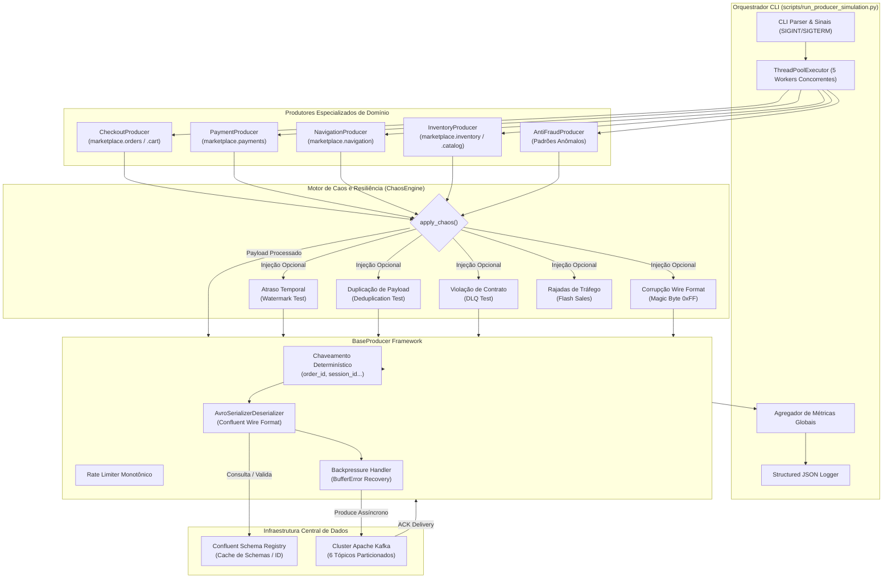

# Guia de Aprendizado — Etapa 3: Construção de Produtores de Eventos (Building Event Producers) — Sessão 09: Produtores de Domínio, Injeção de Caos e Simulação de Streaming em Tempo Real

---

## 1. Resumo da Sessão

A **Sessão 09** conclui de ponta a ponta a **Etapa 3 (Construção de Produtores de Eventos)** do projeto [Marketplace Sandbox](file:///home/rafael-siqueira/estudos/projetos/Marketplace-Sandbox/README.md). Após o estabelecimento do framework base de ingestão e geração sintética na Sessão 08, esta sessão entregou todos os produtores especializados por domínio de negócio, o motor de injeção de falhas e resiliência (*ChaosEngine*), o orquestrador de simulação multi-threaded com suporte a sinais operacionais e telemetria estruturada, e uma suíte completa de testes automatizados unitários e de integração ao vivo contra Kafka e Schema Registry.

### Tarefas do Roadmap Concluídas

- **Fase 2: Produtores de Domínio do Marketplace:**
  - Implementação do `CheckoutProducer` para emissão nos tópicos `marketplace.orders` e `marketplace.cart` com modos operacionais (`orders`, `cart` e `blended`).
  - Implementação do `PaymentProducer` para emissão em `marketplace.payments`, simulando a máquina de estados completa de liquidação de gateway (`AUTHORIZED` $\rightarrow$ `APPROVED`, `DECLINED` ou `FAILED`).
  - Implementação do `NavigationProducer` para geração de clickstream em alta vazão em `marketplace.navigation`, amarrando jornadas cronológicas de navegação web (`PAGE_VIEW`, `SEARCH_QUERY`, `CATEGORY_BROWSE`, `PRODUCT_CLICK`) sob o mesmo `session_id`.
  - Implementação do `InventoryProducer` para gerenciamento de estoque e catálogo em `marketplace.inventory` e `marketplace.catalog` nos modos `stock`, `catalog` e `blended`.
  - Implementação do `AntiFraudProducer` para telemetria de segurança e injeção de 4 padrões anômalos realistas (`high_value`, `velocity`, `geo` e `card_testing`).
- **Fase 3: Motor de Caos e Resiliência (*ChaosEngine*):**
  - Implementação do `ChaosEngine` em [ingestion/producers/chaos.py](file:///home/rafael-siqueira/estudos/projetos/Marketplace-Sandbox/ingestion/producers/chaos.py) oferecendo anomalias temporais (atraso de timestamp para validação de watermarks), duplicação controlada de payloads (testes de desduplicação na camada Silver), corrupção de schema e wire format (testes de Dead Letter Queue - DLQ), rajadas dinâmicas de tráfego (*flash sales*) e retentativas com backoff exponencial.
- **Fase 4: Orquestração Multi-Threaded e Testes Automatizados:**
  - Implementação do script executável [scripts/run_producer_simulation.py](file:///home/rafael-siqueira/estudos/projetos/Marketplace-Sandbox/scripts/run_producer_simulation.py) utilizando `ThreadPoolExecutor`, gerenciamento de sinais (`SIGINT`, `SIGTERM`), logs estruturados em JSON e telemetria agregada.
  - Expansão da cobertura de testes para **111 testes automatizados** aprovados (`test_producers.py`, `test_chaos.py` e testes de integração streaming ao vivo em `test_live_producers.py`).
- **Fase 5: Documentação Técnica:**
  - Publicação do manual técnico de referência em [docs/event_producers_guide.md](file:///home/rafael-siqueira/estudos/projetos/Marketplace-Sandbox/docs/event_producers_guide.md).

### Arquivos Modificados / Criados

- [ingestion/producers/checkout_producer.py](file:///home/rafael-siqueira/estudos/projetos/Marketplace-Sandbox/ingestion/producers/checkout_producer.py)
- [ingestion/producers/payment_producer.py](file:///home/rafael-siqueira/estudos/projetos/Marketplace-Sandbox/ingestion/producers/payment_producer.py)
- [ingestion/producers/navigation_producer.py](file:///home/rafael-siqueira/estudos/projetos/Marketplace-Sandbox/ingestion/producers/navigation_producer.py)
- [ingestion/producers/inventory_producer.py](file:///home/rafael-siqueira/estudos/projetos/Marketplace-Sandbox/ingestion/producers/inventory_producer.py)
- [ingestion/producers/antifraud_producer.py](file:///home/rafael-siqueira/estudos/projetos/Marketplace-Sandbox/ingestion/producers/antifraud_producer.py)
- [ingestion/producers/chaos.py](file:///home/rafael-siqueira/estudos/projetos/Marketplace-Sandbox/ingestion/producers/chaos.py)
- [scripts/run_producer_simulation.py](file:///home/rafael-siqueira/estudos/projetos/Marketplace-Sandbox/scripts/run_producer_simulation.py)
- [tests/test_chaos.py](file:///home/rafael-siqueira/estudos/projetos/Marketplace-Sandbox/tests/test_chaos.py)
- [tests/test_live_producers.py](file:///home/rafael-siqueira/estudos/projetos/Marketplace-Sandbox/tests/test_live_producers.py)
- [docs/event_producers_guide.md](file:///home/rafael-siqueira/estudos/projetos/Marketplace-Sandbox/docs/event_producers_guide.md)
- [docs/context/current-step.md](file:///home/rafael-siqueira/estudos/projetos/Marketplace-Sandbox/docs/context/current-step.md)

### Principais Decisões Arquiteturais Tomadas

1. **Especialização por Domínio sob o Padrão Template Method:** Todos os 5 produtores herdam de `BaseProducer`, reutilizando conexões do `librdkafka`, serialização binária com cabeçalho de 5 bytes do Confluent Wire Format, registro automático de esquemas e rate limiting, sobrescrevendo apenas os métodos geradores e roteamento multi-tópico.
2. **Simulação Probabilística de Ciclos de Vida:** Em vez de eventos aleatórios e desconexos, os produtores emitem fluxos cronológicos coerentes (jornadas de navegação, funis de conversão de carrinho em pedido e transições temporais de status de pagamento).
3. **Desacoplamento do Mecanismo de Caos:** O `ChaosEngine` atua como uma camada intermediária (*middleware* conceitual), interceptando eventos legítimos e injetando anomalias estocásticas de forma parametrizada sem poluir as regras de domínio dos produtores.
4. **Execução Multi-Threaded com Esvaziamento Gracioso:** Adoção de `ThreadPoolExecutor` com captura de sinais de encerramento do SO (`SIGINT`/`SIGTERM`), garantindo que todas as threads invoquem `producer.flush()` para drenar buffers em memória antes do shutdown.

---

## 2. O que foi Construído

Nesta sessão, a camada de ingestão do sandbox evoluiu de um arcabouço base para um ecossistema completo de emulação de tráfego de e-commerce e testes de estresse para streaming.

### Diagrama Arquitetural da Camada de Ingestão e Simulação



### 2.1 Os 5 Produtores de Domínio de Negócio

1. **`CheckoutProducer` ([ingestion/producers/checkout_producer.py](file:///home/rafael-siqueira/estudos/projetos/Marketplace-Sandbox/ingestion/producers/checkout_producer.py)):**
   - **Tópicos Alvo:** `marketplace.orders` e `marketplace.cart`.
   - **Modos Suportados:**
     - `orders`: Emissão pura de eventos de criação de pedido (`order_creation.avsc`).
     - `cart`: Emissão de eventos do carrinho de compras (`cart_events.avsc`: adição, alteração de quantidade e esvaziamento).
     - `blended` *(padrão)*: Simula a taxa de conversão real de e-commerce, gerando $70\%$ de interações no carrinho e $30\%$ de finalizações de pedido.
   - **Roteamento Dinâmico:** Avalia a estrutura do payload para selecionar o tópico e o subject corretos do Schema Registry em tempo de execução.

2. **`PaymentProducer` ([ingestion/producers/payment_producer.py](file:///home/rafael-siqueira/estudos/projetos/Marketplace-Sandbox/ingestion/producers/payment_producer.py)):**
   - **Tópico Alvo:** `marketplace.payments`.
   - **Máquina de Estados de Gateway:** O método `simulate_payment_lifecycle()` modela o intervalo assíncrono entre a captura do pedido e a liquidação bancária:
     - No instante $t_0$, emite a transação com status `AUTHORIZED`.
     - Após uma latência simulada (200ms a 1500ms), emite a atualização terminal:
       - $90\%$ de probabilidade: `APPROVED`.
       - $7\%$ de probabilidade: `DECLINED` (com motivos reais como `INSUFFICIENT_FUNDS`, `CARD_EXPIRED` e `FRAUD_SUSPICION`).
       - $3\%$ de probabilidade: `FAILED` (motivo `GATEWAY_TIMEOUT`).

3. **`NavigationProducer` ([ingestion/producers/navigation_producer.py](file:///home/rafael-siqueira/estudos/projetos/Marketplace-Sandbox/ingestion/producers/navigation_producer.py)):**
   - **Tópico Alvo:** `marketplace.navigation`.
   - **Perfil de Carga:** Clickstream massivo (taxa padrão de 20 eventos/segundo).
   - **Jornada de Usuário Determinística:** O método `simulate_user_journey()` encadeia eventos que compartilham o mesmo `session_id`, `customer_id` e endereço IP:
     1. `PAGE_VIEW` na página inicial (*Landing*).
     2. `SEARCH_QUERY` executando buscas por termos populares (ex: "smartphone", "notebook").
     3. `CATEGORY_BROWSE` filtrando a categoria relevante.
     4. `PRODUCT_CLICK` inspecionando um produto âncora do catálogo.

4. **`InventoryProducer` ([ingestion/producers/inventory_producer.py](file:///home/rafael-siqueira/estudos/projetos/Marketplace-Sandbox/ingestion/producers/inventory_producer.py)):**
   - **Tópicos Alvo:** `marketplace.inventory` e `marketplace.catalog`.
   - **Modos Suportados:**
     - `stock`: Emissão de `stock_updates.avsc` (operações `RESERVED`, `RELEASED`, `REPLENISHED` e `ADJUSTED`) referenciando armazéns físicos (`WH-SP-01`, `WH-RJ-01`, etc.).
     - `catalog`: Emissão de `catalog_changes.avsc` (atualizações de preços com `Decimal(18,4)` e status de ativação/desativação de SKUs).
     - `blended` *(padrão)*: $80\%$ movimentações de estoque e $20\%$ alterações de catálogo.

5. **`AntiFraudProducer` ([ingestion/producers/antifraud_producer.py](file:///home/rafael-siqueira/estudos/projetos/Marketplace-Sandbox/ingestion/producers/antifraud_producer.py)):**
   - **Tópicos Alvo:** `marketplace.orders` e `marketplace.payments`.
   - **Padrões de Ataque e Fraude Simulados:**
     - `high_value`: Pedidos anômalos com multiplicador de preço de $10\times$ em eletrônicos de luxo, gerando compras superiores a R$ 50.000,00.
     - `velocity`: Rajadas de automação maliciosa (*botting* / *credential stuffing*), disparando 5 ou mais pedidos para o mesmo `customer_id` com espaçamento de apenas 250ms.
     - `geo`: Quebra de localidade geográfica (*impossible travel*), gerando um pedido em São Paulo (`SP`), seguido, segundos depois, por outro pedido no Amazonas (`AM`) para o mesmo usuário.
     - `card_testing`: Teste automatizado de cartões furtados, disparando múltiplas tentativas consecutivas rejeitadas com status `DECLINED`/`FAILED` para o mesmo pedido.

### 2.2 O Motor de Caos e Resiliência (`ChaosEngine`)

Implementado em [ingestion/producers/chaos.py](file:///home/rafael-siqueira/estudos/projetos/Marketplace-Sandbox/ingestion/producers/chaos.py), o `ChaosEngine` expõe ferramentas para validação das camadas downstream da Arquitetura Medalhão:

| Funcionalidade de Caos | Mecanismo Interno | Objetivo de Teste na Pipeline |
| :--- | :--- | :--- |
| **Atraso Temporal de Timestamps** | Subtrai de 60 a 3600 segundos do timestamp do evento. | Valida se janelas de tempo (*tumbling/sliding windows*) e *watermarks* do Spark Streaming descartam ou acumulam dados tardios corretamente. |
| **Duplicação Estocástica** | Emite cópias profundas (*deep copies*) com o mesmo `event_id`. | Testa a capacidade de desduplicação idempotente na ingestão da camada Bronze para a Silver. |
| **Violação de Schema Avro** | Aplica `SchemaViolationType` (remove campos obrigatórios, injeta strings em números decimais, insere valores negativos ou corrompe objetos aninhados). | Valida o desvio de payloads venenosos (*poison pills*) para a *Dead Letter Queue* (DLQ) sem interromper o streaming. |
| **Corrupção de Wire Format** | Altera o Magic Byte (`0x00` $\rightarrow$ `0xFF`) ou trunca os 5 bytes do cabeçalho binário. | Testa a robustez do deserializador e do tratamento de exceções de framing. |
| **Picos de Tráfego (*Bursts*)** | Aplica multiplicadores de vazão (ex: $5\times$) periódicos ou probabilísticos. | Testa a resiliência contra saturação de buffer local (`BufferError`) e auto-scaling de nós consumidores. |
| **Retentativa com Backoff Exponencial** | Função utilitária com crescimento geométrico do tempo de espera ($t = t_0 \times 2^{\text{attempt}}$). | Garante tolerância a partições transitórias de rede ou rebalanceamentos de cluster Kafka. |

### 2.3 Orquestrador CLI Multi-Threaded (`run_producer_simulation.py`)

O script executável [scripts/run_producer_simulation.py](file:///home/rafael-siqueira/estudos/projetos/Marketplace-Sandbox/scripts/run_producer_simulation.py) integra todos os componentes em um processo unificado de simulação:
- Executa os produtores selecionados em paralelo através de um `ThreadPoolExecutor`.
- Implementa manipuladores de sinais para interceptar `SIGINT` (Ctrl+C) e `SIGTERM`, disparando a interrupção coordenada de todas as threads.
- Formata todos os eventos de log em JSON estruturado, contendo timestamps, identificadores de thread, tópicos e contadores.
- Emite um relatório final consolidado detalhando tempo de execução, eventos produzidos, eventos entregues, falhas e throughput efetivo (mensagens por segundo).

### 2.4 Suíte de Testes Automatizados

A maturidade do código foi validada através de **111 testes automatizados**:
- [tests/test_producers.py](file:///home/rafael-siqueira/estudos/projetos/Marketplace-Sandbox/tests/test_producers.py): Testes unitários do `BaseProducer`, `ProducerConfig`, gerador sintético e produtores de domínio utilizando mocks de Kafka e Schema Registry.
- [tests/test_chaos.py](file:///home/rafael-siqueira/estudos/projetos/Marketplace-Sandbox/tests/test_chaos.py): Testes unitários para todas as facetas do `ChaosEngine`, cobrindo limites de parâmetros, corrupções estruturais de tipos, manipulações de timestamp e retentativas com backoff.
- [tests/test_live_producers.py](file:///home/rafael-siqueira/estudos/projetos/Marketplace-Sandbox/tests/test_live_producers.py): Testes de integração de ponta a ponta que se conectam aos containers locais via Docker Compose, emitem mensagens reais para os tópicos do Kafka, consomem os registros e verificam a integridade do cabeçalho binário Confluent Wire Format (Magic Byte `0x00` e Schema ID de 4 bytes) e deserialização Avro.

---

## 3. Por que foi Construído Dessa Forma (Decisões de Design)

### 1. Padrão Template Method e Herança de `BaseProducer`
A comunicação com o Kafka envolve rotinas complexas de baixo nível: configuração de buffers de socket, loop assíncrono de callbacks (`poll(0)`), recuperação de `BufferError`, serialização e registros HTTP no Schema Registry. Se cada produtor de domínio implementasse sua própria lógica de transporte, haveria duplicação massiva de código. Com o padrão **Template Method**, o `BaseProducer` governa o ciclo de vida completo (`setup()`, `produce_one()`, `run()`, `close()`), enquanto os produtores de domínio focam exclusivamente nas particularidades dos payloads de negócio.

### 2. Máquina de Estados para Pagamentos e Navegação
Em pipelines analíticas reais, eventos nunca surgem de maneira estática ou isolada. Um pagamento recusado só faz sentido se correlacionado a um pedido existente, e a conversão de um carrinho depende de etapas prévias de navegação. Construir métodos como `simulate_payment_lifecycle()` e `simulate_user_journey()` permite testar a ordenação temporal e operações de *stream-stream joins* no PySpark com dados que refletem com fidelidade o comportamento humano e sistêmico.

### 3. Pools de Entidades em Memória para Consistência Relacional
Se os geradores sintéticos utilizassem exclusivamente dados aleatórios descartáveis, os identificadores de entidades (`customer_id`, `product_id`, `seller_id`) seriam puramente disjuntos. As futuras transformações em SQL e dbt na camada Gold falhariam ao executar junções (*joins*) entre a tabela dimensional de clientes e a tabela fato de pedidos. Ao manter reservatórios em memória (50 clientes reais, 30 produtos de catálogo, armazéns fixos e lista circular de pedidos ativos), asseguramos integridade referencial entre os tópicos desacoplados do Kafka.

### 4. Caos como Middleware Desacoplado
Misturar lógica de injeção de falhas (como corromper campos ou duplicar mensagens) dentro do código dos produtores de negócio violaria o **Princípio da Responsabilidade Única (SRP)**. O `ChaosEngine` foi projetado como um interceptor desacoplado: os produtores emitem payloads perfeitamente válidos e saudáveis, e o motor de caos aplica transformações estocásticas controladas apenas quando habilitado por parâmetros ou flags de CLI (`--enable-chaos`).

### 5. Concorrência Baseada em Threads (`ThreadPoolExecutor`)
A biblioteca cliente `confluent-kafka` é um invólucro em Python sobre a biblioteca `librdkafka`, escrita em C. O `librdkafka` gerencia internamente suas próprias threads de I/O em código de máquina, liberando o GIL (*Global Interpreter Lock*) do Python durante operações de socket e polling de mensagens. Consequentemente, utilizar uma arquitetura multi-threaded em Python consome significativamente menos memória do que múltiplos processos independentes (`multiprocessing`), mantendo a simplicidade de orquestração dentro de um script único de simulação.

### 6. Particionamento Determinístico por Entidade Chave
O método `get_event_key()` prioriza campos fundamentais da entidade (`order_id`, `session_id`, `payment_id`). No Apache Kafka, mensagens que possuem a mesma chave binária são invariavelmente direcionadas para a mesma partição do tópico via algoritmo de hash Murmur2. Isso garante que todos os eventos cronológicos de um mesmo pedido ou sessão de usuário cheguem aos consumidores rigorosamente em ordem, evitando inconsistências causais no processamento em streaming.

---

## 4. Conceitos Importantes (Deep-Dives conceituais)

### 4.1 Confluent Wire Format e Enquadramento Binário
Em arquiteturas orientadas a eventos de alto volume, incorporar o schema Avro completo em cada payload JSON/Avro geraria um overhead proibitivo de rede. O padrão **Confluent Wire Format** introduz um enquadramento binário compacto de exatamente 5 bytes antes do payload útil:

$$\underbrace{\mathtt{0x00}}_{\text{Magic Byte (1B)}} \quad \underbrace{\mathtt{0x00\ 0x00\ 0x00\ 0x01}}_{\text{Schema ID Big-Endian (4B)}} \quad \underbrace{\mathtt{0x12\ 0x34\ \dots\ 0xAB}}_{\text{Payload Avro Binário (NB)}}$$

- **Magic Byte (Byte 0):** Sempre `0x00`, identificando conformidade com a convenção Confluent.
- **Schema ID (Bytes 1 a 4):** Inteiro de 32 bits em ordem de bytes *Big-Endian*, correspondente ao ID único atribuído ao esquema pelo Schema Registry.
- **Corpo Binário (Bytes 5 em diante):** Conteúdo serializado via Avro sem nomes de campos ou metadados desnecessários.

Consumidores downstream lêem os primeiros 5 bytes, consultam o schema correspondente em seu cache LRU em memória e deserializam o restante do payload com custo computacional mínimo.

### 4.2 Estratégias de Particionamento e Semântica de Ordenação
O Apache Kafka não oferece garantia de ordenação global entre partições diferentes de um mesmo tópico; **a ordenação estrita é garantida única e exclusivamente dentro de uma mesma partição**.
- Se um evento é enviado sem chave (`key=None`), o produtor distribui as mensagens de maneira round-robin ou aleatória entre as partições. Como resultado, o evento `AUTHORIZED` pode cair na Partição 0 e o evento `APPROVED` na Partição 1. Se os consumidores lerem em ritmos diferentes, o sistema consumidor pode tentar aprovar um pedido antes mesmo de receber a autorização!
- Ao utilizarmos a chave determinística da entidade (ex: `key=order_id.encode('utf-8')`), a partição de destino é calculada matematicamente por:

$$\text{Partição} = \text{murmur2}(\text{key}) \pmod{\text{total\_de\_partições}}$$

Todos os eventos de um dado `order_id` são serializados na mesma partição, preservando a cronologia causal absoluta.

### 4.3 Backpressure e Gerenciamento de Memória no `librdkafka`
O método `producer.produce()` não aguarda a resposta do broker na rede; ele apenas enfileira a mensagem no buffer de memória do processo (`queue.buffering.max.messages`, cujo valor padrão é 100.000 mensagens).
- Se a taxa de geração de eventos da aplicação for superior à taxa de vazão da rede ou de absorção dos brokers, o buffer atinge sua capacidade máxima e o cliente dispara imediatamente uma exceção `BufferError`.
- O padrão de tratamento implementado no `BaseProducer` captura essa condição, executa uma chamada bloqueante `producer.poll(1.0)` para dar tempo às threads internas em C de transmitirem os pacotes pendentes e limparem o espaço no buffer, e então reaplica o enfileiramento com sucesso, implementando **backpressure cooperativo**.

### 4.4 Watermarks e Tratamento de Dados Tardios (*Late-Arriving Data*)
Em sistemas de streaming, há uma distinção crítica entre:
1. **Event Time (Tempo do Evento):** O instante exato em que o fato de negócio ocorreu no mundo real (campo `created_at` gerado pelo cliente).
2. **Processing Time (Tempo de Processamento):** O instante em que a máquina do cluster (ex: worker do PySpark) efetivamente executa o código que consome a mensagem.

Devido a problemas de conexão móvel, fila ou partições de rede, eventos podem chegar aos brokers com segundos, minutos ou horas de atraso. O mecanismo de **Watermarking** estabelece uma janela temporal de tolerância:

$$\text{Watermark}(t) = \max(\text{Event Time Visto}) - \Delta t_{\text{tolerância}}$$

Qualquer evento que chegue com $\text{Event Time} < \text{Watermark}(t)$ é classificado como "dado tardio" e pode ser descartado ou redirecionado para auditoria. A funcionalidade de alteração de timestamp do `ChaosEngine` foi desenvolvida especificamente para testar e validar essa tolerância nas etapas seguintes do projeto.

### 4.5 Padrão Dead Letter Queue (DLQ)
Quando um evento com dados corrompidos (ex: campo monetário contendo texto ou campos obrigatórios faltantes) é consumido por uma esteira de streaming, ele causa uma falha de deserialização (*Poison Pill*). Se não for tratado, o consumidor trava em um loop infinito de retentativas, bloqueando o avanço do offset da partição.
O padrão **Dead Letter Queue (DLQ)** isola a mensagem defeituosa:
1. O deserializador intercepta a falha de schema ou formatação binária.
2. Em vez de quebrar a pipeline, a mensagem bruta acompanhada de metadados de erro é gravada em um tópico segregado (ex: `marketplace.orders.dlq`).
3. O offset do fluxo principal avança normalmente, mantendo a ingestão saudável, enquanto equipes de sustentação analisam os registros na DLQ.

### 4.6 Idempotência e Desduplicação no Lakehouse
Redes de computadores estão sujeitas a falhas intermitentes. Se o broker Kafka gravar a mensagem com sucesso, mas a resposta de confirmação (ACK) se perder por timeout na rede, o produtor repetirá o envio, gerando duplicatas no tópico (garantia de entrega *At-Least-Once*).
Para evitar que uma transação de R$ 1.000,00 seja contabilizada em duplicidade no faturamento da empresa:
- Cada evento carrega um identificador único de mensagem imutável (`event_id`).
- Na transição da camada **Bronze** (dados brutos gravados no MinIO como recebidos) para a camada **Silver** (dados higienizados e tipados), a engine de processamento executa desduplicação idempotente particionada:

```sql
SELECT * FROM (
    SELECT *, ROW_NUMBER() OVER (PARTITION BY event_id ORDER BY ingested_at DESC) as rn
    FROM bronze_orders
) WHERE rn = 1;
```

---

## 5. Abordagens Alternativas

Durante o planejamento e implementação do Step 3, foram analisadas diferentes arquiteturas técnicas para geração, injeção de caos e concorrência:

### 5.1 Geração de Dados Sintéticos: Faker em Memória vs Datasets Estáticos vs Mock HTTP APIs

| Critério | Faker com Pools em Memória (Adotada) | Leitura de Datasets Estáticos (CSV/Parquet) | Mock Servers HTTP (WireMock / Mountebank) |
| :--- | :--- | :--- | :--- |
| **Consumo de Armazenamento** | **Zero bytes em disco**; geração procedural em runtime. | Exige dezenas de megabytes em arquivos de dados no Git. | Exige infraestrutura adicional de contêineres e mocks. |
| **Flexibilidade & Variação** | **Infinita**; gera milhões de combinações exclusivas em `pt_BR`. | Finita; loops repetitivos sobre as mesmas linhas estáticas. | Média; limitada a templates estáticos ou dinâmicos prévios. |
| **Performance de Geração** | **Altíssima** ($> 5.000$ eventos/segundo em memória). | Limitada por I/O de leitura de disco ou descompressão. | Baixa; sobrecarga do protocolo HTTP/REST para geração. |
| **Integridade Relacional** | Mantida por listas circulares e pools estáticos compartilhados. | Alta, porém estática e inflexível para novos testes. | Complexa de orquestrar estado entre múltiplos endpoints. |
| **Decisão & Justificativa** | **Adotada.** Oferece máxima autonomia ao laboratório, sem dependências externas de arquivos gigantescos no repositório. | Descartada por engessar a base de testes e poluir o controle de versão com datasets pesados. | Descartada pela sobrecarga operacional e lentidão na vazão de ingestão. |

### 5.2 Concorrência de Ingestão: Threads vs Multiprocessing vs Asyncio

| Critério | `ThreadPoolExecutor` (Adotada) | `multiprocessing.Process` | `asyncio` (`aiokafka`) |
| :--- | :--- | :--- | :--- |
| **Overhead de Memória** | **Muito Baixo**; memória compartilhada no mesmo espaço de endereçamento. | Alto; duplica o interpretador Python e pools de dados para cada processo. | Muito Baixo; single-thread com event loop cooperativo. |
| **Impacto do Python GIL** | **Desprezível**; o `librdkafka` faz o trabalho pesado de I/O em C fora do GIL. | Inexistente; processos independentes possuem GILs próprios. | Inexistente; modelo assíncrono baseado em corrotinas. |
| **Complexidade de Código** | **Baixa**; API concisa e compartilhamento simples de estado/telemetria. | Média-Alta; exige filas inter-processo (`IPC/Queue`) para agregar métricas. | Alta; exige reescrever todo o ecossistema com bibliotecas puramente assíncronas. |
| **Integração com Schema Registry** | Nativa e estável com a biblioteca oficial `confluent-kafka`. | Nativa, porém com múltiplas conexões HTTP concorrentes. | Exige wrappers não oficiais de terceiros para o Schema Registry. |
| **Decisão & Justificativa** | **Adotada.** Combina simplicidade de implementação com alto throughput liberado pelas threads em C da biblioteca da Confluent. | Descartada pelo consumo de memória desnecessário no sandbox local. | Descartada para evitar dependências instáveis de clientes assíncronos não oficiais. |

### 5.3 Injeção de Falhas: Caos em Nível de Aplicação vs Caos em Nível de Infraestrutura

| Critério | `ChaosEngine` na Aplicação (Adotada) | Proxies de Rede (Toxiproxy / Chaos Mesh) |
| :--- | :--- | :--- |
| **Granularidade do Caos** | **Nível de Campo e Schema** (corrompe valores decimais, remove chaves JSON, atrasa timestamps lógicos). | **Nível de Rede/Socket** (injeta latência de TCP, perda de pacotes, fechamento abrupto de conexões). |
| **Facilidade de Teste Unitário** | **Imediata**; testável deterministicamente via Pytest sem containers rodando. | Exige ambiente Docker ou Kubernetes completo com privilégios de kernel (*root/capabilities*). |
| **Simulação de Anomalias de Negócio** | **Perfeita**; modela fraudes, divergências monetárias e violações de contratos Avro. | Nula; enxerga apenas fluxo cego de bytes de transporte TCP/IP. |
| **Decisão & Justificativa** | **Adotada.** O objetivo educacional deste estágio é testar a governança de dados, contratos Avro e deduplicação no Lakehouse. | Complementar para futuras fases de infraestrutura, mas insuficiente para testes de esquemas. |

---

## 6. Trade-offs (Compensações de Engenharia)

Toda decisão de arquitetura impõe compensações intencionais entre forças concorrentes:

### 1. Fidelidade Estatística vs Custo de Memória
- **Decisão:** Manter reservatórios relacionais limitados em memória (50 clientes, 30 produtos e buffer circular de 200 pedidos ativos).
- **Trade-off:** Ganhamos altíssima velocidade na geração sintética e simplicidade de execução local sem dependências de bancos relacionais de suporte. A compensação aceita é que, em execuções de simulação extremamente longas (horas de duração), haverá repetição dos mesmos clientes e produtos no histórico de eventos.

### 2. Durabilidade Estrita (`acks=all`) vs Vazão Máxima (*Throughput*)
- **Decisão:** Configuração padrão com `acks=all` e `retries=5` no `BaseProducer`.
- **Trade-off:** Priorizamos a garantia de que nenhuma mensagem confirmada seja perdida pelo broker, preparando o estudante para padrões financeiros reais. A compensação é que a vazão máxima de produção no ambiente local é ligeiramente reduzida em comparação a uma política frouxa (`acks=0` ou `acks=1`), o que é irrelevante para a escala do sandbox.

### 3. Caos na Aplicação vs Caos na Rede
- **Decisão:** Injetar falhas manipulando diretamente os payloads e o enquadramento de bytes através do `ChaosEngine`.
- **Trade-off:** Conquistamos capacidade cirúrgica para testar contratos de dados específicos, tipos lógicos Avro e Dead Letter Queues em testes unitários rápidos. A compensação é que não emulamos diretamente falhas de hardware, como travamento de placa de rede ou partições de nós no cluster de brokers.

### 4. Simplicidade da ThreadPool vs Escalabilidade Distribuída
- **Decisão:** Orquestrar os 5 produtores via `ThreadPoolExecutor` dentro de um único interpretador Python.
- **Trade-off:** A simplicidade operacional é incomparável: o estudante inicia todo o ecossistema com um único comando CLI (`python scripts/run_producer_simulation.py`). A compensação é que a geração fica limitada aos limites de processador de uma única máquina hospedeira, em vez de ser distribuída em um cluster distribuído de carga (como Locust ou Apache JMeter distribuído).

---

## 7. Perspectiva da Indústria

### Simulação de Tráfego e Testes de Estresse em Grandes E-Commerces
Empresas como **Amazon**, **Mercado Livre** e **Shopify** operam programas contínuos de preparação para grandes datas sazonais (como a *Black Friday* e o *Prime Day*). 
- Nessas corporações, equipes de engenharia de dados utilizam plataformas internas de simulação para reproduzir cenários de carga extrema meses antes do evento real.
- Motores semelhantes ao implementado neste sandbox geram fluxos massivos de telemetria de navegação e adições de itens ao carrinho, permitindo dimensionar o auto-scaling de tópicos no Kafka/MSK, calibrar a memória de clusters Spark Streaming e detectar previamente gargalos de gravação na camada Bronze do Data Lakehouse.

### Padrão Dead Letter Queue (DLQ) em Serviços Financeiros e Fintechs
Em instituições financeiras e gateways globais (como **Nubank**, **Stripe** e **Adyen**), um barramento de eventos nunca pode parar por causa de um evento corrompido ou fora de conformidade.
- A prática corporativa padrão exige o isolamento imediato da falha via tópicos de DLQ ou tópicos de quarentena.
- Acompanhando a DLQ, sistemas automatizados emitem alertas no Slack/PagerDuty e disparam esteiras de reprocessamento (*replay pipelines*) assim que a causa raiz é sanada (por exemplo, após uma atualização retroativa de schema no Schema Registry).

### Princípios de Engenharia de Caos (*Chaos Engineering*)
Popularizada pela **Netflix** com ferramentas como o *Chaos Monkey*, a engenharia de caos deixou de ser exclusividade da infraestrutura de servidores e migrou para a Engenharia de Dados (*Data Chaos Engineering*).
- Pipelines de streaming modernas são projetadas sob o princípio fundamental de que **a rede é hostil, relógios de servidores sofrem desvios (*clock drift*) e dados chegarão duplicados ou fora de ordem**.
- Simular atrasos de timestamp e duplicações intencionais de registros antes que o código entre em produção é a única forma de garantir que as janelas de agregação e as regras contábeis do Lakehouse permaneçam consistentes.

### Diferenças entre o Sandbox Local e Ambientes Gerenciados na Nuvem

| Componente | Implementação no Sandbox Educacional | Equivalente Gerenciado em Nuvem Corporativa |
| :--- | :--- | :--- |
| **Barramento de Mensageria** | Apache Kafka em container local Docker Compose. | **Confluent Cloud**, **Amazon MSK** (Managed Streaming for Apache Kafka) ou **Azure Event Hubs**. |
| **Catálogo de Contratos** | Confluent Schema Registry local em container. | **Confluent Cloud Schema Registry** ou **AWS Glue Schema Registry**. |
| **Emissão de Eventos** | Scripts Python com `librdkafka` e `ThreadPoolExecutor`. | Microsserviços distribuídos em **Kubernetes (EKS/GKE)**, lambdas serverless (**AWS Lambda**) ou conectores **Kafka Connect**. |
| **Armazenamento de Eventos** | Volumes locais montados pelo Docker no sistema de arquivos. | Armazenamento de dados em camadas de três zonas (**EBS gp3** + **Tiered Storage** no Amazon S3 / Google Cloud Storage). |

---

## 8. Erros Comuns e Armadilhas

### Armadilha 1: Omissão do `poll(0)` Gerando Acúmulo de Memória e Travamento
- **O Problema:** Programadores iniciantes acostumados com APIs puramente síncronas costumam chamar apenas `producer.produce()` dentro de loops rápidos, sem invocar `producer.poll(0)`.
- **Por que acontece:** No `librdkafka`, as confirmações de entrega do broker são despachadas para uma fila interna de eventos em C. A chamada `produce()` apenas enfileira o envio, mas não atende aos eventos da fila de resposta.
- **Sintoma:** Os callbacks de entrega (`_delivery_callback`) nunca são executados, os descritores de rede se acumulam e o consumo de memória RAM do processo cresce descontroladamente até o sistema operacional matar o processo via OOM (*Out Of Memory*).
- **Como a nossa base previne:** O método `BaseProducer.produce_one()` executa deterministicamente `self.producer.poll(0)` imediatamente após cada envio de mensagem.

### Armadilha 2: Chaves Nulas ou Aleatórias Quebrando a Causalidade
- **O Problema:** Enviar mensagens com `key=None` ou gerar um `uuid.uuid4()` novo como chave para cada atualização de pagamento.
- **Por que acontece:** O desenvolvedor assume que a ordem das mensagens no Kafka é global ou não compreende a mecânica de roteamento por partições.
- **Sintoma:** O evento de cancelamento ou aprovação de um pedido chega a um nó consumidor antes do evento de criação do mesmo pedido, resultando em erros como `OrderNotFoundException` ou gravações órfãs no banco analítico.
- **Como a nossa base previne:** O método `BaseProducer.get_event_key()` inspeciona uma hierarquia ordenada de chaves de domínio (`order_id`, `payment_id`, `session_id`, etc.), garantindo que todas as mutações daquela entidade convirjam estritamente para a mesma partição.

### Armadilha 3: Desligamento Abrupto com Perda Silenciosa de Dados
- **O Problema:** Finalizar a aplicação com `sys.exit()` ou interrupção de terminal sem drenar os buffers internos de envio.
- **Por que acontece:** A aplicação conclui o loop em Python e finaliza imediatamente, mas centenas ou milhares de mensagens ainda estavam no buffer local do `librdkafka` aguardando envio pela thread de socket em segundo plano.
- **Sintoma:** Perda de dados silenciosa (*silent data loss*); o produtor contabilizou o evento como gerado, mas ele nunca chegou aos brokers.
- **Como a nossa base previne:** Todos os produtores implementam suporte a gerenciadores de contexto (`with producer:`) e o método `close()` invoca obrigatoriamente `producer.flush(timeout=10.0)`, bloqueando a saída até que o buffer em memória seja completamente esvaziado.

### Armadilha 4: Confusão entre Tipos de Ponto Flutuante e Decimais
- **O Problema:** Utilizar números de ponto flutuante primitivos (`float`) para representar preços, fretes e descontos.
- **Por que acontece:** A tipagem padrão de números decimais na maioria dos tutoriais de Python utiliza `float` (ex: `19.90`).
- **Sintoma:** O padrão IEEE 754 de ponto flutuante introduz dízimas binárias imprecisas (como `19.899999999999998`), violando o contrato Avro `decimal(18,4)` e provocando erros de conciliação financeira entre sistemas contábeis.
- **Como a nossa base previne:** O motor `SyntheticDataGenerator` utiliza estritamente instâncias de `decimal.Decimal` quantizadas com 4 casas decimais para todas as grandezas monetárias.

---

## 9. Leituras Complementares

Para expandir os conhecimentos adquiridos nesta sessão, recomenda-se a leitura das seguintes referências técnicas:

1. **Livros e Obras Fundamentais:**
   - *Designing Data-Intensive Applications* (Martin Kleppmann) — Especialmente os Capítulos 3 (Storage and Retrieval), 11 (Stream Processing) e 12 (The Future of Data Systems).
   - *Kafka: The Definitive Guide* (Gwen Shapira, Todd Palino, Rajini Sivaram, Scott Petty) — Leitura indispensável sobre arquitetura interna do broker, protocolo de replicação e parametrização de produtores.
   - *Streaming Systems: The What, Where, When, and How of Large-Scale Data Processing* (Tyler Akidau, Slava Chernyak, Reuven Lax) — A bíblia conceitual sobre Event Time, Processing Time, Watermarks e Triggers.
   - *Chaos Engineering: Building Confidence in System Behavior through Experiments* (Casey Rosenthal, Nora Jones) — Fundamentos para desenho de testes de resiliência e injeção de falhas controladas.

2. **Padrões e Documentações Oficiais:**
   - [Confluent Schema Registry Wire Format Specification](https://docs.confluent.io/platform/current/schema-registry/fundamentals/serdes-develop/index.html#wire-format) — Especificação técnica do enquadramento binário de 5 bytes.
   - [librdkafka Configuration Properties Reference](https://github.com/confluentinc/librdkafka/blob/master/CONFIGURATION.md) — Documentação aprofundada sobre parâmetros de buffer (`queue.buffering.*`), `linger.ms`, `acks` e compressão.
   - [Apache Avro 1.11+ Specification](https://avro.apache.org/docs/current/spec.html) — Detalhes sobre a representação e codificação de tipos lógicos (`timestamp-millis` e `decimal`).

3. **Documentos Internos do Repositório:**
   - [docs/event_producers_guide.md](file:///home/rafael-siqueira/estudos/projetos/Marketplace-Sandbox/docs/event_producers_guide.md) — Manual técnico completo de operação dos produtores de eventos do sandbox.
   - [docs/learning/step-03-building-event-producers/2026-07-29-session-08-base-producer-framework-and-synthetic-generation.md](file:///home/rafael-siqueira/estudos/projetos/Marketplace-Sandbox/docs/learning/step-03-building-event-producers/2026-07-29-session-08-base-producer-framework-and-synthetic-generation.md) — Registro da arquitetura base e motores sintéticos desenvolvido na sessão anterior.
   - [docs/context/roadmap.md](file:///home/rafael-siqueira/estudos/projetos/Marketplace-Sandbox/docs/context/roadmap.md) — Roteiro estratégico de evolução do projeto Marketplace Sandbox.

---

## 10. Principais Conclusões

- **Acoplamento Inteligente via Contratos:** A camada de ingestão opera de forma 100% orientada a contratos de dados. O Confluent Schema Registry e o Confluent Wire Format garantem que nenhuma mensagem malformada penetre silenciosamente no barramento sem validação prévia.
- **Fidelidade de Negócio em Simulações:** Gerar dados sintéticos de alta qualidade exige mais do que dados aleatórios; requer modelagem de comportamento humano (jornadas de navegação no site), ciclos de vida de entidades (máquinas de estado para pagamentos e pedidos) e integridade referencial em memória.
- **Engenharia de Resiliência desde o Primeiro Dia:** O streaming de dados não deve ser desenvolvido assumindo um mundo ideal. A introdução deliberada do `ChaosEngine` prepara as futuras camadas de streaming e Lakehouse para lidar com dados duplicados, eventos atrasados fora de ordem e anomalias de fraude.
- **Robustez Operacional em Sistemas Concorrentes:** A combinação de `ThreadPoolExecutor` com captura de sinais de sistema (`SIGINT`/`SIGTERM`) e esvaziamento bloqueante de buffers (`flush()`) estabelece uma fundação profissional que impede corrupção e perda oculta de mensagens durante encerramentos do sistema.
- **Prontidão para o Próximo Marco:** Com os 6 tópicos do Kafka sendo abastecidos por dados sintéticos ricos e auditados por 111 testes automatizados, a **Etapa 3 está 100% concluída**, abrindo caminho para a **Etapa 4: Processamento de Fluxo com PySpark Streaming**.
