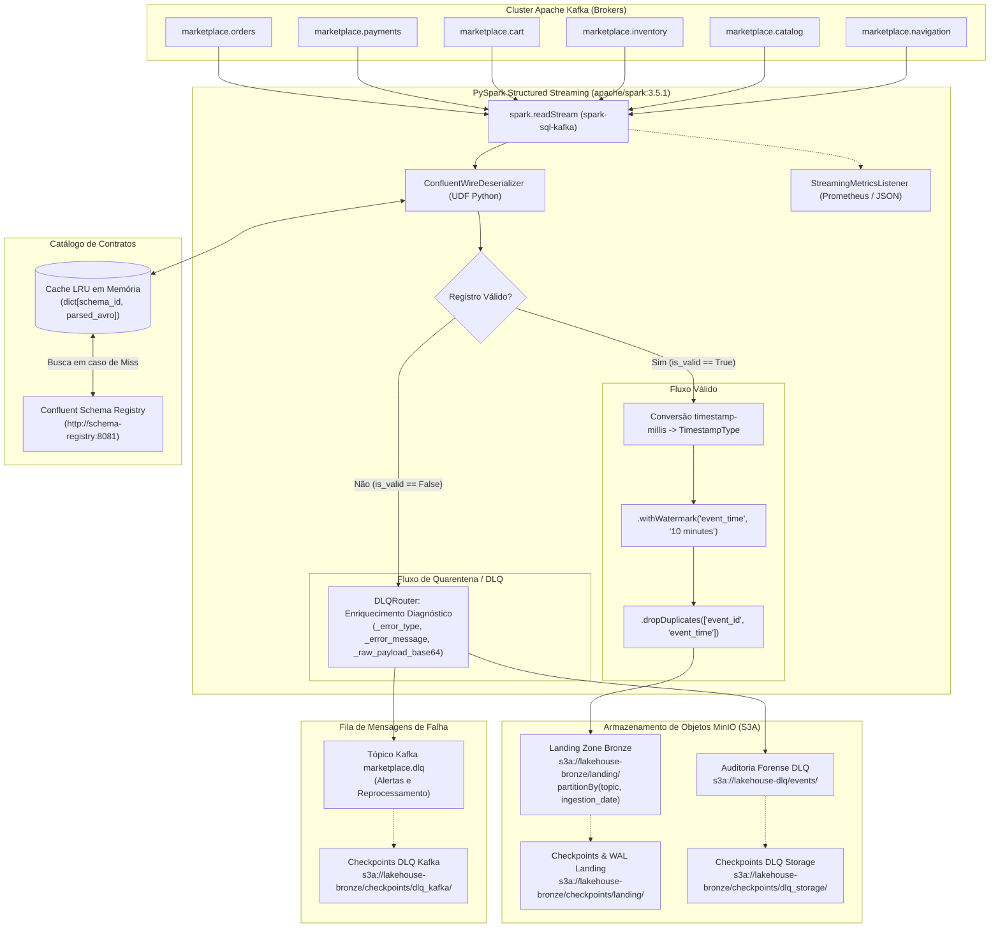

# Guia de Aprendizado — Etapa 4: Pipeline de Ingestão em Streaming (Streaming Ingestion Pipeline) — Sessão 10: Pipeline de Ingestão em Streaming com PySpark, Wire Format Confluent, Watermarking e Dead Letter Queue

---

## 1. Resumo Executivo & Visão Geral

A **Sessão 10** marca a conclusão de ponta a ponta da **Etapa 4 (Streaming Ingestion Pipeline)** do [Marketplace Sandbox](file:///home/rafael-siqueira/estudos/projetos/Marketplace-Sandbox/README.md). Enquanto a Etapa 3 foi responsável por conceber produtores de eventos sintéticos e simular cargas de dados de e-commerce com injeção de caos no Apache Kafka, esta etapa estabelece o motor computacional central de consumo e processamento contínuo em tempo real utilizando **Apache Spark 3.5.1 Structured Streaming (PySpark)**.

O principal objetivo alcançado foi a entrega de uma esteira de ingestão robusta, tolerante a falhas e orientada a contratos, capaz de multiplexar o consumo de múltiplos tópicos de domínio, decodificar mensagens no padrão binário **Confluent Avro Wire Format**, isolar registros malformados ou anômalos (*poison pills*) em uma **Dead Letter Queue (DLQ)** bifurcada sem interromper a esteira, reconciliar eventos desordenados através de **Watermarking baseado em tempo do evento (*Event-Time*)**, eliminar redundâncias via **Desduplicação com Estado (*Stateful Deduplication*)** e descarregar os dados saneados na camada de pouso (*Landing Zone*) do MinIO com pontos de recuperação consistentes (*Checkpoints* e *Write-Ahead Logs*).

### Tarefas do Roadmap Concluídas

- **Consumo Multiplexado Multi-Tópico:** Leitura unificada dos 6 tópicos do marketplace (`marketplace.orders`, `marketplace.payments`, `marketplace.cart`, `marketplace.inventory`, `marketplace.catalog`, `marketplace.navigation`) via conector `spark-sql-kafka-0-10_2.12:3.5.1`.
- **Decodificador Binário Confluent Wire Format com Cache LRU:** Implementação da classe `ConfluentWireDeserializer` e UDF Spark para desempacotar o cabeçalho de 5 bytes (`0x00` + 4 bytes do ID de Schema), consultar o *Confluent Schema Registry* em HTTP REST com cache em memória e decodificar payloads binários usando `fastavro`.
- **Roteamento Bifurcado e Dead Letter Queue (DLQ):** Construção do módulo `DLQRouter` que bifurca o fluxo em registros válidos e registros defeituosos, enriquecendo estes últimos com metadados diagnósticos (`_error_type`, `_error_message`, `_raw_payload_base64`, coordenadas Kafka e timestamp UTC) e enviando-os simultaneamente para o tópico Kafka `marketplace.dlq` e o armazenamento de objetos MinIO (`s3a://lakehouse-dlq/events`).
- **Watermarking por Tempo de Evento e Desduplicação com Estado:** Conversão do tipo lógico `timestamp-millis` para `TimestampType` Spark, aplicação de marca d'água (`.withWatermark("event_time", "10 minutes")`) e eliminação de duplicatas com retenção delimitada (`.dropDuplicates(["event_id", "event_time"])`), complementado pelo emulador puro em Python `InMemoryWatermarkDeduplicator` para testes unitários sem necessidade de JVM.
- **Ponto de Recuperação e Tolerância a Falhas:** Isolamento de diretórios de checkpoints (`checkpoints/landing/`, `checkpoints/dlq_kafka/`, `checkpoints/dlq_storage/`) em MinIO/S3A, garantindo semântica *At-Least-Once* de ponta a ponta sem colisões de escrita concorrente.
- **Observabilidade com Métricas Prometheus e Logs JSON:** Implementação da classe `StreamingMetricsListener` (derivada de `StreamingQueryListener` do Spark) e do registro `PrometheusMetricsRegistry`, coletando taxas de ingestão (`inputRowsPerSecond`), taxas de processamento (`processedRowsPerSecond`), latências de micro-lote (`batchDurationMs`) e volume de estado retido.
- **Supervisor de Recuperação e Interface CLI:** Criação da classe `StreamingRecoverySupervisor` com algoritmo de *Exponential Backoff* e *Jitter*, tratamento elegante de sinais do sistema operacional (`SIGINT`/`SIGTERM`) e script utilitário de linha de comando [scripts/run_streaming_ingestion.py](file:///home/rafael-siqueira/estudos/projetos/Marketplace-Sandbox/scripts/run_streaming_ingestion.py) com verificação de conectividade pré-voo (*pre-flight checks*).
- **Cobertura de Testes e Formalização de Decisão:** Adição de suítes de testes automatizados (`tests/test_streaming_*.py`) cobrindo configuração, deserializador, DLQ, métricas, supervisor, CLI e pipeline de ponta a ponta, além da elaboração da [ADR-0007: Streaming Ingestion Pipeline Architecture](file:///home/rafael-siqueira/estudos/projetos/Marketplace-Sandbox/docs/adr/0007-streaming-ingestion-pipeline-architecture.md) e do guia operacional [docs/streaming_ingestion_guide.md](file:///home/rafael-siqueira/estudos/projetos/Marketplace-Sandbox/docs/streaming_ingestion_guide.md).

### Arquivos Modificados / Criados

- [processing/streaming/config.py](file:///home/rafael-siqueira/estudos/projetos/Marketplace-Sandbox/processing/streaming/config.py)
- [processing/streaming/deserializer.py](file:///home/rafael-siqueira/estudos/projetos/Marketplace-Sandbox/processing/streaming/deserializer.py)
- [processing/streaming/dlq.py](file:///home/rafael-siqueira/estudos/projetos/Marketplace-Sandbox/processing/streaming/dlq.py)
- [processing/streaming/watermark.py](file:///home/rafael-siqueira/estudos/projetos/Marketplace-Sandbox/processing/streaming/watermark.py)
- [processing/streaming/pipeline.py](file:///home/rafael-siqueira/estudos/projetos/Marketplace-Sandbox/processing/streaming/pipeline.py)
- [processing/streaming/metrics.py](file:///home/rafael-siqueira/estudos/projetos/Marketplace-Sandbox/processing/streaming/metrics.py)
- [processing/streaming/recovery.py](file:///home/rafael-siqueira/estudos/projetos/Marketplace-Sandbox/processing/streaming/recovery.py)
- [scripts/run_streaming_ingestion.py](file:///home/rafael-siqueira/estudos/projetos/Marketplace-Sandbox/scripts/run_streaming_ingestion.py)
- [docs/adr/0007-streaming-ingestion-pipeline-architecture.md](file:///home/rafael-siqueira/estudos/projetos/Marketplace-Sandbox/docs/adr/0007-streaming-ingestion-pipeline-architecture.md)
- [docs/streaming_ingestion_guide.md](file:///home/rafael-siqueira/estudos/projetos/Marketplace-Sandbox/docs/streaming_ingestion_guide.md)

---

## 2. Arquitetura & Decisões de Design

A arquitetura do pipeline de streaming foi projetada para operar de forma contínua no ecossistema de contêineres Docker locais (`apache/spark:3.5.1`) mantendo 100% de paridade com o modelo de execução em nuvem que será utilizado no Databricks AWS no Step 13.

### Diagrama de Fluxo e Topologia de Processamento



### Principais Decisões Arquiteturais Formalizadas na ADR-0007

1. **Adoção do PySpark Structured Streaming em vez de Faust ou Flink:** O Apache Spark oferece uma transição direta para a plataforma corporativa que será adotada na etapa em nuvem (Databricks), permitindo reaproveitamento total da lógica analítica de DataFrames, checkpoints em S3A e integração nativa com a camada Bronze/Silver do Lakehouse.
2. **Decodificação de Wire Format via UDF em Python em vez de Bibliotecas Externas:** A biblioteca nativa `spark-avro` falha ao processar o cabeçalho de 5 bytes do Confluent Schema Registry. A implementação de uma UDF customizada com `fastavro` confere controle granular sobre cada registro, possibilitando a captura de *poison pills* e injeções de anomalias sem derrubar a JVM ou requerer compilação de JARs Scala de terceiros (como ABRiS).
3. **Isolamento Estrito de Checkpoints por Sink:** Uma consulta de streaming Spark (`writeStream`) vincula seu Write-Ahead Log e seu catálogo de estados a um caminho de checkpoint exclusivo. Como o pipeline bifurca os dados em três destinos distintos (Landing no MinIO, DLQ no Kafka e DLQ no MinIO), cada gravador possui seu próprio subdiretório de checkpoint, impedindo corrupção de metadados.
4. **Desduplicação Delimitada por Marca d'Água (*Watermark*):** Para evitar que a tabela de estado interno (*State Store*) do Spark cresça indefinidamente até causar falta de memória (OOM), a desduplicação inclui obrigatoriamente a coluna temporal com marca d'água (`event_time`), instruindo o motor a purgar estados mais antigos que 10 minutos.

---

## 3. Conceitos Fundamentais

### 3.1 Semânticas de Entrega: *At-Least-Once* vs *Exactly-Once*

Em sistemas de processamento distribuído de dados em tempo real, garantir que dados não sejam perdidos ou duplicados em caso de falha de rede ou queda de nós é o desafio primordial:

- **At-Least-Once (Pelo Menos Uma Vez):** O sistema garante que cada registro seja entregue e processado ao menos uma vez. Caso ocorra uma falha antes que a confirmação (*acknowledgement* ou *commit* de offset) seja persistida, o consumidor reprocessará a mensagem. Isso elimina a perda de dados, mas introduz a possibilidade de registros duplicados downstream. O Spark Structured Streaming combinado com o Write-Ahead Log (WAL) no Kafka atinge deterministicamente *At-Least-Once*.
- **Exactly-Once (Exatamente Uma Vez):** Garante que o efeito final do processamento sobre o estado persistente seja equivalente a cada mensagem ter sido processada exatamente uma única vez, mesmo diante de falhas de hardware ou rebalanceamento de partições. No ecossistema Spark/Lakehouse, atinge-se *Exactly-Once* combinando fontes reproduzíveis (offsets do Kafka), processamento determinístico (micro-batches com checkpoints) e operações idempotentes no sink (como desduplicação por chave dentro de watermark e consolidação idempotente nas camadas Bronze/Silver).

### 3.2 O Confluent Wire Format e o Cabeçalho de 5 Bytes

Quando produtores integrados ao *Confluent Schema Registry* emitem mensagens em Avro, eles não publicam o esquema completo junto com o payload (o que geraria overhead massivo de rede), nem publicam Avro binário puro. Em vez disso, adotam o padrão de enquadramento binário de 5 bytes:

$$\text{Payload} = [\underbrace{0\text{x}00}_{1\text{ byte (Magic Byte)}} \;\parallel\; \underbrace{\text{Schema ID}}_{4\text{ bytes (Big-Endian UInt32)}} \;\parallel\; \underbrace{\text{Avro Binary Payload}}_{N\text{ bytes}}]$$

- **Byte 0 (Magic Byte):** Sempre `0x00`. Serve como identificador de protocolo para indicar que a mensagem segue o formato de cabeçalho do Confluent Schema Registry.
- **Bytes 1 a 4 (Schema ID):** Um inteiro de 32 bits codificado em formato *Big-Endian* (rede). Representa o identificador global exclusivo do contrato de dados registrado no Schema Registry.
- **Bytes 5 em diante:** Os dados binários reais codificados de acordo com a especificação do esquema Avro correspondente ao Schema ID indicado.

Se uma ferramenta comum tentar ler esses bytes diretamente como Avro (como a função nativa `from_avro()` do Spark), o decodificador interpretará o Magic Byte e o Schema ID como parte dos campos de dados, falhando imediatamente com erros de cabeçalho inválido (*Invalid Avro Magic Marker*).

### 3.3 Tempo do Evento (*Event-Time*) vs Tempo de Processamento (*Processing-Time*) e *Watermarking*

No processamento de fluxos, a linha do tempo em que as coisas acontecem se divide em:
- **Processing-Time:** O instante marcado pelo relógio da máquina ou cluster Spark no momento em que ela executa o processamento do micro-lote. É simples, mas não reflete a realidade de sistemas distribuídos com alta latência de rede.
- **Event-Time:** O instante em que o fato de negócio realmente ocorreu na origem (por exemplo, quando o usuário clicou no botão "Comprar" em seu celular), registrado no campo `timestamp` do payload (no formato `timestamp-millis`).

Como a rede é imprevisível, eventos podem chegar fora de ordem ou com atrasos consideráveis (*late-arriving data*). Para lidar com isso sem reter dados na memória para sempre, o Spark implementa a técnica de **Marca d'Água (*Watermark*)**:

$$T_{\text{watermark}} = \max(T_{\text{event\_observado}}) - \Delta_{\text{atraso\_permitido}}$$

Qualquer evento cujo $T_{\text{event}}$ seja inferior a $T_{\text{watermark}}$ é considerado excessivamente atrasado e é descartado das janelas e operadores com estado. No nosso pipeline, definimos $\Delta = 10\text{ minutos}$.

### 3.4 Desduplicação com Estado (*Stateful Deduplication*)

Para remover duplicatas geradas por retentativas de produtores ou instabilidades de rede, o Spark utiliza a operação `.dropDuplicates()`. Contudo, em streaming infinito, manter uma lista de todos os `event_id` já observados na história causaria o estouro da memória RAM (*Out of Memory*).

Ao associar o `dropDuplicates` a uma coluna que possui *watermark* (`event_time`), o Spark consegue calcular a janela de validade da chave de estado. Quando o relógio da marca d'água avança além do `event_time` associado a um determinado `event_id`, o nó de execução descarta aquela entrada do armazenamento de estado (*State Store*), mantendo o consumo de memória delimitado e estável.

### 3.5 Quarentena de *Poison Pills* e o Padrão Dead Letter Queue (DLQ)

Uma *Poison Pill* (pílula de veneno) é uma mensagem que reside no tópico do Kafka e possui formatação corrompida, cabeçalho truncado, esquema não registrado ou dados incompatíveis. Se um consumidor não estiver preparado para ela, o decodificador lançará uma exceção não tratada, abortando o processamento do lote. Ao reiniciar, o consumidor tentará ler a mesma mensagem, falhará novamente e entrará em um laço infinito de travamento (*crash loop*).

O padrão **Dead Letter Queue (DLQ)** resolve esse problema ao interceptar falhas no nível de cada registro (*per-record isolation*): em vez de permitir que o erro exploda para a JVM, a mensagem defeituosa é empacotada com metadados de diagnóstico e desviada para filas de quarentena, permitindo que o fluxo principal continue operando sem qualquer interrupção.

---

## 4. Implementação Passo a Passo

A camada de ingestão foi estruturada de forma modular no diretório `processing/streaming/`, integrando-se com os componentes criados nas etapas anteriores:

```text
processing/streaming/
├── __init__.py
├── config.py           # Dataclass de configuração e resolução de variáveis de ambiente
├── deserializer.py     # Desempacotamento de wire format, cache LRU e UDF Spark
├── dlq.py              # Bifurcação de fluxo, enriquecimento de diagnósticos e sinks de DLQ
├── watermark.py        # Conversão temporal, marcas d'água e emulador in-memory
├── pipeline.py         # Orquestrador central de streaming e gerenciamento de queries
├── metrics.py          # Coletor de métricas de micro-lotes e registro Prometheus
└── recovery.py         # Supervisor com backoff exponencial e captura de sinais OS
scripts/
└── run_streaming_ingestion.py  # Ponto de entrada CLI e testes pré-voo de infraestrutura
```

### Passo 1: Configuração Centralizada (`config.py`)
Criamos a dataclass `SparkStreamingConfig`, que centraliza parâmetros do Kafka, Schema Registry, MinIO, partições de shuffle, limites de offsets por trigger (`max_offsets_per_trigger=5000`) e tempos de watermark. Ela implementa métodos utilitários que convertem suas propriedades diretamente no dicionário de opções de configuração do Spark (`to_spark_conf()`) e parâmetros de leitura do Kafka (`to_kafka_read_options()`), incluindo autenticação S3A com MinIO (`fs.s3a.endpoint`, `fs.s3a.path.style.access=true`).

### Passo 2: Decodificação Segura e Desempacotamento (`deserializer.py`)
Implementamos a classe `ConfluentWireDeserializer`, responsável por:
1. Validar se o payload binário possui no mínimo 5 bytes e se o primeiro byte é `0x00`.
2. Extrair o `schema_id` via `struct.unpack(">I", raw_bytes[1:5])[0]`.
3. Consultar o esquema no *Confluent Schema Registry*, utilizando cache em memória para que cada esquema seja baixado apenas uma vez.
4. Ler o payload Avro com `fastavro.schemaless_reader()`.
5. Validar o envelope estrutural obrigatório (`event_id`, `event_type`, `timestamp`).
6. Envolver a execução em uma fronteira estrita de captura de exceções, retornando a classe `DeserializedRecord` com `is_valid=True` ou `is_valid=False` e detalhes do erro.
7. Encapsular a lógica em uma UDF do PySpark (`deserialize_kafka_stream`) que expande esses campos na projeção tabular do DataFrame.

### Passo 3: Roteamento de DLQ e Bifurcação (`dlq.py`)
O `DLQRouter` recebe o DataFrame deserializado e o bifurca:
- `valid_df`: Filtrado com `is_valid == True`.
- `dlq_df`: Filtrado com `is_valid == False`, enriquecido com `_error_type`, `_error_message`, o payload bruto codificado em Base64 (`_raw_payload_base64`), coordenadas do Kafka (`topic`, `partition`, `offset`) e timestamp de falha.
O módulo também implementa os métodos `write_dlq_to_kafka` (escrevendo no tópico `marketplace.dlq`) e `write_dlq_to_storage` (escrevendo arquivos JSON no MinIO em `s3a://lakehouse-dlq/events`).

### Passo 4: Marcas d'Água e Desduplicação (`watermark.py`)
O módulo converte o `event_timestamp_ms` em um objeto `TimestampType` denominado `event_time`, cria partições derivadas (`ingestion_date`, `ingested_at`), aplica o `.withWatermark("event_time", watermark_delay)` e invoca `.dropDuplicates(["event_id", "event_time"])`. Adicionalmente, implementamos a classe `InMemoryWatermarkDeduplicator`, que replica com exatidão a máquina de estados de watermarks e expiração de chaves em Python puro, permitindo validar o comportamento de eventos atrasados em testes rápidos de CI sem depender da inicialização de um cluster Spark.

### Passo 5: Orquestração Central da Pipeline (`pipeline.py`)
A classe `StreamingIngestionPipeline` amarra todo o fluxo:
- Constrói a `SparkSession` injetando os pacotes Maven (`spark-sql-kafka-0-10`, `spark-avro`, `hadoop-aws`).
- Registra o listener de métricas.
- Inicia o fluxo de leitura do Kafka para a lista de tópicos.
- Dispara as três `StreamingQuery` concorrentes: pouso dos dados válidos no MinIO particionados por `topic` e `ingestion_date`, persistência da DLQ no Kafka e persistência da DLQ no MinIO.
- Provê métodos de controle de ciclo de vida: `start_queries()`, `stop_queries()` e `await_termination()`.

### Passo 6: Telemetria e Métricas Prometheus (`metrics.py`)
O componente `StreamingMetricsListener` estende o `StreamingQueryListener` nativo do Spark. A cada micro-lote concluído (`onQueryProgress`), ele captura métricas reais de vazão (`numInputRows`, `inputRowsPerSecond`, `processedRowsPerSecond`, `durationMs`) e tamanho de estado, alimentando tanto logs estruturados em JSON quanto a classe `PrometheusMetricsRegistry`, pronta para exposição de métricas em texto padrão do Prometheus.

### Passo 7: Supervisor de Recuperação e CLI (`recovery.py` e `run_streaming_ingestion.py`)
O `StreamingRecoverySupervisor` isola a execução da pipeline dentro de uma esteira resiliente. Caso uma falha transiente ocorra (como um soluço momentâneo de conectividade com o broker ou com o Schema Registry), ele captura o erro, calcula um tempo de espera exponencial com jitter estocástico e reinicia a consulta a partir dos últimos offsets salvos nos checkpoints. O script executável [scripts/run_streaming_ingestion.py](file:///home/rafael-siqueira/estudos/projetos/Marketplace-Sandbox/scripts/run_streaming_ingestion.py) implementa checagens de soquete TCP/HTTP prévias antes de iniciar o Spark, evitando que o processo suba em vão se o Kafka, Schema Registry ou MinIO estiverem offline.

---

## 5. Análise de Código e Trechos Chave

### 5.1 Desempacotamento Binário do Cabeçalho Confluent e Captura de Falhas

No arquivo [processing/streaming/deserializer.py](file:///home/rafael-siqueira/estudos/projetos/Marketplace-Sandbox/processing/streaming/deserializer.py), o método `parse_wire_header` realiza a checagem cirúrgica do cabeçalho binário, enquanto `deserialize` protege o consumidor contra qualquer erro de formato:

```python
# Trecho de processing/streaming/deserializer.py
@staticmethod
def parse_wire_header(raw_bytes: bytes | None) -> tuple[int, bytes]:
    """Valida o cabeçalho de 5 bytes do Confluent Wire Format e extrai o Schema ID."""
    if not raw_bytes:
        raise WireFormatError("Payload is empty or None.", "EMPTY_PAYLOAD")

    if len(raw_bytes) < WIRE_FORMAT_HEADER_SIZE:  # WIRE_FORMAT_HEADER_SIZE = 5
        raise WireFormatError(
            f"Payload length ({len(raw_bytes)}) is shorter than Confluent header ({WIRE_FORMAT_HEADER_SIZE} bytes).",
            "TRUNCATED_HEADER",
        )

    magic_byte = raw_bytes[:1]
    if magic_byte != WIRE_FORMAT_MAGIC_BYTE:  # WIRE_FORMAT_MAGIC_BYTE = b'\x00'
        raise WireFormatError(
            f"Invalid wire format magic byte: expected 0x00, got {magic_byte!r}.",
            "INVALID_MAGIC_BYTE",
        )

    # Desempacota 4 bytes como unsigned int de 32 bits em Big-Endian (notação ">I")
    schema_id = struct.unpack(">I", raw_bytes[1:5])[0]
    avro_payload = raw_bytes[5:]
    return schema_id, avro_payload
```

Observe a robustez: caso o evento tenha sido gerado pelo `ChaosEngine` com o Magic Byte corrompido para `0xFF` ou com bytes truncados, uma exceção do tipo `WireFormatError` é disparada e capturada imediatamente pelo método chamador, transformando o evento em um `DeserializedRecord(is_valid=False, error_type="INVALID_MAGIC_BYTE", ...)` sem interromper o processamento dos demais registros do lote.

### 5.2 Bifurcação do Fluxo e Enriquecimento Diagnóstico da DLQ

No arquivo [processing/streaming/dlq.py](file:///home/rafael-siqueira/estudos/projetos/Marketplace-Sandbox/processing/streaming/dlq.py), o método `bifurcate_stream` separa os fluxos com garantias de preenchimento nulo seguro via `F.coalesce`:

```python
# Trecho de processing/streaming/dlq.py
@staticmethod
def bifurcate_stream(deserialized_df: DataFrame) -> tuple[DataFrame, DataFrame]:
    """Divide o stream deserializado em eventos válidos e diagnósticos enriquecidos para DLQ."""
    # Fluxo Válido
    valid_df = deserialized_df.filter(F.col("is_valid") == F.lit(True)).select(
        F.col("event_id"),
        F.col("event_type"),
        F.col("event_timestamp_ms"),
        F.col("schema_id"),
        F.col("payload_json"),
        F.col("topic"),
        F.col("partition"),
        F.col("offset"),
        F.col("kafka_timestamp"),
    )

    # Fluxo DLQ enriquecido
    dlq_raw_col = F.col("value") if "value" in deserialized_df.columns else F.lit(None).cast("binary")
    raw_b64_fallback = F.base64(dlq_raw_col)

    dlq_df = (
        deserialized_df.filter(F.col("is_valid") == F.lit(False))
        .withColumn("_error_type", F.coalesce(F.col("_error_type"), F.lit("UNKNOWN_DESERIALIZATION_ERROR")))
        .withColumn("_error_message", F.coalesce(F.col("_error_message"), F.lit("Unspecified failure")))
        .withColumn("_raw_payload_base64", F.coalesce(F.col("_raw_payload_base64"), raw_b64_fallback, F.lit("")))
        .withColumn("_kafka_topic", F.coalesce(F.col("topic"), F.lit("unknown")))
        .withColumn("_kafka_partition", F.coalesce(F.col("partition"), F.lit(0)))
        .withColumn("_kafka_offset", F.coalesce(F.col("offset"), F.lit(0).cast("long")))
        .withColumn("_failed_at", F.date_format(F.current_timestamp(), "yyyy-MM-dd'T'HH:mm:ss.SSS'Z'"))
        .select(
            F.col("_error_type"),
            F.col("_error_message"),
            F.col("_raw_payload_base64"),
            F.col("_kafka_topic"),
            F.col("_kafka_partition"),
            F.col("_kafka_offset"),
            F.col("_failed_at"),
            F.col("schema_id"),
        )
    )
    return valid_df, dlq_df
```

### 5.3 Marca d'Água e Desduplicação com Estado

No arquivo [processing/streaming/watermark.py](file:///home/rafael-siqueira/estudos/projetos/Marketplace-Sandbox/processing/streaming/watermark.py), as funções aplicam as restrições de janela temporal:

```python
# Trecho de processing/streaming/watermark.py
def apply_event_time_and_watermark(
    valid_df: DataFrame,
    watermark_delay: str = "10 minutes",
    timestamp_ms_col: str = "event_timestamp_ms",
    event_time_col: str = "event_time",
) -> DataFrame:
    # Converte milissegundos desde o epoch para TimestampType nativo do Spark
    with_event_time = valid_df.withColumn(
        event_time_col,
        (F.col(timestamp_ms_col) / F.lit(1000.0)).cast("timestamp"),
    )
    # Deriva a data de ingestão para particionamento físico
    with_dates = with_event_time.withColumn("ingestion_date", F.to_date(F.col(event_time_col))).withColumn(
        "ingested_at", F.current_timestamp()
    )
    # Define a marca d'água oficial do streaming
    return with_dates.withWatermark(event_time_col, watermark_delay)


def apply_stateful_deduplication(
    watermarked_df: DataFrame,
    dedup_columns: list[str] | None = None,
) -> DataFrame:
    # A inclusão de event_time ao lado de event_id é mandatória para permitir state eviction
    if dedup_columns is None:
        dedup_columns = ["event_id", "event_time"] if "event_time" in watermarked_df.columns else ["event_id"]
    return watermarked_df.dropDuplicates(dedup_columns)
```

### 5.4 Supervisor com Backoff Exponencial e Jitter

No arquivo [processing/streaming/recovery.py](file:///home/rafael-siqueira/estudos/projetos/Marketplace-Sandbox/processing/streaming/recovery.py), a fórmula de atraso estocástico impede que reinicializações colidam contra os serviços de suporte:

```python
# Trecho de processing/streaming/recovery.py
def compute_backoff(self, attempt: int) -> float:
    """Calcula atraso exponencial: initial * (multiplier ^ attempt) + jitter."""
    if attempt <= 0:
        return 0.0
    backoff = self.initial_backoff_seconds * (self.backoff_multiplier ** (attempt - 1))
    clamped_backoff = min(backoff, self.max_backoff_seconds)
    # Jitter estocástico para prevenir o efeito "thundering herd"
    jitter = clamped_backoff * self.jitter_factor * (2.0 * random.random() - 1.0)
    return max(0.0, clamped_backoff + jitter)
```

---

## 6. Desafios Enfrentados e Soluções

### Desafio 1: Incompatibilidade do `from_avro()` Nativo com o Cabeçalho de 5 Bytes da Confluent
- **O Problema:** A função nativa de leitura Avro do Spark (`pyspark.sql.avro.functions.from_avro`) foi desenhada para consumir arquivos Avro tradicionais ou mensagens binárias limpas. No ecossistema Confluent, cada mensagem é encapsulada com 5 bytes de cabeçalho (`0x00` + Schema ID). Ao tentar passar essa coluna de bytes diretamente para `from_avro()`, o Spark falha catastroficamente com erro de formato de arquivo corrompido.
- **Soluções Tradicionais da Indústria e suas Limitações:**
  - *Biblioteca ABRiS (Scala):* Bastante usada, mas adiciona acoplamento estrito entre a versão binária da JVM do Spark (3.5.x) e a versão da Scala (2.12 vs 2.13), além de exigir compilação ou download de JARs pesados e dificultar a depuração de falhas de schema em Python.
  - *Corte de Bytes com `substring(value, 6)`:* Remove os 5 bytes iniciais e aplica `from_avro()` com um esquema estático pré-definido. O grande problema é que essa abordagem assume que todas as mensagens do tópico sempre compartilham o mesmo e único esquema, quebrando completamente a evolução dinâmica de esquemas (*Schema Evolution*) e ignorando o Schema ID dinâmico gravado no cabeçalho.
- **A Nossa Solução:** Desenvolvemos a classe `ConfluentWireDeserializer` integrando a biblioteca de alta performance `fastavro` encapsulada em uma UDF Spark. O desempacotador lê os bytes 1 a 4 via `struct.unpack(">I")`, recupera o esquema correspondente em cache de memória (ou faz o fetch pontual no Schema Registry) e deserializa o restante dos bytes. Mais importante: isso permitiu envelopar a decodificação em um bloco `try/except` por registro, viabilizando o isolamento de *poison pills* e injeções de anomalias do `ChaosEngine` para a DLQ sem derrubar a consulta de streaming.

### Desafio 2: Execução de Testes Unitários Sem Dependência de JVM / Java Local
- **O Problema:** Ambientes de integração contínua (CI), contêineres de desenvolvimento leves ou máquinas locais de desenvolvedores nem sempre possuem Java/JVM configurados no `$PATH`. Executar suítes de testes rápidas e testes de pré-commit com `pytest` que tentassem instanciar um `SparkSession` completo resultaria em lentidão extrema ou quebra por ausência do ambiente Java.
- **A Nossa Solução:** Adotamos duas abordagens complementares:
  1. *Criação de Emuladores Puros em Python:* Criamos o `InMemoryWatermarkDeduplicator` em `watermark.py`, que emula com 100% de precisão matemática a máquina de avanço de marcas d'água e o descarte de eventos atrasados ou duplicados sem tocar no Spark.
  2. *Mocks com Encadeamento Fluente (`MagicMock`):* Construímos fixtures de teste mockando a API fluente do Spark (`df.writeStream.format().partitionBy().option().trigger().start()`), permitindo validar toda a lógica de configuração, roteamento e argumentos CLI em microssegundos no ambiente local.

### Desafio 3: Colisão de Metadados em Checkpoints Concorrentes
- **O Problema:** Inicialmente, múltiplos escritores de streaming tentavam utilizar o diretório base configurado para checkpoints (`s3a://lakehouse-bronze/checkpoints/`). O Spark grava arquivos de metadados transacionais denominados `metadata`, `offsets/0`, `offsets/1` e diretórios de estado. Quando mais de um sink escreve no mesmo caminho ao mesmo tempo, um gravador sobrescreve os metadados do outro, resultando em falhas graves de execução do tipo `AnalysisException: Multiple streaming queries are writing to the same checkpoint location`.
- **A Nossa Solução:** Padronizamos a separação estrita de checkpoints em métodos auxiliares dentro de `SparkStreamingConfig`:
  - `get_landing_checkpoint_path()` $\rightarrow$ `.../checkpoints/landing`
  - `get_dlq_kafka_checkpoint_path()` $\rightarrow$ `.../checkpoints/dlq_kafka`
  - `get_dlq_storage_checkpoint_path()` $\rightarrow$ `.../checkpoints/dlq_storage`

---

## 7. Trade-offs de Engenharia & Alternativas Consideradas

Toda decisão técnica em arquitetura de dados requer a escolha consciente entre vantagens e desvantagens concorrentes:

### 1. UDF Python com `fastavro` vs Biblioteca Scala Nativa (ABRiS)
- **Decisão:** Adotar UDF em Python com `fastavro` e cache de esquemas em nível de worker.
- **Trade-off:** Ganhamos extrema simplicidade arquitetural, independência de compilação de JARs Scala específicos, facilidade total de depuração em Python e a capacidade única de capturar *poison pills* por mensagem individual. A contrapartida aceita é que a execução de código Python dentro de executores da JVM do Spark introduz um custo de serialização IPC (*PySpark worker process communication*), o que seria relevante apenas em vazões de centenas de milhares de mensagens por segundo por nó.

### 2. Stream Multiplexado Único vs Múltiplas Consultas Isoladas por Tópico
- **Decisão:** Consumir todos os 6 tópicos do marketplace através de uma única consulta de streaming assinando a lista separada por vírgula (`subscribe: "topic1,topic2,..."`).
- **Trade-off:** Reduzimos dramaticamente a sobrecarga operacional de gerenciar processos concorrentes e manter múltiplos coordenadores de micro-lotes consumindo memória do cluster. A compensação é que uma anomalia de processamento em um tópico de altíssimo volume (como `marketplace.navigation`) compartilha a janela de micro-lote com tópicos críticos de menor volume (como `marketplace.orders`). Mitigamos isso configurando `maxOffsetsPerTrigger=5000`.

### 3. DLQ com Destino Duplo (Kafka + MinIO) vs Destino Único
- **Decisão:** Implementar gravação bifurcada simultânea em tópico Kafka (`marketplace.dlq`) e armazenamento de objetos MinIO (`s3a://lakehouse-dlq/events`).
- **Trade-off:** Incorremos na inicialização de dois gravadores de streaming separados para mensagens defeituosas. Em contrapartida, unimos o melhor dos dois mundos operacionais: o tópico Kafka permite que ferramentas de observabilidade em tempo real (como bots no Slack ou filas de alerta) processem as falhas imediatamente, enquanto o MinIO retém o histórico forense imutável de longo prazo em JSON para auditoria e esteiras de reprocessamento em lote (*replay jobs*).

### 4. Execução Contínua (`processingTime`) vs Lote sob Demanda (`Trigger.AvailableNow`)
- **Decisão:** Suportar ambos os modos via parâmetro CLI (`--once` para `Trigger.AvailableNow` e `--continuous` para `Trigger.ProcessingTime`).
- **Trade-off:** O modo contínuo é o padrão corporativo de baixa latência (10 segundos), mas consome recursos continuamente. A adição do gatilho `AvailableNow` permite executar o pipeline em esteiras de teste, rotinas de CI/CD e cargas de recuperação retroativa sem deixar contêineres ociosos consumindo CPU e memória.

---

## 8. Boas Práticas e Padrões Recomendados

1. **Ajuste Fino do Limite de Ingestão por Micro-Lote (`maxOffsetsPerTrigger`):** Nunca deixe uma consulta Spark conectada ao Kafka sem definir um limite máximo de leitura por trigger. Em cenários de recuperação pós-falha (ou quando novos tópicos são adicionados com milhares de eventos acumulados), o Spark tentará ler todos os offsets pendentes em um único micro-lote gigantesco, estourando a memória RAM dos executores (*OOM*). O valor padrão de `5000` adotado garante previsibilidade de consumo.
2. **Uso de Jitter em Algoritmos de Backoff:** Ao projetar mecanismos de auto-recuperação contra falhas de rede, sempre adicione um fator aleatório (*jitter*) ao tempo de espera entre tentativas. Se múltiplos nós ou serviços caírem simultaneamente e tentarem reconectar nos mesmos intervalos exatos (ex: 2s, 4s, 8s), eles criarão ondas repetidas de sobrecarga no serviço de destino (o padrão anti-produtivo conhecido como *Thundering Herd Problem*).
3. **Encapsulamento de Metadados Brutos em Base64 para Falhas na DLQ:** Ao descartar um registro corrompido para a Dead Letter Queue, nunca tente convertê-lo diretamente para string UTF-8 caso ele tenha falhado na decodificação binária. Caracteres binários inválidos truncarão o log ou quebrarão a serialização JSON. Sempre codifique o payload original em Base64 (`base64.b64encode(raw_bytes)`), garantindo que os dados originais possam ser inspecionados byte a byte pela equipe de engenharia.
4. **Encerramento Gracioso (*Graceful Shutdown*):** Capture os sinais do sistema operacional `SIGINT` (Ctrl+C) e `SIGTERM` (comando de parada do contêiner Docker/Kubernetes) para acionar `query.stop()`. Essa chamada permite que o Spark conclua a escrita do micro-lote que está em andamento e grave o último arquivo de commit no checkpoint, evitando estados corrompidos na inicialização subsequente.

---

## 9. Perspectiva da Indústria e Casos Reais

### Ingestão de Streaming em Grandes Marketplaces Globais
Em grandes marketplaces como **Mercado Livre**, **Uber**, **iFood** e **Shopee**, milhões de eventos transacionais e de telemetria ocorrem por minuto:
- **Mercado Livre:** Opera centenas de clusters Kafka e plataformas de streaming baseadas em Spark e Flink. A validação de contratos de dados no Schema Registry é mandatória para evitar que mudanças não autorizadas de APIs quebrem relatórios de faturamento e esteiras financeiras. Mensagens que não atendem às especificações são isoladas em tópicos de DLQ monitorados por equipes de governança de dados (*Data Governance*).
- **Uber:** Desenvolveu o conceito de arquitetura Lakehouse para resolver o problema de eventos desordenados de viagens e geolocalização. Utilizam amplamente janelas de watermarking e desduplicação por chaves primárias antes de consolidar os dados na camada Bronze.
- **iFood:** Processa milhões de pedidos diários em eventos distribuídos entre carrinhos, entregadores e restaurantes. Para evitar perda de dados durante picos (como finais de semana e noites chuvosas), utilizam ingestão desacoplada em streaming que despeja os dados brutos em uma *Landing Zone* particionada por data antes de disparar transformações analíticas complexas.

### Comparativo: Sandbox Educacional vs Ambiente de Produção em Nuvem

| Componente | Implementação no Marketplace Sandbox | Equivalente Corporativo em Nuvem (Step 13 - AWS / Databricks) |
| :--- | :--- | :--- |
| **Motor de Streaming** | PySpark 3.5.1 em contêiner Docker local (`apache/spark:3.5.1`). | **Databricks Runtime (DBR)** ou **AWS EMR Serverless Spark**. |
| **Armazenamento de Objetos** | MinIO local via conector S3A (`s3a://lakehouse-bronze/`). | **Amazon S3** nativo com criptografia KMS e ciclo de vida inteligente (*S3 Intelligent-Tiering*). |
| **Formato da Camada de Pouso** | Arquivos Parquet/JSON particionados por tópico e data. | **Lakehouse Bronze / Delta Lake** gerenciado com *Unity Catalog*. |
| **Catálogo de Schemas** | Confluent Schema Registry local em Docker Compose. | **Confluent Cloud Schema Registry** ou **AWS Glue Schema Registry**. |
| **Resiliência e Execução** | Supervisor Python local (`StreamingRecoverySupervisor`). | **Databricks Workflows** com políticas de retry automáticas e reinicialização de nós spot. |

---

## 10. Exercícios Práticos e Próximos Passos

Para consolidar os aprendizados desta sessão, recomenda-se executar os seguintes exercícios práticos no ambiente:

### Exercício 1: Observação de Quarentena e Injeção de Caos
1. Em um terminal, inicie a ingestão em modo contínuo:
   ```bash
   uv run python scripts/run_streaming_ingestion.py --continuous --trigger-interval "5 seconds"
   ```
2. Em outro terminal, execute o produtor com injeção de caos habilitada:
   ```bash
   uv run python scripts/run_producer_simulation.py --events 100 --chaos --mode burst
   ```
3. Acesse o console web do MinIO (`http://localhost:9001`) ou liste o bucket de DLQ:
   - Verifique que os arquivos gerados em `lakehouse-dlq/events/` contêm diagnósticos detalhados (`INVALID_MAGIC_BYTE`, `SCHEMA_NOT_FOUND` ou `AVRO_DECODE_ERROR`) e que o pipeline de streaming permaneceu ativo sem cair.

### Exercício 2: Validação de Desduplicação com Estado
1. Utilize o emulador in-memory em um script interativo Python para simular a chegada de eventos fora de ordem e duplicados:
   ```python
   from processing.streaming.watermark import InMemoryWatermarkDeduplicator

   dedup = InMemoryWatermarkDeduplicator(watermark_delay="10 minutes")
   # Evento na hora T
   dedup.process_event({"event_id": "evt-1", "event_timestamp_ms": 1700000000000})
   # Evento duplicado idêntico
   accepted, reason = dedup.process_event({"event_id": "evt-1", "event_timestamp_ms": 1700000000000})
   print(f"Aceito: {accepted}, Motivo: {reason}")  # Deve retornar: Aceito: False, Motivo: DUPLICATE_EVENT
   ```

### Ponte para a Etapa 5 (Construção da Camada Bronze)
Com o término da Etapa 4, o **Marketplace Sandbox** possui agora um ecossistema de ingestão contínua em tempo real em pleno funcionamento. Os dados brutos sanitizados estão sendo continuamente depositados na *Landing Zone* do MinIO (`s3a://lakehouse-bronze/landing/`).

A **Etapa 5 (Bronze Layer Construction)** utilizará essa fundação para:
- Estruturar a camada **Bronze** da Arquitetura Medalhão em formato colunar **Apache Parquet** com compressão Snappy e particionamento hierárquico (`topic/year/month/day`).
- Enriquecer os eventos brutos com envelope completo de metadados técnicos (`_bronze_id`, `_ingested_at`, `_payload_hash`, coordenadas Kafka e versão de schema) garantindo imutabilidade *append-only*.
- Implementar rotinas de compactação de pequenos arquivos (*Small File Compaction*) e catálogo de partições no PostgreSQL.
