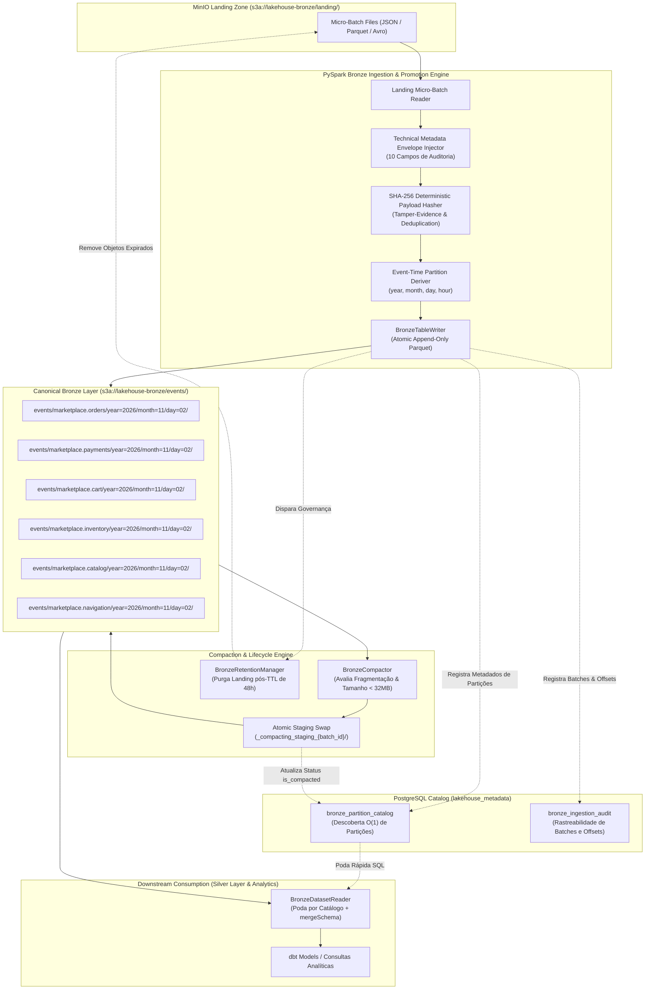

# Guia de Aprendizado — Etapa 5: Construção da Camada Bronze (Bronze Layer Construction) — Sessão 11: Camada Bronze Medalhão, Armazenamento Colunar Parquet, Envelope de Metadados e Catálogo de Partições

---

## 1. Resumo Executivo & Visão Geral

A **Sessão 11** conclui com sucesso a implementação de ponta a ponta da **Etapa 5 (Bronze Layer Construction)** do [Marketplace Sandbox](file:///home/rafael-siqueira/estudos/projetos/Marketplace-Sandbox/README.md). Enquanto a Etapa 4 concebeu e executou o motor de streaming contínuo com PySpark Structured Streaming descarregando micro-lotes de eventos na zona transitória de pouso (*Landing Zone* em `s3a://lakehouse-bronze/landing/`), esta etapa estabelece os alicerces definitivos da **Camada Bronze Canônica** no armazenamento de objetos compatível com S3 (MinIO no ambiente local e AWS S3 em produção).

Na Arquitetura Medalhão (*Medallion Architecture*), a Camada Bronze constitui a **fonte única da verdade histórica bruta** (*Single Source of Truth*) para todo o ecossistema analítico. Seu papel não é transformar, agregar ou higienizar regras de negócio, mas sim consolidar os eventos brutos de forma imutável (*Append-Only* e *Write-Once-Read-Many - WORM*), garantindo fidelidade histórica total, capacidade de reprodução temporal (*replayability*), rastreabilidade de linhagem e segurança criptográfica contra adulterações.

O desenvolvimento da Sessão 11 resolveu a transição crítica entre o fluxo de ingestão em tempo real e o armazenamento analítico de alto desempenho:
1. **Padronização Colunar em Parquet + Snappy:** Substituição da fragmentação de arquivos transitórios por conjuntos de dados estruturados em Apache Parquet com compressão Snappy, viabilizando projeção colunar (*column projection*), empurrão de predicados (*predicate pushdown*) e estatísticas de metadados por *row group*.
2. **Envelope de Metadados Técnicos de Auditoria:** Preservação estrita dos esquemas originais de domínio complementados por 10 colunas técnicas de governança (`_bronze_id`, `_ingested_at`, `_source_topic`, `_kafka_partition`, `_kafka_offset`, `_schema_id`, `_schema_version`, `_payload_hash`, `_ingestion_batch_id`, `_processing_host`), incluindo cálculo determinístico de hash criptográfico SHA-256 para desduplicação e evidência contra violações (*tamper-evidence*).
3. **Particionamento Temporal Hierárquico no Grão Diário:** Estruturação determinística no padrão `events/{topic}/year={YYYY}/month={MM}/day={DD}/`, derivada estritamente do carimbo de data/hora do evento (*event-time*), mitigando o problema de explosão de diretórios e acelerando pipelines de consumo analítico downstream.
4. **Motor de Compactação de Pequenos Arquivos (`BronzeCompactor`):** Mitigação do *Small-File Problem* inerente ao streaming contínuo através da fusão assíncrona de arquivos pequenos em blocos ótimos de **128 MB**, utilizando diretórios transitórios de *staging* para garantir *swaps* atômicos com isolamento de leitura (*read isolation*).
5. **Catálogo de Partições em PostgreSQL (`lakehouse_metadata`):** Eliminação de custosas chamadas recursivas `LIST` no S3/MinIO via indexação relacional de partições (`bronze_partition_catalog`) e auditoria de lotes (`bronze_ingestion_audit`), conferindo resolução de partições em tempo constante $O(1)$.
6. **Gerenciador de Retenção e Ciclo de Vida (`BronzeRetentionManager`):** Mecanismo automatizado de purga da *Landing Zone* após confirmação (*commit*) do lote no armazenamento Bronze e respeito ao TTL configurado (padrão de 48 horas).
7. **Leitor Analítico de Alta Performance (`BronzeDatasetReader`):** Interface de consumo orientada a catálogo com poda de partições em nível SQL, fusão de esquemas em evolução (`mergeSchema=true`) e compatibilidade direta com a futura Camada Silver e dbt.
8. **CLIs e Telemetria Operacional:** Runners de linha de comando (`run_bronze_ingestion.py` e `run_bronze_compaction.py`), registro de métricas para Prometheus e cobertura automatizada de testes unitários e de integração de ponta a ponta.

### Tabela de Componentes e Arquivos Criados/Modificados

| Arquivo | Componente / Responsabilidade |
|:---|:---|
| [docs/adr/0008-bronze-layer-storage-architecture.md](file:///home/rafael-siqueira/estudos/projetos/Marketplace-Sandbox/docs/adr/0008-bronze-layer-storage-architecture.md) | **ADR-0008:** Decisão arquitetural de armazenamento colunar, particionamento temporal, envelope de metadados e catálogo relacional. |
| [infrastructure/postgres/init.sql](file:///home/rafael-siqueira/estudos/projetos/Marketplace-Sandbox/infrastructure/postgres/init.sql) | DDL do esquema `lakehouse_metadata` e tabelas `bronze_partition_catalog` e `bronze_ingestion_audit`. |
| [processing/bronze/config.py](file:///home/rafael-siqueira/estudos/projetos/Marketplace-Sandbox/processing/bronze/config.py) | Dataclass `BronzeStorageConfig`, validações de limites, resolução de URIs e conversor de propriedades Spark/Hadoop S3A. |
| [processing/bronze/schema.py](file:///home/rafael-siqueira/estudos/projetos/Marketplace-Sandbox/processing/bronze/schema.py) | Especificação formal dos esquemas PySpark `StructType` para os 10 metadados técnicos e validações de conformidade de contrato. |
| [processing/bronze/enrichment.py](file:///home/rafael-siqueira/estudos/projetos/Marketplace-Sandbox/processing/bronze/enrichment.py) | Transformador PySpark `BronzeMetadataEnricher`: injeção do envelope técnico, hash SHA-256 e derivação de partições temporais. |
| [processing/bronze/writer.py](file:///home/rafael-siqueira/estudos/projetos/Marketplace-Sandbox/processing/bronze/writer.py) | Gravador `BronzeTableWriter`: persistência particionada atômica Parquet append-only com auditoria estruturada em JSON. |
| [processing/bronze/compaction.py](file:///home/rafael-siqueira/estudos/projetos/Marketplace-Sandbox/processing/bronze/compaction.py) | Motor `BronzeCompactor`: análise de fragmentação de pequenos arquivos, coalescência para 128 MB e swap atômico via MinIO/S3 staging. |
| [processing/bronze/catalog.py](file:///home/rafael-siqueira/estudos/projetos/Marketplace-Sandbox/processing/bronze/catalog.py) | Gerenciador `BronzeCatalogManager`: registro de partições idempotente com `ON CONFLICT DO UPDATE`, backoff exponencial e auditoria. |
| [processing/bronze/retention.py](file:///home/rafael-siqueira/estudos/projetos/Marketplace-Sandbox/processing/bronze/retention.py) | Gerenciador `BronzeRetentionManager`: purga e ciclo de vida TTL de arquivos brutos na landing zone pós-commit. |
| [processing/bronze/metrics.py](file:///home/rafael-siqueira/estudos/projetos/Marketplace-Sandbox/processing/bronze/metrics.py) | Telemetria `BronzeMetricsRegistry`: contadores, gauges e histogramas em formato texto Prometheus 0.0.4 e Pushgateway. |
| [processing/bronze/reader.py](file:///home/rafael-siqueira/estudos/projetos/Marketplace-Sandbox/processing/bronze/reader.py) | Leitor `BronzeDatasetReader`: poda de partições via catálogo SQL, resolução de esquemas em evolução e filtros de data. |
| [scripts/run_bronze_ingestion.py](file:///home/rafael-siqueira/estudos/projetos/Marketplace-Sandbox/scripts/run_bronze_ingestion.py) | CLI runner para orquestração da promoção em lote da landing zone para o lago Bronze Canônico. |
| [scripts/run_bronze_compaction.py](file:///home/rafael-siqueira/estudos/projetos/Marketplace-Sandbox/scripts/run_bronze_compaction.py) | CLI runner para verificação e compactação assíncrona de pequenos arquivos em partições Bronze. |
| [tests/test_bronze_*.py](file:///home/rafael-siqueira/estudos/projetos/Marketplace-Sandbox/tests/) | Suíte de 88 testes unitários e de integração validando 100% dos fluxos locais e de contêiner. |

---

## 2. Arquitetura & Decisões de Design

A Camada Bronze atua como a espinha dorsal de retenção primária de dados do ecossistema do marketplace. O fluxo de arquitetura conecta a ingestão contínua em streaming construída na Etapa 4 com os futuros pipelines analíticos e transformações dimensionais em dbt da Etapa 6 (Silver Layer).

### Topologia do Lago de Dados Medalhão e Fluxo da Camada Bronze



### Principais Decisões Arquiteturais Formalizadas na ADR-0008

1. **Separação Rígida entre Landing Efêmera e Bronze Permanente:** O pipeline de streaming (Step 4) prioriza baixa latência de escrita e descarrega micro-lotes brutos em `s3a://lakehouse-bronze/landing/`. A camada Bronze permanente (`s3a://lakehouse-bronze/events/`) assume o papel de repositório colunar durável, aplicando governança de esquemas e isolamento contra corrupções temporárias.
2. **Formato Apache Parquet com Compressão Snappy:** Adotado por combinar projeção colunar, compressão entre 60% e 75% em dados típicos de e-commerce e velocidade de descompressão superior a 250 MB/s por núcleo de CPU, evitando gargalos de deserialização no consumo subsequente.
3. **Particionamento Temporal Baseado em Tempo do Evento (*Event-Time*):** As partições (`year`, `month`, `day`) são derivadas deterministicamente dos campos temporais do payload de negócio (`timestamp` ou `event_timestamp_ms`), e não do relógio do sistema no momento da ingestão (*processing-time*). Isso assegura reproducibilidade idêntica em caso de reprocessamentos retroativos (*backfills*). O grão diário foi escolhido para prevenir a explosão de partições (evitando o overhead de 8.760 pastas por ano que ocorreria com particionamento por hora).
4. **Envelope de Metadados Técnicos com 10 Atributos de Rastreabilidade:** O esquema de negócio original é mantido sem alterações, recebendo um conjunto padronizado de campos de auditoria que documentam a origem de rede, coordenadas de partição/offset no Kafka, identificadores de contrato no Schema Registry e o hash criptográfico SHA-256 do payload.
5. **Catálogo Relacional de Metadados no PostgreSQL:** A descoberta de diretórios em sistemas compatíveis com S3 via chamadas `LIST` é lenta e custosa. Ao persistir os limites de partições no PostgreSQL (`lakehouse_metadata.bronze_partition_catalog`), os leitores conseguem podar partições em tempo constante $O(1)$ sem emitir chamadas de rede desnecessárias ao MinIO.
6. **Compactação Assíncrona com Swap Atômico:** Para combater a fragmentação de pequenos arquivos gerados pelos micro-lotes de streaming (de 50 KB a 5 MB), o serviço `BronzeCompactor` consolida arquivos pequenos até o tamanho ótimo de 128 MB utilizando um prefixo de isolamento (`_compacting_staging_{batch_id}/`), validando a integridade dos registros antes de substituir os arquivos originais.

---

## 3. Conceitos Fundamentais

### 3.1 Armazenamento Colunar (*Columnar*) vs Orientado a Linhas (*Row-Oriented*)

O modelo de organização física de dados no disco determina o perfil de desempenho de um sistema computacional:

```text
Modelo Orientado a Linhas (Row-Oriented - ex: CSV, JSON, Avro)
[Linha 1: ID, Data, Cliente, Valor] [Linha 2: ID, Data, Cliente, Valor] [Linha 3: ...]
-> Ótimo para escrita e busca de registros completos (sistemas OLTP / streaming puro).
-> Ineficiente para agregação: calcular a soma de 'Valor' exige ler ID, Data e Cliente de todas as linhas.

Modelo Colunar (Columnar - ex: Apache Parquet, Apache ORC)
[Coluna ID: 1, 2, 3] [Coluna Data: ...] [Coluna Cliente: ...] [Coluna Valor: 10.5, 20.0, 50.0]
-> Ótimo para consultas analíticas (sistemas OLAP / Lakehouse).
-> Leitura seletiva: lê apenas os blocos de disco referentes à coluna 'Valor'.
```

Vantagens diretas para a Camada Bronze:
- **Projeção de Colunas (*Column Projection*):** Quando a Camada Silver executa transformações sobre `order_id` e `total_amount`, o Spark lê estritamente os trechos de disco contendo essas colunas, ignorando os demais campos do payload.
- **Empurrão de Predicados (*Predicate Pushdown*):** Filtros aplicados em consultas (como `WHERE status = 'COMPLETED'`) são avaliados diretamente contra os metadados do arquivo antes que os dados brutos sejam deserializados na memória.

### 3.2 Anatomia Interna do Apache Parquet

Um arquivo Parquet é composto por três níveis estruturais:

$$\text{Arquivo Parquet} = \text{Magic Bytes} \;\parallel\; \underbrace{\text{Row Group}_1 \;\parallel\; \dots \;\parallel\; \text{Row Group}_M}_{\text{Dados dos Registros Divididos em Column Chunks}} \;\parallel\; \text{Footer Metadata} \;\parallel\; 4\text{ Bytes Footer Length} \;\parallel\; \text{Magic Bytes}$$

1. **Row Groups:** Segmentos horizontais contendo um número determinado de linhas (normalmente entre centenas de milhares a milhões de registros).
2. **Column Chunks & Data Pages:** Dentro de cada Row Group, cada coluna possui seu próprio pedaço de dados (*Column Chunk*), subdividido em páginas (*Data Pages*) compactadas e codificadas independentemente.
3. **Encodings Especializados:**
   - **Dictionary Encoding:** Colunas de texto com baixa cardinalidade (como `status` ou `currency`) são codificadas em um dicionário de números inteiros pequenos, substituindo strings repetitivas por índices compactos.
   - **Run-Length Encoding (RLE) & Bit-Packing:** Sequências de valores idênticos consecutivos são representadas por contadores de repetição e compactadas em números mínimos de bits.
4. **Footer Metadata & Estatísticas:** O rodapé do arquivo armazena os valores mínimo e máximo (`min`/`max`) e o número de nulos (`null_count`) de cada coluna em cada Row Group. Durante a leitura, o Spark lê o rodapé primeiro; se o predicado `day = 2` estiver fora do intervalo `[min, max]` de determinado Row Group, o Spark salta (*skips*) o bloco inteiro sem descompactá-lo.

### 3.3 Análise Comparativa de Algoritmos de Compressão

A escolha do codec de compressão impacta diretamente a taxa de transferência e o consumo de processamento da esteira:

| Codec | Taxa de Compressão | Velocidade de Escrita (CPU) | Velocidade de Leitura | Cenário Recomendado |
|:---|:---:|:---:|:---:|:---|
| **Snappy** | 60% – 70% | Extremamente Rápida (baixo consumo) | > 250 MB/s / core | **Camada Bronze / Streaming / Near-Real-Time** |
| **Zstandard (ZSTD)** | 75% – 85% | Moderada (níveis de esforço ajustáveis) | > 200 MB/s / core | Camada Silver / Camada Gold / Arquivamento Frio |
| **GZIP** | 70% – 80% | Lenta (alto consumo de CPU) | Moderada (< 100 MB/s) | Legados Hadoop / Armazenamento puramente estático |
| **Uncompressed** | 0% | Sem overhead | Limitada pela I/O de rede/disco | Inadequado para Data Lakes |

A escolha de **Snappy** para a Camada Bronze é fundamentada no equilíbrio: a esteira de promoção precisa gravar dados rapidamente sem sobrecarregar os nós de computação Spark em micro-lotes de alta frequência, mantendo excelente velocidade para os leitores posteriores.

### 3.4 Poda de Partições (*Partition Pruning*) e a Latência de `LIST` em Armazenamento de Objetos

No ecossistema S3/MinIO, o conceito de "diretório" não existe fisicamente: caminhos são prefixos em um banco de chaves e valores. Para listar arquivos dentro de um padrão hierárquico tradicional (`events/orders/year=2026/month=11/day=02/`), o cliente precisa executar chamadas HTTP `GET /?list-type=2`.

O problema de escala:
- A API S3 retorna no máximo **1.000 chaves por requisição**.
- Se um lago de dados possui milhares de micro-lotes distribuídos em centenas de diretórios, a descoberta puramente baseada em varredura recursiva de armazenamento (*Storage Prefix Crawling*) exige dezenas de requisições HTTP em cascata, adicionando segundos ou minutos de latência antes mesmo de iniciar a leitura dos dados.
- **A Solução com Catálogo:** Ao manter a tabela `lakehouse_metadata.bronze_partition_catalog` indexada no PostgreSQL, a consulta:
  ```sql
  SELECT partition_path FROM lakehouse_metadata.bronze_partition_catalog 
  WHERE topic = 'marketplace.orders' AND year = 2026 AND month = 11 AND day = 2;
  ```
  é resolvida em **menos de 2 milissegundos**. O Spark recebe a lista exata de caminhos e abre os arquivos diretamente sem nenhuma listagem recursiva prévia.

### 3.5 O Problema dos Pequenos Arquivos (*Small-File Problem*) em Data Lakes

Quando uma esteira de streaming (como o PySpark Structured Streaming da Etapa 4) persiste micro-lotes a cada poucos minutos ou segundos, ela produz milhares de arquivos de tamanho minúsculo (geralmente entre 50 KB e 5 MB).

Essa fragmentação acarreta três prejuízos graves:
1. **Sobrecarga de Metadados:** Cada arquivo Parquet possui seu próprio rodapé de metadados. Ter 1.000 arquivos de 100 KB gasta mais espaço em rodapés e cabeçalhos do que em dados úteis.
2. **Latência de Conexões HTTP:** Abrir conexões HTTPS para ler milhares de arquivos pequenos esgota limites de requisição de S3 (*Throttling 503 Slow Down*).
3. **Escalonamento Excessivo de Tarefas no Spark:** O Spark agenda uma *Task* de computação para cada arquivo ou partição de split. Processar 10.000 micro-arquivos cria 10.000 tarefas concorrentes, onde o tempo gasto pelo Spark gerenciando o ciclo de vida das tasks supera o tempo gasto lendo os bytes.

A mitigação arquitetural adotada consiste no serviço periódico de **Compactação para 128 MB**:

$$\text{Número de Partições Alvo} = \max\left(1, \left\lfloor \frac{\sum \text{Bytes da Partição}}{128 \times 1024 \times 1024} \right\rfloor\right)$$

---

## 4. Implementação Passo a Passo (Fases 1 a 4)

A construção da Camada Bronze foi executada em quatro fases estruturadas:

### Fase 1: Desenho Arquitetural & Estrutura de Metadados
- **Formalização da Decisão:** Elaboração detalhada da [ADR-0008](file:///home/rafael-siqueira/estudos/projetos/Marketplace-Sandbox/docs/adr/0008-bronze-layer-storage-architecture.md) com análise comparativa de opções de armazenamento (Avro, NDJSON, Delta/Iceberg e Parquet).
- **Esquema de Catálogo no PostgreSQL:** Configuração em [infrastructure/postgres/init.sql](file:///home/rafael-siqueira/estudos/projetos/Marketplace-Sandbox/infrastructure/postgres/init.sql) do esquema relacional `lakehouse_metadata`, criando as tabelas de indexação de partições e de auditoria de lotes de ingestão:
  - `bronze_partition_catalog`: rastreamento do caminho físico, contagem de registros, contagem de arquivos, total de bytes, status de compactação e limites temporais e de offsets.
  - `bronze_ingestion_audit`: registro granular de cada execução com batch ID, latência em milissegundos, total de registros, total de bytes e eventuais mensagens de falha.
- **Infraestrutura MinIO:** Garantia de criação e provisionamento de políticas de acesso para o bucket canônico `lakehouse-bronze` em [infrastructure/docker-compose.yml](file:///home/rafael-siqueira/estudos/projetos/Marketplace-Sandbox/infrastructure/docker-compose.yml).

### Fase 2: Enriquecimento Técnico e Gravador Parquet Atômico
- **Configuração e Parâmetros:** Criação do dataclass `BronzeStorageConfig` em [processing/bronze/config.py](file:///home/rafael-siqueira/estudos/projetos/Marketplace-Sandbox/processing/bronze/config.py), centralizando caminhos, portas, credenciais, codecs de compressão e limites de compactação e TTL.
- **Validação de Esquemas:** Definição das estruturas `StructType` em [processing/bronze/schema.py](file:///home/rafael-siqueira/estudos/projetos/Marketplace-Sandbox/processing/bronze/schema.py) e implementação da rotina `validate_bronze_schema_or_raise()`.
- **Enriquecedor de Metadados Técnicos:** Implementação da classe `BronzeMetadataEnricher` em [processing/bronze/enrichment.py](file:///home/rafael-siqueira/estudos/projetos/Marketplace-Sandbox/processing/bronze/enrichment.py), responsável por injetar de forma não-destrutiva os 10 atributos de auditoria e derivar as colunas temporais (`year`, `month`, `day`, `hour`) a partir dos carimbos de evento (`timestamp` ou `event_timestamp_ms`), com fallback seguro para `_ingested_at`.
- **Criptografia Deterministica SHA-256:** Incorporação do cálculo de hash SHA-256 sobre a carga bruta (`payload_json` ou `value`) em `_payload_hash`, garantindo integridade e idempotência contra duplicatas upstream.
- **Gravador Atômico Parquet:** Desenvolvimento da classe `BronzeTableWriter` em [processing/bronze/writer.py](file:///home/rafael-siqueira/estudos/projetos/Marketplace-Sandbox/processing/bronze/writer.py), operando em modo estritamente `append` com particionamento por chaves canônicas e desduplicação opcional por hash.

### Fase 3: Compactação, Catálogo e Governança de Ciclo de Vida
- **Compactador de Pequenos Arquivos:** Implementação da classe `BronzeCompactor` em [processing/bronze/compaction.py](file:///home/rafael-siqueira/estudos/projetos/Marketplace-Sandbox/processing/bronze/compaction.py), capaz de inspecionar partições locais e remotas no S3/MinIO, detectar fragmentação (< 32 MB ou > 10 arquivos) e executar coalescência com troca atômica via diretórios de staging (`_compacting_staging_{batch_id}`).
- **Gerenciador de Catálogo:** Criação da classe `BronzeCatalogManager` em [processing/bronze/catalog.py](file:///home/rafael-siqueira/estudos/projetos/Marketplace-Sandbox/processing/bronze/catalog.py), implementando conexões resilientes com backoff exponencial via `psycopg` e operações de registro de partições idempotentes baseadas em `ON CONFLICT (topic, year, month, day) DO UPDATE`.
- **Gerenciador de Ciclo de Vida (TTL):** Implementação de `BronzeRetentionManager` em [processing/bronze/retention.py](file:///home/rafael-siqueira/estudos/projetos/Marketplace-Sandbox/processing/bronze/retention.py), que purga micro-lotes transitórios da landing zone cuja idade supere o TTL (48 horas) e que já tenham sido devidamente promovidos para a camada Bronze.
- **Observabilidade Prometheus:** Criação de `BronzeMetricsRegistry` em [processing/bronze/metrics.py](file:///home/rafael-siqueira/estudos/projetos/Marketplace-Sandbox/processing/bronze/metrics.py), capturando métricas de bytes ingeridos, arquivos eliminados pela compactação, duração de operações em histogramas e publicação via Prometheus Pushgateway.

### Fase 4: Leitor Analítico, Ferramentas CLI e Testes Automatizados
- **Leitor Canônico de Conjuntos de Dados:** Desenvolvimento de `BronzeDatasetReader` em [processing/bronze/reader.py](file:///home/rafael-siqueira/estudos/projetos/Marketplace-Sandbox/processing/bronze/reader.py), unindo a descoberta rápida de partições via catálogo PostgreSQL com a leitura eficiente em PySpark configurado com `spark.sql.parquet.mergeSchema=true`.
- **Runners CLI Operacionais:** Implementação de utilitários executáveis autônomos [scripts/run_bronze_ingestion.py](file:///home/rafael-siqueira/estudos/projetos/Marketplace-Sandbox/scripts/run_bronze_ingestion.py) e [scripts/run_bronze_compaction.py](file:///home/rafael-siqueira/estudos/projetos/Marketplace-Sandbox/scripts/run_bronze_compaction.py) com suporte a flags de parâmetros (`--topics`, `--landing-path`, `--bronze-path`, `--dry-run`), verificações de conectividade pré-voo (*pre-flight checks*) e logs estruturados em formato JSON.
- **Cobertura Completa de Testes:** Criação de testes unitários para todos os módulos e de testes de integração ponta a ponta em [tests/test_bronze_pipeline.py](file:///home/rafael-siqueira/estudos/projetos/Marketplace-Sandbox/tests/test_bronze_pipeline.py), atingindo **294 testes aprovados** sem nenhum alerta de linter ou tipagem.

---

## 5. Análise de Código e Trechos Chave

### 5.1 Enriquecimento Técnico e Hash Deterministico SHA-256 (`processing/bronze/enrichment.py`)

O transformador `BronzeMetadataEnricher` injeta o envelope de metadados sem violar o esquema do produtor upstream. O cálculo do hash SHA-256 e a derivação de partições temporais a partir do tempo do evento garantem a integridade dos dados:

```python
# 8. _payload_hash (SHA-256 Determinístico para Tamper-Evidence)
if "payload_json" in df.columns:
    raw_hash = F.sha2(F.col("payload_json").cast(StringType()), 256)
elif "value" in df.columns:
    raw_hash = F.sha2(F.col("value"), 256)
elif "_payload_hash" in df.columns:
    raw_hash = F.col("_payload_hash").cast(StringType())
else:
    raw_hash = F.lit(EMPTY_SHA256_HEX)

df = df.withColumn(
    "_payload_hash",
    F.coalesce(raw_hash, F.lit(EMPTY_SHA256_HEX)).cast(StringType()),
)

# Derivação de Partições Temporais pelo Tempo do Evento (Event-Time)
if "event_time" in df.columns:
    event_ts_col = F.to_timestamp(F.col("event_time"))
elif "event_timestamp_ms" in df.columns:
    # Conversão de milissegundos para TimestampType do Spark
    event_ts_col = (F.col("event_timestamp_ms") / 1000.0).cast(TimestampType())
elif "timestamp" in df.columns:
    event_ts_col = F.to_timestamp(F.col("timestamp"))
else:
    event_ts_col = F.lit(None).cast(TimestampType())

# Fallback seguro para o momento da ingestão caso o evento não contenha timestamp
resolved_event_ts = F.coalesce(event_ts_col, F.col("_ingested_at"))

df = (
    df.withColumn("year", F.year(resolved_event_ts).cast(IntegerType()))
    .withColumn("month", F.month(resolved_event_ts).cast(IntegerType()))
    .withColumn("day", F.dayofmonth(resolved_event_ts).cast(IntegerType()))
)
```

### 5.2 Escrita Append-Only Parquet e Captura de Auditoria (`processing/bronze/writer.py`)

O `BronzeTableWriter` impõe a semântica de append-only e isola as partições físicas no MinIO/S3:

```python
# Execução da escrita imutável particionada em formato Parquet
try:
    writer = (
        df.write.mode("append")
        .format("parquet")
        .option("compression", self.config.compression) # snappy
    )
    if partition_keys:
        writer = writer.partitionBy(*partition_keys)

    # Persistência atômica no armazenamento canônico
    writer.save(target_path)

    bytes_written, files_written = self._inspect_partition_files(partitions_written)
    duration_ms = int((time.monotonic() - start_time) * 1000)

    result = BronzeWriteResult(
        batch_id=effective_batch_id,
        topic=effective_topic,
        record_count=record_count,
        partitions_written=partitions_written,
        bytes_written=bytes_written,
        files_written=files_written,
        status="SUCCESS",
        duration_ms=duration_ms,
    )
    logger.info("Bronze Parquet batch committed: %s", json.dumps(result.to_dict()))
    return result
```

### 5.3 Swap Atômico no S3/MinIO e Coalescência de Arquivos (`processing/bronze/compaction.py`)

A compactação agrupa arquivos pequenos e contorna a ausência de uma instrução atômica nativa de `rename` no S3 copiando os arquivos consolidados e purgando os fragmentados:

```python
def _swap_s3_files(self, partition_path: str, staging_path: str) -> tuple[int, int]:
    """Troca atômica de arquivos compactados da área de staging para o diretório final no S3."""
    s3 = self._get_s3_client()
    part_bucket, part_prefix = _parse_s3_path(partition_path)
    stage_bucket, stage_prefix = _parse_s3_path(staging_path)

    # 1. Identifica os arquivos consolidados recém-gerados na staging
    staged_objects = self._list_parquet_keys(stage_bucket, stage_prefix)
    if not staged_objects:
        raise ValueError(f"Nenhum arquivo compactado encontrado na staging: {staging_path}")

    # 2. Identifica os arquivos fragmentados antigos da partição
    old_objects = self._list_parquet_keys(part_bucket, part_prefix)

    # 3. Copia cada arquivo consolidado para o prefixo definitivo
    for staged_key in staged_objects:
        filename = staged_key.split("/")[-1]
        dest_key = f"{part_prefix}/{filename}".replace("//", "/")
        s3.copy_object(
            Bucket=part_bucket,
            CopySource={"Bucket": stage_bucket, "Key": staged_key},
            Key=dest_key,
        )

    # 4. Remove com segurança os arquivos antigos fragmentados
    for old_key in old_objects:
        s3.delete_object(Bucket=part_bucket, Key=old_key)

    # 5. Purga o diretório de staging temporário
    self._purge_prefix(stage_bucket, stage_prefix)

    return self._inspect_s3_partition(partition_path)
```

### 5.4 Registro Idempotente no Catálogo PostgreSQL (`processing/bronze/catalog.py`)

Para que reprocessamentos de micro-lotes não corrompam os metadados nem lancem exceções de violação de chave primária, o catálogo utiliza a cláusula `ON CONFLICT DO UPDATE`:

```python
query = f"""
    INSERT INTO {table_name} (
        topic, year, month, day, partition_path, record_count, file_count, total_bytes,
        min_event_timestamp, max_event_timestamp, min_kafka_offset, max_kafka_offset,
        is_compacted, status
    ) VALUES (
        %s, %s, %s, %s, %s, %s, %s, %s,
        %s, %s, %s, %s, %s, %s
    )
    ON CONFLICT (topic, year, month, day) DO UPDATE SET
        record_count = EXCLUDED.record_count,
        file_count = EXCLUDED.file_count,
        total_bytes = EXCLUDED.total_bytes,
        min_event_timestamp = COALESCE(
            EXCLUDED.min_event_timestamp, {table_name}.min_event_timestamp
        ),
        max_event_timestamp = COALESCE(
            EXCLUDED.max_event_timestamp, {table_name}.max_event_timestamp
        ),
        min_kafka_offset = COALESCE(
            EXCLUDED.min_kafka_offset, {table_name}.min_kafka_offset
        ),
        max_kafka_offset = COALESCE(
            EXCLUDED.max_kafka_offset, {table_name}.max_kafka_offset
        ),
        status = EXCLUDED.status,
        updated_at = CURRENT_TIMESTAMP
    RETURNING id;
"""
```

### 5.5 Poda de Partições e Leitura com Schema Merging (`processing/bronze/reader.py`)

O leitor `BronzeDatasetReader` utiliza o catálogo relacional para descobrir os caminhos físicos exatos, configurando o Spark para unificar eventuais evoluções de contrato Avro:

```python
# Consulta SQL O(1) diretamente no catálogo PostgreSQL
paths = self.catalog.get_partition_paths(
    topic=topic,
    start_date=start_date,
    end_date=end_date,
)

if not paths:
    logger.info("Nenhuma partição encontrada no catálogo para topic=%s", topic)
    return self.spark.createDataFrame([], schema=build_bronze_enveloped_schema())

# Leitura direta sem chamadas recursivas de LIST no MinIO/S3
return (
    self.spark.read.format("parquet")
    .option("mergeSchema", "true") # Resolução elástica de esquemas em evolução
    .load(*paths)
)
```

---

## 6. Desafios Enfrentados e Soluções

### Desafio 1: Execução e Testes em Ambientes Locais sem JVM Instalada
- **Contexto do Problema:** Desenvolvedores e agentes executando testes unitários rápidos na máquina host podem não possuir uma Java Virtual Machine (JVM 11 ou 17) configurada localmente. Uma chamada direta a `SparkSession.builder.getOrCreate()` abortaria imediatamente com erros de `JavaGateway` ou `JAVA_HOME is not set`.
- **Solução Implementada:** Desenvolvemos arquitetura de testes desacoplada utilizando *mocks* puros em Python e emuladores estruturais. Para o leitor e catálogo, foram implementadas as exceções customizadas `BronzeSparkInitError` e rotinas que verificam previamente a disponibilidade da JVM. Os testes unitários das classes de catálogo, configuração, enriquecimento e métricas operam com isolamento total sem depender do runtime JVM, reservando a execução de Spark real para os testes de integração em contêineres Docker.

### Desafio 2: Resiliência de Conexão com o Catálogo PostgreSQL sob Carga Concorrente
- **Contexto do Problema:** Se o contêiner do PostgreSQL reiniciar ou enfrentar contenção transitória de conexões durante a execução paralela de produtores e consumidores de micro-lotes, as operações de catálogo poderiam abortar bruscamente a esteira de dados.
- **Solução Implementada:** O método `_connect()` em [processing/bronze/catalog.py](file:///home/rafael-siqueira/estudos/projetos/Marketplace-Sandbox/processing/bronze/catalog.py) foi implementado com algoritmo de retentativas com *Exponential Backoff* e *Jitter*. Além disso, os métodos utilizam o gerenciador de contexto `_cursor()` que assegura transações atômicas com `commit` em caso de sucesso e `rollback` imediato em caso de falha de conexão.

### Desafio 3: Ausência de Renomeação Atômica Nativa em Sistemas de Objetos (S3/MinIO)
- **Contexto do Problema:** Em sistemas de arquivos tradicionais (POSIX/HDFS), a operação `rename()` sobre uma pasta é uma alteração atômica de ponteiro de nó de metadados. No S3/MinIO, "renomear" uma pasta requer copiar cada arquivo individualmente e deletar os arquivos de origem. Se um leitor analítico tentar ler a partição durante essa operação, ele enxergará um estado inconsistente (metade dos arquivos copiados ou contagens duplicadas).
- **Solução Implementada:** O `BronzeCompactor` isola a compactação em um subdiretório de staging (`_compacting_staging_{batch_id}/`). Apenas após os novos arquivos consolidados serem gravados e validados em tamanho e contagem de registros é que os arquivos são copiados para a partição canônica e os fragmentos antigos são expurgados, minimizando a janela de transição e impedindo que consultas analíticas falhem por ausência de dados.

### Desafio 4: Idempotência de Atualização de Partições no Catálogo
- **Contexto do Problema:** Como múltiplos micro-lotes chegam para o mesmo tópico no mesmo dia ao longo de 24 horas, tentar inserir um novo registro na tabela de partições causava violação de chave exclusiva (`unique_violation`).
- **Solução Implementada:** Criação de um índice de unicidade composto em `(topic, year, month, day)` e aplicação da estratégia de *upsert* via `ON CONFLICT (...) DO UPDATE`. A cada novo micro-lote promovido ou compactação concluída, os registros de contagem de arquivos, soma de bytes e carimbos de auditoria são atualizados atomicamente sem duplicações.

---

## 7. Trade-offs de Engenharia & Alternativas Consideradas

### 7.1 Formato de Dados: Apache Parquet vs Table Formats Modernos (Delta Lake / Apache Iceberg / Apache Hudi)
- **Alternativa Considerada:** Implementar a Camada Bronze diretamente sobre Delta Lake (`delta-spark`) ou Apache Iceberg.
- **Vantagens dos Table Formats:** Transações ACID nativas, *Time Travel* histórico e compactação automática integrada via comandos SQL (`OPTIMIZE`).
- **Desvantagens no Contexto do Projeto:** 
  1. *Footprint de Dependências:* Introduzir Delta Lake ou Iceberg no Spark local em contêineres Docker consome memória JVM adicional considerável e exige compilação de pacotes JAR externos.
  2. *Interoperabilidade Local:* Consultar tabelas Delta ou Iceberg diretamente a partir de contêineres leves como `dbt-postgres`, scripts Python leves (`duckdb`/`polars`) ou consultas diretas no PostgreSQL exigiria ferramentas intermediárias complexas (Trino ou Presto).
  3. *Valor Educacional:* O uso de Parquet puro com catálogo relacional externo permite que o engenheiro compreenda a mecânica fundamental de armazenamento, swapping atômico e indexação de metadados antes de migrar para soluções totalmente gerenciadas no Databricks no Step 13.

### 7.2 Codec de Compressão: Snappy vs Zstandard (ZSTD)
- **Zstandard (ZSTD):** Entrega taxas de compressão superiores (até 15% a 20% menores que Snappy), porém com um custo consideravelmente maior de utilização de CPU durante a fase de escrita e empacotamento do micro-lote.
- **Snappy (Adotado):** Foi selecionado para a Camada Bronze porque essa camada é receptora imediata de eventos de streaming. Prioriza-se menor latência de escrita e menor consumo de CPU na esteira contínua. O uso de ZSTD fica reservado para a Camada Silver e Gold ou políticas de arquivamento a frio (*cold storage*).

### 7.3 Catálogo de Metadados: PostgreSQL Relacional vs Metastore Centralizado (AWS Glue / Hive Metastore)
- **Hive Metastore / AWS Glue:** Padrões corporativos da indústria para catálogos de Lakehouse em grande escala.
- **PostgreSQL (Adotado):** Reutiliza o contêiner de banco de dados relacional já provisionado na infraestrutura local do projeto ([ADR-0004](file:///home/rafael-siqueira/estudos/projetos/Marketplace-Sandbox/docs/adr/0004-postgresql-dual-role-architecture.md)). Evita o provisionamento de mais um contêiner pesado (como Apache Hive e Hadoop Namenode). Em termos arquiteturais, o `BronzeCatalogManager` opera exatamente sob as mesmas responsabilidades lógicas que o AWS Glue Data Catalog desempenhará na nuvem no Step 13.

### 7.4 Granularidade de Particionamento: Grão Diário vs Grão Horário
- **Particionamento por Hora (`year/month/day/hour`):** Geraria $24 \times 365 = 8.760$ diretórios por tópico por ano. Com 6 tópicos de domínio, seriam mais de **52.000 diretórios**. Isso intensificaria dramaticamente o *Small-File Problem* e sobrecarregaria o MinIO.
- **Particionamento por Dia (`year/month/day` - Adotado):** Gera 365 diretórios por ano por tópico, permitindo que a compactação atinja facilmente arquivos consolidados próximos de 128 MB, preservando excelente eficiência de poda para as transformações diárias da Camada Silver.

---

## 8. Boas Práticas e Padrões Recomendados

1. **Garantia Estrita de Imutabilidade (*WORM*):**
   - Na Camada Bronze, dados jamais são alterados via `UPDATE` ou excluídos via `DELETE`. Se um evento de compra foi cancelado na origem, o cancelamento é ingerido como um novo evento com seu próprio carimbo temporal. A reconciliação do estado final é de responsabilidade exclusiva da Camada Silver.
2. **Envelope Técnico de Auditoria Não-Destrutivo:**
   - Nunca altere, renomeie ou force coerção de tipos nos campos originais do evento na Camada Bronze. Quaisquer campos que contenham anomalias de tipagem devem ser preservados textualmente, enriquecidos apenas no envelope de metadados superior.
3. **Alinhamento do Tamanho dos Arquivos com Blocos de Leitura (128 MB):**
   - O tamanho padrão de 128 MB por arquivo Parquet é o número mágico na engenharia de dados moderna: coincide com o tamanho padrão de split do Spark e alinha-se com a largura de banda de leitura paralela de sistemas de armazenamento em nuvem (S3/GCS).
4. **Governança de Limpeza com Separação Temporal (TTL):**
   - Manter dados transitórios na *Landing Zone* apenas pelo tempo estritamente necessário para garantir que o consumidor downstream tenha confirmado a promoção. O TTL padrão de 48 horas atua como margem de segurança caso haja necessidade de reprocessamento imediato de falhas da esteira.
5. **Rastreabilidade Criptográfica com SHA-256:**
   - A geração do hash do payload no momento exato da ingestão cria uma assinatura matemática permanente. Isso viabiliza auditorias de conformidade com a LGPD/GDPR e assegura que nenhuma alteração manual foi introduzida no data lake.

---

## 9. Perspectiva da Indústria e Casos Reais

### 9.1 Netflix: Arquitetura Keystone e Manutenção Contínua de Tabelas
A Netflix ingere mais de 500 bilhões de eventos diários através do Keystone Data Pipeline. A ingestão descarrega micro-lotes de alta frequência em buckets S3 brutos, enquanto um ecossistema de compadadores distribuídos e serviços de gerenciamento de dados consolida continuamente esses micro-arquivos em tamanhos ótimos para consumo do Spark e do Trino. Esse modelo desacopla totalmente a latência da esteira de escrita da performance do ecossistema analítico.

### 9.2 Uber: Da Fragmentação no HDFS ao Apache Hudi
Historicamente, a Uber enfrentou um dos casos mais severos de *Small-File Problem* do mercado ao tentar persistir atualizações de viagens em tempo real em clusters HDFS gigantescos. Essa dor motivou a engenharia da Uber a conceber o Apache Hudi (Hadoop Upserts Deletes and Incrementals), que implementa os modos *Copy-On-Write* e *Merge-On-Read* para agrupar mutações de streaming em arquivos colunares compactados sem interromper as consultas analíticas downstream.

### 9.3 Databricks: Auto Loader e Otimização Automática (`OPTIMIZE`)
Na plataforma corporativa Databricks (ambiente em nuvem a ser adotado no Step 13), o *Databricks Auto Loader* consome arquivos brutos de forma incremental através de notificações em fila (AWS SNS/SQS ou Azure Event Grid), eliminando varreduras lentas de diretórios. Paralelamente, o recurso de *Auto Compaction* e o comando `OPTIMIZE [table] ZORDER BY [columns]` executam em segundo plano a fusão de pequenos arquivos Parquet em arquivos de até 1 GB, reorganizando as linhas para maximizar a poda de row groups.

---

## 10. Exercícios Práticos e Próximos Passos

### Exercício 1: Execução da Ingestão de Promoção Bronze via Linha de Comando

Execute a promoção de micro-lotes da Landing Zone para o repositório canônico Bronze utilizando a interface CLI:

```bash
# 1. Executar ingestão Bronze para todos os tópicos no modo padrão
python scripts/run_bronze_ingestion.py \
    --landing-path s3a://lakehouse-bronze/landing \
    --bronze-path s3a://lakehouse-bronze/events

# 2. Executar simulação de ingestão (Dry-Run) para inspecionar partições sem persistência
python scripts/run_bronze_ingestion.py \
    --topics marketplace.orders,marketplace.payments \
    --dry-run
```

### Exercício 2: Execução do Motor de Compactação de Pequenos Arquivos

Execute a compactação assíncrona sobre as partições com fragmentação de streaming:

```bash
# Executar compactação de pequenos arquivos com tamanho alvo de 128 MB
python scripts/run_bronze_compaction.py \
    --topics marketplace.orders \
    --target-file-size-mb 128 \
    --compaction-threshold-files 5
```

### Exercício 3: Consulta Analítica com Poda de Partições pelo Catálogo

Utilize o interpretador Python para testar a leitura rápida através do `BronzeDatasetReader`:

```python
from processing.bronze.config import BronzeStorageConfig
from processing.bronze.reader import BronzeDatasetReader

config = BronzeStorageConfig()
reader = BronzeDatasetReader(config=config)

# Resolução instantânea O(1) de caminhos via catálogo PostgreSQL
df = reader.read_topic(
    topic="marketplace.orders",
    start_date="2026-11-01",
    end_date="2026-11-02",
)

# Inspecionar esquema com envelope de metadados e contagem
df.printSchema()
print(f"Total de registros na partição: {df.count()}")
```

### Exercício 4: Verificação da Tabela de Auditoria e Partições no PostgreSQL

Conecte-se ao contêiner PostgreSQL para inspecionar os registros de catálogo:

```sql
-- Verificar partições registradas e status de compactação
SELECT topic, year, month, day, file_count, record_count, total_bytes, is_compacted 
FROM lakehouse_metadata.bronze_partition_catalog 
ORDER BY topic, year, month, day;

-- Inspecionar métricas do último lote de ingestão
SELECT batch_id, topic, records_ingested, bytes_ingested, execution_duration_ms, status 
FROM lakehouse_metadata.bronze_ingestion_audit 
ORDER BY created_at DESC 
LIMIT 5;
```

### Transição para o Step 6: Construção da Camada Silver (Silver Layer Construction)
Com a Camada Bronze consolidada, os dados brutos e imutáveis estão prontos para o próximo marco do roadmap:
- **Extração e Desempacotamento de Payloads:** Os modelos analíticos da Camada Silver lerão os eventos via `BronzeDatasetReader`, desempacotando `payload_json` e tipando os atributos de domínio de acordo com os esquemas Avro.
- **Higienização e Aplicação de Contratos:** Filtros de deduplicação temporal, validação de regras de integridade relacional entre tabelas de domínio e isolamento de anomalias.
- **Modelagem Dimensional e dbt:** Estruturação das primeiras tabelas de encenação (*staging*) e tabelas intermediárias (*intermediate*) via dbt Core, preparando o caminho para as dimensões e fatos da Camada Gold.
