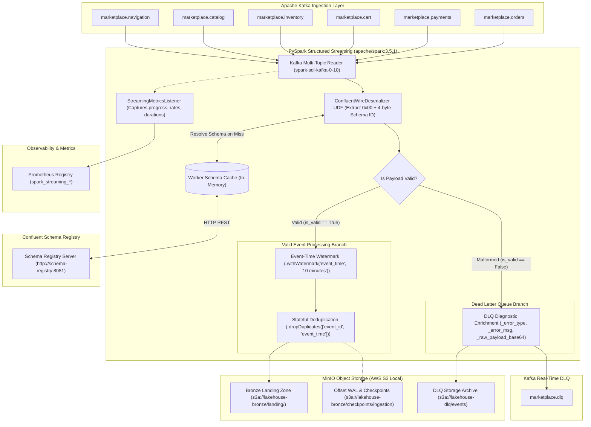

# Streaming Ingestion Pipeline Operations Guide

This guide provides comprehensive architectural, engineering, and operational documentation for the **Marketplace Sandbox Streaming Ingestion Pipeline** (Step 4 of the roadmap). It describes the end-to-end real-time ingestion layer built on Apache Spark Structured Streaming, Confluent Avro wire-format deserialization, Schema Registry caching, Dead Letter Queue (DLQ) bifurcation, event-time watermarking, stateful deduplication, and fault-tolerant checkpointing.

> [!NOTE]
> Architectural decisions governing this pipeline are formalized in [docs/adr/0007-streaming-ingestion-pipeline-architecture.md](file:///home/rafael-siqueira/estudos/projetos/Marketplace-Sandbox/docs/adr/0007-streaming-ingestion-pipeline-architecture.md).
> All pipeline execution initially runs locally via Docker Compose ([infrastructure/docker-compose.yml](file:///home/rafael-siqueira/estudos/projetos/Marketplace-Sandbox/infrastructure/docker-compose.yml)) and is architected for zero-code-change cloud migration to managed **Databricks** on AWS in Step 13.

---

## Table of Contents

1. [Architecture Overview](#1-architecture-overview)
2. [Confluent Avro Wire-Format Deserialization](#2-confluent-avro-wire-format-deserialization)
3. [Dead Letter Queue (DLQ) Isolation & Diagnostic Schema](#3-dead-letter-queue-dlq-isolation--diagnostic-schema)
4. [Event-Time Watermarking & Stateful Deduplication](#4-event-time-watermarking--stateful-deduplication)
5. [Fault Tolerance, Checkpointing & Automatic Recovery](#5-fault-tolerance-checkpointing--automatic-recovery)
6. [Observability & Prometheus Metrics](#6-observability--prometheus-metrics)
7. [CLI Reference & Operational Runbooks](#7-cli-reference--operational-runbooks)

---

## 1. Architecture Overview

The streaming ingestion pipeline consumes six high-throughput e-commerce event streams from Apache Kafka, validates and unpacks their binary payloads against Confluent Schema Registry, partitions valid records into MinIO Bronze Landing storage, isolates malformed records into dual DLQ sinks, and maintains deterministic state across failures.

### Pipeline Component Map
* **Stream Ingestion Source**: Multi-topic Kafka consumer managed by `spark-sql-kafka-0-10_2.12:3.5.1`.
* **Payload Unpacker**: Custom `ConfluentWireDeserializer` stripping the 5-byte Confluent framing and resolving Avro schemas via in-memory cached Schema Registry HTTP calls.
* **Bifurcation Router**: `DLQRouter` splitting each micro-batch into a valid event stream and an enriched error stream.
* **Stateful Engine**: Event-time watermarking (`10 minutes` default) and stateful deduplication on `["event_id", "event_time"]`.
* **Storage Sinks**:
  * **Bronze Landing Sink**: Partitioned Parquet files written to `s3a://lakehouse-bronze/landing/`.
  * **DLQ Object Storage Sink**: Append-only JSON records written to `s3a://lakehouse-dlq/events/`.
  * **DLQ Kafka Publisher Sink**: Diagnostic records published to `marketplace.dlq`.
* **Supervisor**: `StreamingRecoverySupervisor` managing exponential backoff restarts and graceful OS signal handling (`SIGINT`, `SIGTERM`).
* **Telemetry**: `StreamingMetricsListener` collecting micro-batch progress metrics for Prometheus exposition and structured JSON logging.

### End-to-End Data Flow



### Module Architecture Map

| Module Path | Core Classes / Functions | Primary Responsibility |
| :--- | :--- | :--- |
| [processing/streaming/config.py](file:///home/rafael-siqueira/estudos/projetos/Marketplace-Sandbox/processing/streaming/config.py) | `SparkStreamingConfig`, `build_streaming_arg_parser`, `parse_streaming_config` | Dataclass configuration, environment defaults, CLI parsing, and S3A connector settings. |
| [processing/streaming/deserializer.py](file:///home/rafael-siqueira/estudos/projetos/Marketplace-Sandbox/processing/streaming/deserializer.py) | `ConfluentWireDeserializer`, `deserialize_kafka_stream`, `WireFormatError`, `DeserializedRecord` | Confluent 5-byte header parsing, Schema Registry caching, fastavro decoding, and envelope validation. |
| [processing/streaming/dlq.py](file:///home/rafael-siqueira/estudos/projetos/Marketplace-Sandbox/processing/streaming/dlq.py) | `DLQRouter`, `DLQRecord` | Stream bifurcation, error envelope generation, Kafka DLQ publisher, and MinIO DLQ writer. |
| [processing/streaming/watermark.py](file:///home/rafael-siqueira/estudos/projetos/Marketplace-Sandbox/processing/streaming/watermark.py) | `apply_event_time_and_watermark`, `apply_stateful_deduplication`, `InMemoryWatermarkDeduplicator` | Epoch millis normalization, 10-minute watermark derivation, stateful deduplication, and memory eviction. |
| [processing/streaming/pipeline.py](file:///home/rafael-siqueira/estudos/projetos/Marketplace-Sandbox/processing/streaming/pipeline.py) | `StreamingIngestionPipeline` | End-to-end pipeline coordinator binding reader, transformations, and sink streams together. |
| [processing/streaming/metrics.py](file:///home/rafael-siqueira/estudos/projetos/Marketplace-Sandbox/processing/streaming/metrics.py) | `StreamingMetricsListener`, `PrometheusMetricsRegistry`, `QueryProgressSnapshot` | Structured JSON event emission, Prometheus metrics registration, and trigger profiling. |
| [processing/streaming/recovery.py](file:///home/rafael-siqueira/estudos/projetos/Marketplace-Sandbox/processing/streaming/recovery.py) | `StreamingRecoverySupervisor`, `RecoveryMetrics`, `StreamingRecoveryExhaustedError` | Fault-tolerant execution loop with exponential backoff, jitter, and signal trapping. |
| [scripts/run_streaming_ingestion.py](file:///home/rafael-siqueira/estudos/projetos/Marketplace-Sandbox/scripts/run_streaming_ingestion.py) | `StreamingIngestionRunner`, `main` | Production CLI runner script for local, Dockerized, or scheduled execution. |

---

## 2. Confluent Avro Wire-Format Deserialization

Standard Spark `from_avro` functions expect raw Avro binary data without packaging headers. However, producers in the marketplace adhere to the **Confluent Schema Registry Wire Format specification**, which prepends every message with a 5-byte header.

### 5-Byte Wire Format Framing

```
+----------------+-------------------------------+-----------------------------------+
|  Byte 0 (1B)   |        Bytes 1-4 (4B)         |          Bytes 5-N (Var)          |
+----------------+-------------------------------+-----------------------------------+
|   0x00         |   32-bit Big-Endian Schema ID |   Binary Encoded Avro Payload     |
|  (Magic Byte)  |   (e.g., [0x00, 0x00, 0x00, 3])|   (fastavro schemaless binary)    |
+----------------+-------------------------------+-----------------------------------+
```

### Worker-Level Schema Caching
To avoid expensive remote HTTP requests for every individual record:
1. `ConfluentWireDeserializer` maintains an in-memory dictionary cache mapping `schema_id -> parsed_avro_schema`.
2. PySpark workers reuse a worker-level singleton instance `_get_worker_deserializer(schema_registry_url)` across executor partitions.
3. On a cache miss, the deserializer issues an HTTP GET to `${SCHEMA_REGISTRY_URL}/schemas/ids/{schema_id}`, parses the Avro schema using `fastavro.parse_schema`, and caches it permanently in memory.

### Error Taxonomy
When the deserializer encounters malformed payloads or anomalous records injected by the Chaos Engine, it intercepts the error and flags the row as `is_valid = False` instead of raising an unhandled exception that would crash the Spark query:

| Error Type Code | Root Cause | Example Scenario |
| :--- | :--- | :--- |
| `EMPTY_PAYLOAD` | Message payload is `None` or 0 bytes in length. | Kafka tombstone message or empty heartbeat. |
| `TRUNCATED_HEADER` | Payload length is less than 5 bytes. | Fragmented packet or incomplete socket transmission. |
| `INVALID_MAGIC_BYTE` | Byte 0 is not `0x00`. | Raw JSON/CSV payload sent to an Avro topic. |
| `SCHEMA_NOT_FOUND` | Schema ID in bytes 1-4 is not registered in Schema Registry (HTTP 404). | Payload produced against a different registry cluster. |
| `SCHEMA_REGISTRY_ERROR` | Schema Registry is temporarily down, times out, or returns HTTP 5xx. | Transient network partition or container startup lag. |
| `AVRO_DECODE_ERROR` | Fastavro fails to decode bytes 5-N using the resolved schema. | Payload corruption, bitflips, or schema incompatibility. |
| `STRUCTURAL_VALIDATION_ERROR` | Decoded payload lacks mandatory envelope keys (`event_id`, `event_type`, `timestamp`). | Missing envelope contract or non-dictionary Avro record. |
| `JSON_SERIALIZATION_ERROR` | Decoded record fails JSON serialization. | Unserializable non-primitive data types. |

---

## 3. Dead Letter Queue (DLQ) Isolation & Diagnostic Schema

To guarantee zero pipeline interruption from poison pill records, [processing/streaming/dlq.py](file:///home/rafael-siqueira/estudos/projetos/Marketplace-Sandbox/processing/streaming/dlq.py) applies a bifurcated routing pattern via `DLQRouter.bifurcate_stream`.

### Diagnostic Envelope Schema

Every malformed record routed to the DLQ is wrapped in a standardized diagnostic envelope:

```json
{
  "_error_type": "INVALID_MAGIC_BYTE",
  "_error_message": "Invalid wire format magic byte: expected 0x00, got b'\\x7f'.",
  "_raw_payload_base64": "f0FCQ0RFRkdISUpLTE1OT1BRUlNUVVZXWFla",
  "_kafka_topic": "marketplace.orders",
  "_kafka_partition": 1,
  "_kafka_offset": 45012,
  "_failed_at": "2026-10-24T22:15:30.124Z",
  "schema_id": null
}
```

### Diagnostic Field Descriptions
* `_error_type` (`string`): High-level failure categorization matching the error taxonomy.
* `_error_message` (`string`): Detailed exception message or rejection reason.
* `_raw_payload_base64` (`string`): Exact binary bytes of the incoming message encoded in Base64 for byte-level hex inspection and forensic triage.
* `_kafka_topic` (`string`): Origin topic where the anomaly occurred.
* `_kafka_partition` (`int`): Origin partition index.
* `_kafka_offset` (`long`): Message offset on the partition.
* `_failed_at` (`string`): UTC ISO-8601 timestamp with millisecond precision recording when the failure was caught.
* `schema_id` (`int | null`): Schema Registry ID extracted from header, or `null` if the header was invalid.

### Dual Routing Sinks
The pipeline dispatches DLQ records concurrently to two independent sinks:
1. **Kafka DLQ Topic (`marketplace.dlq`)**: Keyed by `_kafka_topic`, enabling real-time alerting systems, dead-letter monitoring consumers, and automated replay tools to read bad records immediately.
2. **MinIO DLQ Storage (`s3a://lakehouse-dlq/events`)**: Append-only storage for long-term auditability, compliance logging, and offline bulk analysis.

---

## 4. Event-Time Watermarking & Stateful Deduplication

The marketplace experiences network latency, retry bursts, and deliberate anomaly injection from the Chaos Engine (such as out-of-order events and duplicated messages). The pipeline handles this through event-time watermarking and stateful deduplication in [processing/streaming/watermark.py](file:///home/rafael-siqueira/estudos/projetos/Marketplace-Sandbox/processing/streaming/watermark.py).

### Timestamp Parsing & Normalization
1. Avro events store logical timestamp `timestamp-millis` in the `event_timestamp_ms` field.
2. The pipeline converts milliseconds to a Spark SQL `TimestampType`:
   ```python
   with_event_time = valid_df.withColumn("event_time", (F.col("event_timestamp_ms") / F.lit(1000.0)).cast("timestamp"))
   ```
3. Derived partition columns `ingestion_date` (`to_date(event_time)`) and `ingested_at` (`current_timestamp()`) are appended for downstream partitioning.

### Watermark Specification
The pipeline applies `.withWatermark("event_time", watermark_delay)`:
* **Default Delay**: `10 minutes` (configurable via `--watermark-delay` or `SPARK_WATERMARK_DELAY`).
* **Semantic Behavior**:
  `Watermark Threshold = max(event_time) - watermark_delay`
  Events arriving with `event_time < Watermark Threshold` are categorized as excessively late and discarded from stateful operations.

### Stateful Deduplication Semantics
To prevent memory leaks in long-running streaming queries, PySpark requires the watermarked timestamp column to be included in the deduplication constraint:
```python
deduplicated_df = watermarked_df.dropDuplicates(["event_id", "event_time"])
```
* **State Retention**: Spark retains `event_id` keys in an internal state store until the watermark moves past the associated `event_time`.
* **State Eviction**: Once `event_time < Watermark Threshold`, the state entry is evicted from memory, bounding the state store size.
* **Testing Without JVM**: For rapid, JVM-free testing, `InMemoryWatermarkDeduplicator` emulates this exact watermark sliding window, duplicate suppression, and state eviction logic in pure Python.

---

## 5. Fault Tolerance, Checkpointing & Automatic Recovery

The pipeline adheres to **at-least-once** processing guarantees (effectively exactly-once when combined with downstream idempotent sinks) through Write-Ahead Log (WAL) checkpointing and process supervision.

### Checkpoint Storage Hierarchy
All streaming progress, partition offsets, state store snapshots, and commit logs are committed to MinIO S3A storage:

```
s3a://lakehouse-bronze/checkpoints/ingestion/
├── landing/               # Write-Ahead Logs and offsets for Bronze Landing Parquet sink
│   ├── commits/
│   ├── metadata
│   ├── offsets/
│   └── state/             # Stateful deduplication state snapshots
├── dlq_storage/           # Checkpoints for MinIO DLQ JSON archive sink
│   ├── commits/
│   ├── offsets/
│   └── metadata
└── dlq_kafka/             # Checkpoints for Kafka marketplace.dlq publisher sink
    ├── commits/
    ├── offsets/
    └── metadata
```

### Automatic Recovery Supervisor (`StreamingRecoverySupervisor`)
The pipeline runs under the supervision of `StreamingRecoverySupervisor` ([processing/streaming/recovery.py](file:///home/rafael-siqueira/estudos/projetos/Marketplace-Sandbox/processing/streaming/recovery.py)), which wraps query execution in a resilient restart loop:

```python
# Exponential backoff formula with bounded jitter
backoff = min(max_backoff_seconds, initial_backoff_seconds * (backoff_multiplier ** (attempt - 1)))
jitter = random.uniform(-jitter_factor * backoff, jitter_factor * backoff)
delay = max(0.0, min(max_backoff_seconds, backoff + jitter))
```

* **Default Configuration**:
  * `max_retries`: 5 attempts.
  * `initial_backoff_seconds`: 2.0 seconds.
  * `max_backoff_seconds`: 60.0 seconds.
  * `backoff_multiplier`: 2.0.
  * `jitter_factor`: 0.1 (+/- 10%).
* **Transient Faults Handled**: Temporary Kafka broker rebalances, network connection resets, Schema Registry restarts, and MinIO socket timeouts.
* **Fatal Exhaustion**: If failures persist beyond `max_retries`, the supervisor raises `StreamingRecoveryExhaustedError` and exits with non-zero exit code for orchestrator intervention.

### Graceful Signal Handling
The supervisor intercepts OS termination signals (`SIGINT` and `SIGTERM`):
1. Sets an internal `_shutdown_requested` thread event.
2. Iterates across all active `StreamingQuery` instances and calls `query.stop()`.
3. Spark finishes committing the currently executing micro-batch and flushes WAL offsets cleanly to `s3a://lakehouse-bronze/checkpoints/ingestion/`.
4. The process exits with code `0`, ensuring no uncommitted in-flight offsets occur.

---

## 6. Observability & Prometheus Metrics

Observability is instrumented natively through `StreamingMetricsListener` ([processing/streaming/metrics.py](file:///home/rafael-siqueira/estudos/projetos/Marketplace-Sandbox/processing/streaming/metrics.py)), implementing PySpark's `StreamingQueryListener` API.

### Exported Prometheus Metrics Table

Metrics are maintained in-memory in a thread-safe `PrometheusMetricsRegistry` and exposed via standard text format:

| Metric Name | Type | Help Description | Labels |
| :--- | :--- | :--- | :--- |
| `spark_streaming_input_rows_total` | Counter | Total number of input rows read from Kafka. | `query_name` |
| `spark_streaming_input_rows_per_second` | Gauge | Current input ingestion rate in rows/sec. | `query_name` |
| `spark_streaming_processed_rows_per_second` | Gauge | Current processing throughput in rows/sec. | `query_name` |
| `spark_streaming_batch_duration_ms` | Gauge | Total trigger execution duration in milliseconds. | `query_name` |
| `spark_streaming_batches_completed_total` | Counter | Total number of micro-batches successfully processed. | `query_name` |
| `spark_streaming_query_errors_total` | Counter | Total number of query failures or terminations with error. | `query_name` |
| `spark_streaming_state_rows_total` | Gauge | Total active deduplication keys currently retained in state. | `query_name` |
| `spark_streaming_state_memory_bytes` | Gauge | Memory consumed by state store operators in bytes. | `query_name` |

### Sample Prometheus Exposition Format
```prometheus
# HELP spark_streaming_input_rows_total Total number of input rows read by the streaming query.
# TYPE spark_streaming_input_rows_total counter
spark_streaming_input_rows_total{query_name="bronze_landing_sink"} 15420
spark_streaming_input_rows_total{query_name="dlq_storage_sink"} 342

# HELP spark_streaming_batch_duration_ms Total duration of the most recent micro-batch trigger execution in milliseconds.
# TYPE spark_streaming_batch_duration_ms gauge
spark_streaming_batch_duration_ms{query_name="bronze_landing_sink"} 1420
spark_streaming_batch_duration_ms{query_name="dlq_storage_sink"} 310
```

### Structured JSON Audit Logs
Every micro-batch progress event emits a single-line JSON log entry for automated log ingestion:

```json
{
  "event": "streaming_query_progress",
  "query_id": "7a6d8f1e-4b2a-4f5c-8d1e-2a3b4c5d6e7f",
  "run_id": "9b8c7d6e-5f4a-3b2c-1d0e-9f8a7b6c5d4e",
  "query_name": "bronze_landing_sink",
  "batch_id": 42,
  "timestamp": "2026-10-24T22:20:00.000Z",
  "num_input_rows": 2500,
  "input_rows_per_second": 250.0,
  "processed_rows_per_second": 1760.5,
  "batch_duration_ms": 1420,
  "event_time_watermark": "2026-10-24T22:10:00.000Z",
  "state_rows_total": 8450,
  "state_memory_bytes": 1048576
}
```

---

## 7. CLI Reference & Operational Runbooks

The pipeline is executed via the unified CLI entrypoint [scripts/run_streaming_ingestion.py](file:///home/rafael-siqueira/estudos/projetos/Marketplace-Sandbox/scripts/run_streaming_ingestion.py).

### CLI Flags & Arguments Reference

| Flag / Option | Type | Default Value | Description |
| :--- | :--- | :--- | :--- |
| `--topics` | `list` | All 6 default topics | Comma-separated or space-separated Kafka topics to consume. |
| `--bootstrap-servers` | `str` | `localhost:9092` / `kafka:29092` | Comma-separated Kafka broker addresses. |
| `--schema-registry-url` | `str` | `http://localhost:8081` | Confluent Schema Registry base URL. |
| `--landing-path` | `str` | `s3a://lakehouse-bronze/landing` | Target S3A/MinIO path for valid Bronze landing events. |
| `--checkpoint-dir` | `str` | `s3a://lakehouse-bronze/checkpoints/ingestion` | Base S3A/MinIO directory for streaming checkpoints. |
| `--dlq-path` | `str` | `s3a://lakehouse-dlq/events` | Target S3A/MinIO path for DLQ storage archive. |
| `--dlq-topic` | `str` | `marketplace.dlq` | Dedicated Kafka topic for DLQ event routing. |
| `--watermark-delay` | `str` | `10 minutes` | Watermark threshold expression (e.g., `10 minutes`, `1 hour`). |
| `--trigger-interval` | `str` | `10 seconds` | Micro-batch trigger interval expression. |
| `--starting-offsets` | `str` | `earliest` | Initial Kafka offset policy (`earliest`, `latest`, or JSON). |
| `--max-offsets-per-trigger` | `int` | `5000` | Rate-limiting upper bound of records read per micro-batch. |
| `--master` | `str` | `local[*]` | Spark master URL (`local[*]`, `spark://spark-master:7077`). |
| `--app-name` | `str` | `MarketplaceStreamingIngestion` | Spark application name. |
| `--minio-endpoint` | `str` | `http://localhost:9000` | S3A endpoint URL for MinIO. |
| `--shuffle-partitions` | `int` | `4` | Spark SQL shuffle partition count (optimized for local CPU). |
| `--fail-on-data-loss` | `bool` | `False` | Whether to crash if Kafka reports missing offsets. |
| `--continuous` | `flag` | Default | Run continuously until stopped via signal. |
| `--once` | `flag` | `False` | Process all available records (`AvailableNow`) and terminate cleanly. |
| `--skip-preflight` | `flag` | `False` | Skip initial TCP/HTTP connectivity checks before starting Spark. |
| `--disable-dlq-kafka` | `flag` | `False` | Disable publishing DLQ records to the Kafka DLQ topic. |
| `--disable-dlq-storage` | `flag` | `False` | Disable writing DLQ records to MinIO DLQ storage. |

---

### Operational Runbooks

#### Runbook 1: Executing Continuous Ingestion Locally on Host Machine
```bash
uv run python -m scripts.run_streaming_ingestion \
  --bootstrap-servers localhost:9092 \
  --schema-registry-url http://localhost:8081 \
  --minio-endpoint http://localhost:9000 \
  --trigger-interval "10 seconds" \
  --watermark-delay "10 minutes"
```

#### Runbook 2: Executing Inside the Docker Spark Container
When running inside the Docker network `marketplace-network`, use the internal container service hostnames:
```bash
docker exec -it marketplace-spark-master /bin/bash -c "
  cd /opt/workspace &&
  python3 -m scripts.run_streaming_ingestion \
    --master spark://spark-master:7077 \
    --bootstrap-servers kafka:29092 \
    --schema-registry-url http://schema-registry:8081 \
    --minio-endpoint http://minio:9000 \
    --landing-path s3a://lakehouse-bronze/landing \
    --checkpoint-dir s3a://lakehouse-bronze/checkpoints/ingestion \
    --dlq-path s3a://lakehouse-dlq/events \
    --dlq-topic marketplace.dlq
"
```

#### Runbook 3: Executing in Batch Mode (`--once`) for Testing and CI/CD
To consume all backlog data currently waiting in Kafka topics and terminate immediately upon draining without hanging:
```bash
uv run python -m scripts.run_streaming_ingestion --once
```

#### Runbook 4: Inspecting and Triaging DLQ Payloads
1. **Inspect Kafka DLQ Stream**:
   ```bash
   docker exec -it marketplace-kafka kafka-console-consumer \
     --bootstrap-server localhost:9092 \
     --topic marketplace.dlq \
     --from-beginning \
     --property print.key=true
   ```
2. **Inspect MinIO DLQ Storage with MinIO Client (`mc`)**:
   ```bash
   docker exec -it marketplace-minio mc ls local/lakehouse-dlq/events/
   docker exec -it marketplace-minio mc cat local/lakehouse-dlq/events/part-00000-*.json | jq .
   ```

#### Runbook 5: Recovering from Corrupted Checkpoints
If an unrecoverable schema mismatch or corrupted metadata occurs in the local development sandbox:
1. Stop the active ingestion process gracefully (`Ctrl+C` or `SIGTERM`).
2. Purge the specific ingestion checkpoint directory from MinIO:
   ```bash
   docker exec -it marketplace-minio mc rm --recursive --force local/lakehouse-bronze/checkpoints/ingestion/
   ```
3. Restart the ingestion pipeline with `--starting-offsets latest` (or `earliest` if full topic replay is required).
